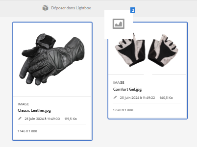

# Lightbox {#lightbox}

Lightbox est un type spécial de collection fournissant un accès facile aux ressources. Vous pouvez accéder rapidement à Lightbox pour ajouter ou supprimer des ressources. Il sert de galerie d’images personnelle.

Si vous êtes utilisateur d’[!DNL Adobe Experience Manager Assets], Lightbox est créé automatiquement la première fois que vous vous connectez à l’application. Elle est exclusive à votre connexion. Les autres utilisateurs et utilisatrices ne peuvent pas accéder à votre Lightbox.

## Ajout de ressources à Lightbox {#adding-assets-to-lightbox}

1. Dans l’interface utilisateur d’[!DNL Assets], sélectionnez les ressources que vous souhaitez ajouter à Lightbox.
1. Faites glisser les ressources jusqu’à la zone **[!UICONTROL Déposer dans Lightbox]**. Relâchez lorsque la zone de dépôt devient active et que le libellé se transforme en **[!UICONTROL Déposer pour ajouter]**.

   

1. Dans la boîte de dialogue, cliquez sur **[!UICONTROL Ajouter]**, puis fermez-la pour terminer le processus. Les ressources sélectionnées sont ajoutées à Lightbox.
1. Pour afficher Lightbox, accédez à la console Collections.
1. Cliquez sur **[!UICONTROL Lightbox]** pour afficher les ressources qu’il contient.

   >[!NOTE]
   >
   >Bien que Lightbox ressemble à une collection, vous ne pouvez pas effectuer toutes les actions que vous effectuez normalement sur les collections. Par exemple, vous ne pouvez pas supprimer, partager ou afficher les paramètres d’une Lightbox. En outre, vous ne pouvez pas l’ajouter à d’autres collections. Vous pouvez toutefois modifier les ressources dans une Lightbox.

## Suppression de ressources de Lightbox {#removing-assets-from-lightbox}

1. Accédez à la console Collections, puis cliquez sur Lightbox pour en afficher les ressources.
1. Sélectionnez les ressources à supprimer.
1. Dans la barre d’outils, cliquez sur **[!UICONTROL Supprimer]**.
1. Dans la boîte de dialogue, cliquez sur **[!UICONTROL Supprimer]** pour confirmer la suppression. Les ressources sont supprimées de Lightbox.
