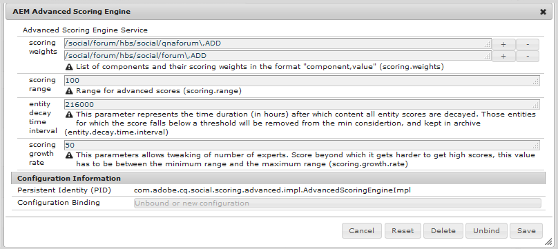
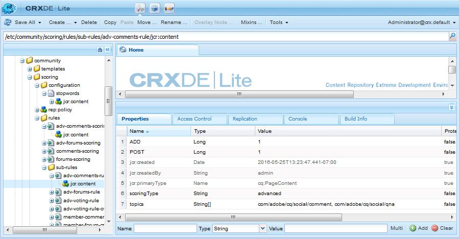
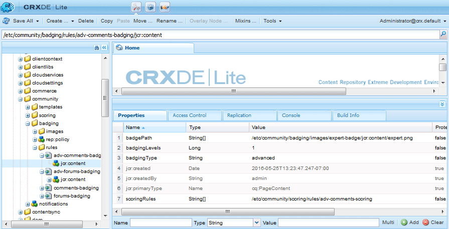

# Notation avancée et badges{#advanced-scoring-and-badges}

## Vue d’ensemble {#overview}

La notation avancée permet d’attribuer des badges pour identifier les membres en tant qu’experts. La notation avancée attribue des points en fonction de la quantité *et* de la qualité du contenu créé par un membre, tandis que la notation de base attribue des points en fonction de la quantité de contenu créé.

Cette différence est due au moteur de notation utilisé pour calculer les notes. Le moteur de notation de base applique des calculs simples. Le moteur de notation avancé est un algorithme adaptatif qui récompense les membres actifs qui contribuent à un contenu valorisé et pertinent, déduit par le traitement du langage naturel (NLP) d’un sujet.

En plus de la pertinence du contenu, les algorithmes de notation tiennent compte des activités des membres, telles que le vote et le pourcentage de réponses. Alors que la notation de base les inclut quantitativement, la notation avancée les utilise par algorithme.

Par conséquent, le moteur de notation avancé nécessite suffisamment de données pour rendre l’analyse significative. Le seuil de réussite pour devenir un expert est constamment réévalué à mesure que l’algorithme s’ajuste en permanence au volume et à la qualité du contenu créé. Il y a aussi un concept de *décadence* des postes plus anciens d&#39;un membre. Si un membre expert cesse de participer au sujet pour lequel il a obtenu le statut d’expert, à un moment prédéterminé (voir [configuration du moteur de notation](#configurable-scoring-engine)), il peut perdre son statut d’expert.

La configuration d’une notation avancée est pratiquement identique à la notation de base :

* Les règles de base et avancées de notation et de badge sont [appliquées au contenu](/help/communities/implementing-scoring.md#apply-rules-to-content) de la même manière.

  * Des règles de base et avancées de score et de badge peuvent être appliquées au même contenu.

* L’[activation des badges pour les composants](/help/communities/implementing-scoring.md#enable-badges-for-component) est générique.

Les différences de configuration des règles de score et de badge sont les suivantes :

* Moteur de notation avancé configurable
* Règles de score avancées :

  * `scoringType` défini sur `advanced`
  * Nécessite `stopwords`

* Règles de badge avancées :

  * `badgingType` défini sur `advanced`
  * `badgingLevels` défini sur **nombre de niveaux d’expert à attribuer**
  * Nécessite `badgingPaths` tableau de badges au lieu de seuils. Le mappage de tableau pointe vers les badges.

>[!NOTE]
>
>Pour utiliser les fonctionnalités avancées de notation et de badge, installez le [package d’identification Expert](https://experience.adobe.com/#/downloads/content/software-distribution/en/aem.html?package=%2Fcontent%2Fsoftware-distribution%2Fen%2Fdetails.html%2Fcontent%2Fdam%2Faem%2Fpublic%2Fadobe%2Fpackages%2Fcq610%2Fsocial%2Ffeaturepack%2Fcq-social-expert-identification-pkg).

## Moteur de notation configurable {#configurable-scoring-engine}

Le moteur de notation avancé fournit une configuration OSGi avec des paramètres qui affectent l’algorithme de notation avancé.



* **Poids de notation**

  Pour un sujet, spécifiez le verbe qui doit recevoir la priorité la plus élevée lors du calcul du score. Un ou plusieurs sujets peuvent être saisis, mais limités à **un verbe par sujet**. Voir [Rubriques et verbes](/help/communities/implementing-scoring.md#topics-and-verbs).
Entré en tant que `topic,verb` avec la virgule placée dans une séquence d’échappement. Par exemple :
  `/social/forum/hbs/social/forum\,ADD`
  La valeur par défaut est définie sur le verbe AJOUTER pour les composants QnA et de forum.

* **Plage de notation**

  La plage des scores avancés est définie par cette valeur (score maximum) et par 0 (score le plus bas possible).

  La valeur par défaut est 100, de sorte que la plage de notation est comprise entre 0 et 100.

* **Intervalle de temps d’atténuation de l’entité**

  Ce paramètre représente le nombre d’heures après lesquelles tous les scores d’entité sont décroissants. Cela est nécessaire pour ne plus inclure d’ancien contenu dans les scores d’un site communautaire.

  La valeur par défaut est de 216000 heures (~24 ans).

* **Taux de croissance du score**
Ceci spécifie le score entre la plage de score 0, au-delà de laquelle la croissance ralentit pour limiter le nombre d’experts.

  La valeur par défaut est 50.

## Règles de notation avancées {#advanced-scoring-rules}

Dans la notation de base, la quantité nécessaire pour gagner un badge est connue.

Dans la notation avancée, la quantité nécessaire est constamment ajustée en fonction de la quantité de données de qualité au sein du système. La notation est continuellement calculée de manière similaire à une courbe en cloche.

Si un membre a obtenu un badge d’expert sur un sujet qui n’est plus actif, il est possible qu’il perde son badge en raison de sa décroissance au fil du temps.

### scoringType {#scoringtype}

Une règle de notation est un ensemble de sous-règles de notation, chacune d’elles déclarant la `scoringType`.

Pour appeler le moteur de notation avancé, le `scoringType` doit être défini sur `advanced`.

Voir [Sous-Règles De Notation](/help/communities/implementing-scoring.md#scoring-sub-rules).



### Mots vides {#stopwords}

Le package de notation avancée installe un dossier de configuration contenant un fichier de mots vides :

* `/libs/settings/community/scoring/configuration/stopwords`

L’algorithme de notation avancé utilise la liste de mots contenue dans le fichier de mots vides pour identifier les mots anglais courants qui sont ignorés pendant le traitement du contenu.

Il n’est pas attendu que ce fichier soit modifié.

Si le fichier de mots vides est manquant, le moteur de notation avancé renvoie une erreur.

## Règles de badge avancées {#advanced-badging-rules}

Les propriétés avancées des règles de badge diffèrent des propriétés de base des règles de badge [basic badging rule properties](/help/communities/implementing-scoring.md#badging-rules).

Au lieu d&#39;associer des points à une image de badge, il suffit d&#39;identifier le nombre d&#39;experts autorisés et l&#39;image de badge à attribuer.



<table>
 <tbody>
  <tr>
   <th>Propriété</th>
   <th>Type</th>
   <th>Description de la valeur</th>
  </tr>
  <tr>
   <td>badgingPath</td>
   <td>Chaîne[]</td>
   <td><em>(Obligatoire)</em> Chaîne à plusieurs valeurs d’images de badge allant jusqu’au nombre de badgingLevels. Les chemins d’accès aux images des badges doivent être triés afin que le premier soit attribué au plus grand expert. S’il y a moins de badges que indiqué par badgingLevels, le dernier badge du tableau remplit le reste du tableau. Exemple d’entrée :<br /> <code>/libs/settings/community/badging/images/expert-badge/jcr:content/expert.png</code></td>
  </tr>
  <tr>
   <td>badgingLevels</td>
   <td>Long</td>
   <td><em>(Facultatif)</em> Indique les niveaux d’expertise à attribuer. Par exemple, s’il doit y avoir un <code>expert </code> et un <code>almost expert</code> (deux badges), alors la valeur doit être définie sur 2. BadgingLevel doit correspondre au nombre d’images de badge associées aux experts répertoriées pour la propriété badgingPath. La valeur par défaut est 1.</td>
  </tr>
  <tr>
   <td>badgingType</td>
   <td>Chaîne</td>
   <td><em>(Obligatoire)</em> Identifie le moteur de notation comme étant « de base » ou « avancé ». Définissez sur « avancé » ; sinon, la valeur par défaut est « de base ».</td>
  </tr>
  <tr>
   <td>scoringRules</td>
   <td>Chaîne[]</td>
   <td><em>(Facultatif)</em> chaîne à plusieurs valeurs permettant de limiter la règle de badge aux événements de score identifiés par une ou plusieurs règles de score répertoriées.<br /> Exemple d’entrée <br /> <code>/libs/settings/community/scoring/rules/adv-comments-scoring</code><br /> La valeur par défaut n’est aucune restriction.</td>
  </tr>
 </tbody>
</table>

## Règles et badges inclus {#included-rules-and-badge}

### Badge inclus {#included-badge}

Cette version bêta comprend un badge d’expert basé sur une récompense :

* `expert`

  `/libs/settings/community/badging/images/expert-badge/jcr:content/expert.png`


Pour que le badge expert apparaisse comme une récompense pour l’activité, veillez à :

* Les `Badges` sont activées pour la fonctionnalité, comme un composant de forum ou de QnA.

* Les règles de score et de badge avancées sont appliquées à la page (ou à l’ancêtre) sur laquelle le composant est placé

Voir les informations de base pour :

* [Activation de la création de badges pour un composant](/help/communities/implementing-scoring.md#enableforcomponent)
* [Application de règles](/help/communities/implementing-scoring.md#applytopage)

### Règles et sous-règles de notation incluses {#included-scoring-rules-and-sub-rules}

La version bêta comprend deux règles de score avancées pour la [fonction de forum](/help/communities/functions.md#forum-function) (une pour les composants forum et commentaires de la fonction forum) :

1. `/libs/settings/community/scoring/rules/adv-comments-scoring`

   ```
   subRules[] =
   /libs/settings/community/scoring/rules/sub-rules/adv-comments-rule
   /libs/settings/community/scoring/rules/sub-rules/adv-voting-rule-owner
   /libs/settings/community/scoring/rules/sub-rules/adv-voting-rule
   ```

1. `/libs/settings/community/scoring/rules/adv-forums-scoring`

   ```
   subRules[] =
   /libs/settings/community/scoring/rules/sub-rules/adv-forums-rule
   /libs/settings/community/scoring/rules/sub-rules/adv-comments-rule
   /libs/settings/community/scoring/rules/sub-rules/adv-voting-rule-owner
   ```

**Remarques:**

* Les nœuds `rules` et `sub-rules` sont de type `cq:Page`.
* `subRules` est un attribut de type chaîne`[]` sur le nœud `jcr:content` de la règle.
* `sub-rules` peuvent être partagées entre différentes règles de notation.
* `rules` doit se trouver dans un emplacement de référentiel avec des autorisations en lecture pour tout le monde.
* Les noms des règles doivent être uniques, quel que soit l’emplacement.

### Règles de badge incluses {#included-badging-rules}

Cette version comprend deux règles de badge avancées qui correspondent aux [règles de score avancées des forums et des commentaires](#included-scoring-rules-and-sub-rules).

* `/libs/settings/community/badging/rules/adv-comments-badging`
* `/libs/settings/community/badging/rules/adv-forums-badging`

**Remarques:**

* `rules` nœuds sont de type cq:Page.
* `rules` doit se trouver dans un emplacement de référentiel avec des autorisations en lecture pour tout le monde.
* Les noms des règles doivent être uniques, quel que soit l’emplacement.
