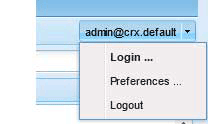

# Créer un sandbox SCF  {#create-an-scf-sandbox}

Depuis AEM 6.1 Communities, le moyen le plus simple de créer rapidement un sandbox consiste à créer un site communautaire. Voir [Prise en main d’AEM Communities](getting-started.md).

Un autre outil utile pour les développeurs est le [guide des composants de communauté](components-guide.md), qui permet d’explorer et de prototyper rapidement les composants et fonctionnalités de communautés.

L’exercice de création d’un site web peut s’avérer utile pour comprendre la structure d’un site web AEM, qui peut inclure des fonctionnalités de Communities, tout en fournissant des pages simples sur lesquelles explorer l’utilisation du [framework de composants sociaux (SCF)](scf.md).

Ce tutoriel s’adresse principalement aux développeurs qui découvrent AEM et qui souhaitent utiliser les composants SCF. Il décrit en détail la création d’un site Sandbox SCF, similaire au tutoriel [Comment créer un site Internet complet](../../help/sites-developing/website.md) qui se concentre sur les structures du site, telles que la navigation, le logo, la recherche, la barre d’outils et la liste des pages enfants.

Le développement a lieu sur une instance de création, tandis qu’il est préférable de tester le site sur une instance de publication.

Les étapes de ce tutoriel sont les suivantes :

* [Configuration de la structure du site web](setup-website.md)
* [Application Sandbox Initiale](initial-app.md)
* [Contenu initial du sandbox](initial-content.md)
* [Développement d’une application Sandbox](develop-app.md)
* [Ajouter Clientlibs](add-clientlibs.md)
* [Développer du contenu Sandbox](develop-content.md)

>[!CAUTION]
>
>Ce tutoriel ne crée pas de site communautaire avec les fonctionnalités créées à l’aide de la console [Sites communautaires](sites-console.md). Par exemple, ce tutoriel ne décrit pas comment configurer la connexion, l’auto-inscription, la [connexion sociale](social-login.md) la messagerie, les profils, etc.
>
>Si vous préférez un site de communauté simple, suivez le tutoriel [Créer un exemple de page](create-sample-page.md).

## Conditions préalables {#prerequisites}

Ce tutoriel suppose que vous avez installé une instance de création AEM et une instance de publication AEM disposant de la [dernière version](deploy-communities.md#latest-releases) de Communities.

Voici quelques liens utiles pour les développeurs qui découvrent la plateforme AEM :

* [Prise en main](../../help/sites-deploying/deploy.md#getting-started) : pour le déploiement d’instances AEM.

  * [Principes de base](../../help/sites-developing/the-basics.md) : pour les développeurs de sites web et de fonctionnalités.
  * [Premières étapes pour les auteurs ](../../help/sites-authoring/first-steps.md) : pour la création de contenu de page.

## Utilisation de l’environnement de développement CRXDE Lite {#using-crxde-lite-development-environment}

Les développeurs et développeuses d’AEM passent la plupart de leur temps dans l’environnement de développement [CRXDE Lite](../../help/sites-developing/developing-with-crxde-lite.md) sur une instance de création. CRXDE Lite offre un accès moins restreint au référentiel CRX. Les outils d’IU classique et les consoles d’IU tactile offrent un accès plus structuré à des parties spécifiques du référentiel CRX.

Après vous être connecté avec des droits d’administrateur, il existe différentes manières d’accéder à CRXDE Lite :

1. Dans la navigation globale, sélectionnez navigation **[!UICONTROL Outils > CRXDE Lite]**.

   

2. Dans la page d’accueil de l’interface utilisateur classique [IU classique](http://localhost:4502/welcome.html), faites défiler l’écran vers le bas et cliquez sur **[!UICONTROL CRXDE Lite]** dans le panneau de droite.

   

3. Accédez directement à `CRXDE Lite` : `<server>:<port>/crx/de`

   Par exemple, sur une instance d’auteur locale : 

Pour utiliser CRXDE Lite, vous devez vous connecter avec des privilèges de développeur ou d’administrateur. Pour l’instance localhost par défaut, vous pouvez vous connecter avec

* `username: admin`
* `password: admin`

Cette connexion expire et vous devez vous reconnecter régulièrement à l’aide du menu déroulant de l’extrémité droite de la barre d’outils de CRXDE Lite.

Si vous n’êtes pas connecté, vous ne pourrez pas naviguer dans le référentiel JCR ni effectuer d’opérations de modification/enregistrement.

***En cas de doute, reconnectez-vous !***

