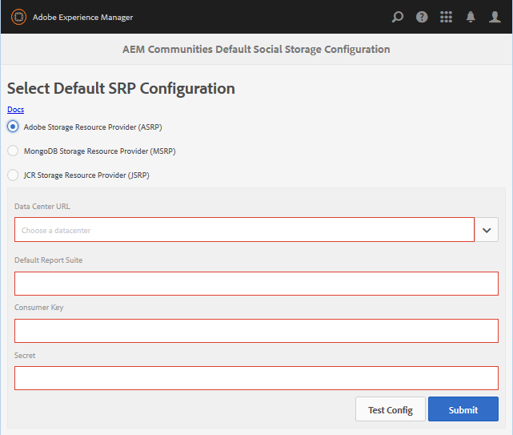

# ASRP - Fournisseur de ressources de stockage Adobe {#asrp-adobe-storage-resource-provider}

## À propos d&#39;ASRP {#about-asrp}

Lorsqu’AEM Communities est configuré pour utiliser ASRP comme magasin commun, le contenu créé par l’utilisateur est accessible à partir de toutes les instances de création et de publication, sans avoir à effectuer de synchronisation ni de réplication.

Consultez également les sections [Caractéristiques des options SRP](/help/communities/working-with-srp.md#characteristics-of-srp-options) et [Topologies recommandées](/help/communities/topologies.md).

## Exigences {#requirements}

Une licence supplémentaire est requise pour utiliser ASRP.

Pour configurer votre site AEM Communities afin d’utiliser ASRP pour le contenu créé par l’utilisateur, contactez votre représentant de compte pour :

* URL du centre de données (adresse du point d’entrée ASRP)
* Clé client
* Clé secrète
* Identifiant(s) de suite de rapports

Les clés de client et secrète sont partagées dans toutes les suites de rapports pour une entreprise. Il y a une suite de rapports par client.

## Configuration {#configuration}

### Sélectionner ASRP {#select-asrp}

La [console de configuration du stockage](/help/communities/srp-config.md) permet de sélectionner la configuration de stockage par défaut, qui identifie l’implémentation de SRP à utiliser.

**Sur l’instance d’auteur AEM :**

* Dans la navigation globale, accédez à **[!UICONTROL Outils > Communautés > Configuration du stockage]** et sélectionnez **[!UICONTROL Fournisseur de ressources de stockage Adobe (ASRP)]**.

Les informations suivantes proviennent du processus d’approvisionnement :

* **URL du centre de données** : faites défiler l’écran vers le bas pour sélectionner le centre de données de production identifié par le représentant de votre compte.
* **Suite de rapports par défaut** : saisissez le nom de la suite de rapports par défaut.
* **Consumer Key** : renseignez la clé du client.
* **Secret** : saisissez le secret.
* Sélectionnez **Envoyer**.

Préparez les instances de publication :

* [Répliquer la clé de chiffrement](#replicate-the-crypto-key)
* [Répliquer la configuration](#publishing-the-configuration)

Après avoir envoyé la configuration, testez la connexion :

* Sélectionnez **Tester la configuration**.

  Pour chaque instance de création et de publication, testez la connexion au centre de données à partir de la console de configuration du stockage.

* Assurez-vous que les URL de site pour les données de profil sont routables à partir du centre de données en [externalisant les liens](#externalize-links).

### Répliquer la clé de chiffrement {#replicate-the-crypto-key}

La clé du client et la clé secrète sont chiffrées. Pour que les clés soient correctement chiffrées/déchiffrées, la clé de chiffrement Granite principale doit être la même sur toutes les instances AEM.

Suivez les instructions de la section [Répliquer la clé de chiffrement](/help/communities/deploy-communities.md#replicate-the-crypto-key).

### Externaliser les liens {#externalize-links}

Pour obtenir des liens de profil et d’image de profil corrects, veillez à [Configurer l’externaliseur de liens](/help/sites-developing/externalizer.md).

Veillez à définir les domaines comme des URL acheminables à partir de l’URL du centre de données (point d’entrée ASRP).

### Synchronisation de l’heure {#time-synchronization}

Pour que l’authentification avec le point d’entrée ASRP réussisse, les machines qui exécutent votre AEM Communities hébergée doivent être synchronisées temporellement, par exemple avec le [protocole NTP (Network Time Protocol)](https://www.ntp.org/).

### Publication de la configuration {#publishing-the-configuration}

ASRP doit être identifié comme le magasin commun sur toutes les instances de création et de publication.

Pour rendre la configuration identique disponible dans l’environnement de publication :

Sur l’instance d’auteur AEM :

* Accédez au menu principal **[!UICONTROL Outils]** > **[!UICONTROL Déploiement]** > **[!UICONTROL Réplication]**
* Sélectionnez **Activer l’arborescence**
* **Chemin de début** : accédez à `/conf/global/settings/communities/srpc/`
* Désélectionnez **Modifié uniquement**
* Sélectionnez **Activer**

## Mise à niveau à partir d’AEM 6.0 {#upgrading-from-aem}

>[!CAUTION]
>
>Si vous activez ASRP sur un site communautaire publié, tout contenu créé par l’utilisateur déjà stocké dans [JCR](/help/communities/jsrp.md) n’est plus visible, car il n’y a pas de synchronisation des données entre le stockage on-premise et le stockage dans le cloud.

**`AEM Communities Extension`** a précédemment été introduit dans les communautés sociales AEM 6.0 as a cloud service. Depuis AEM 6.1 Communities, aucune configuration cloud n’est nécessaire, il vous suffit de sélectionner ASRP dans la [&#x200B; console de configuration du stockage &#x200B;](/help/communities/srp-config.md).

En raison de la nouvelle structure de stockage, il est nécessaire de suivre les instructions [upgrade](/help/communities/upgrade.md#adobe-cloud-storage) lors de la mise à niveau de communautés sociales vers Communities.

## Gestion des données utilisateur {#managing-user-data}

Pour plus d’informations sur les *utilisateurs*, *profils utilisateur* et *groupes d’utilisateurs*, souvent saisis dans l’environnement de publication, consultez

* [Synchronisation des utilisateurs](/help/communities/sync.md)
* [Gestion des utilisateurs et des groupes d’utilisateurs](/help/communities/users.md)

## Résolution des problèmes {#troubleshooting}

### UGC disparaît après la mise à niveau {#ugc-disappears-after-upgrade}

Si vous effectuez une mise à niveau à partir d’un site de la communauté sociale AEM 6.0 existant, suivez les [instructions de mise à niveau](/help/communities/upgrade.md#adobe-cloud-storage), sinon le contenu créé par l’utilisateur semble être perdu.

### Erreurs d’authentification {#authentication-errors}

Si vous recevez des erreurs d’authentification par rapport à l’URL du centre de données et que le fichier error.log AEM contient des messages sur des horodatages obsolètes, vérifiez que la synchronisation de l’heure est en cours.

Utilisez un outil tel que le [Network Time Protocol (NTP)](https://www.ntp.org/) pour synchroniser tous les serveurs de création et de publication d’AEM.

### Le nouveau contenu n’apparaît pas dans les recherches {#new-content-does-not-appear-in-searches}

L’infrastructure de stockage dans le cloud d’Adobe utilise *cohérence éventuelle* pour atteindre ses objectifs d’évolutivité et de performances. Pour cette raison, le nouveau contenu n’est pas disponible instantanément et il faut plusieurs secondes pour qu’il apparaisse dans les résultats de recherche.

Pendant la surveillance de l’intervalle affectant l’éventuelle cohérence, contactez votre représentant de compte si l’affichage du nouveau contenu dans les recherches prend plus de quelques secondes.

### UGC non visible dans ASRP {#ugc-not-visible-in-asrp}

Assurez-vous que l’ASRP a été configuré pour être le fournisseur par défaut en vérifiant la configuration de l’option de stockage . Par défaut, le fournisseur de ressources de stockage est JSRP, et non ASRP.

Sur toutes les instances d’AEM de création et de publication, revenez sur la console de configuration du stockage ou vérifiez le référentiel AEM.

Dans JCR, si [/conf/global/settings/communities &#x200B;](https://localhost:4502/crx/de/index.jsp#/etc/socialconfig/) :

* Ne contient pas de nœud [srpc](https://localhost:4502/crx/de/index.jsp#/conf/global/settings/communities/srp), ce qui signifie que le fournisseur de stockage est JSRP.
* Si le nœud srpc existe et contient le nœud [defaultconfiguration](https://localhost:4502/crx/de/index.jsp#/conf/global/settings/communities/srp/defaultconfiguration), les propriétés de la configuration par défaut définissent ASRP comme fournisseur par défaut.
