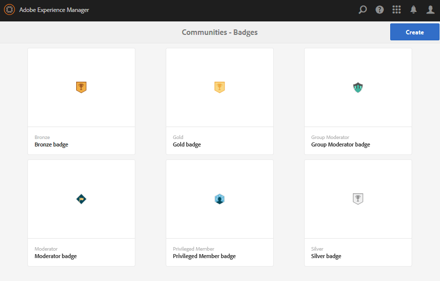

# Console Badges {#badges-console}

## À propos des badges {#about-badges}

La console Badges de communautés vous permet d’ajouter des badges personnalisés qui peuvent être affichés pour un membre lorsqu’ils sont gagnés (attribués) ou lorsqu’il assume un rôle spécifique dans la communauté (attribué).

### Badge Visibility {#badge-visibility}

Actuellement, les badges gagnés ou attribués à un membre de la communauté apparaissent avec son nom et son avatar aux emplacements suivants :

* Profils
* [Forums](/help/communities/forum.md)
* [Q&amp;R](/help/communities/working-with-qna.md)
* [Classements](/help/communities/enabling-leaderboard.md)
* [Conceptualisation](/help/communities/ideation-feature.md)

Dans l’environnement de création, accédez à la console Badges :

* Dans la navigation globale : **[!UICONTROL Outils]** > **[!UICONTROL Communautés]** > **[!UICONTROL Badges]**

Cette console affiche les badges actuellement disponibles et à partir desquels de nouveaux badges peuvent être ajoutés.

## Créer le badge {#create-badge}

Un badge est créé en téléchargeant une image suffisamment petite (72 dpi avec une hauteur comprise entre 26 et 32 pixels) et en fournissant un nom. L’image de badge est stockée dans le référentiel à l’adresse `/libs/settings/community/badging/images` et est automatiquement répliquée dans l’environnement de publication.

Si l’environnement de publication est une batterie d’éditeurs, il est nécessaire de configurer [la synchronisation des utilisateurs](/help/communities/sync.md).

* **Charger l’image**

  (*Obligatoire*) Image de badge d’une taille recommandée de 32 x 32 pixels à 72 ppp au format JPEG ou PNG.

* **Nom**

  (*Obligatoire*) Nom du badge. Il s’agit de la `Display Name` par défaut et du nom du nœud du référentiel. Si le `Name` n’est pas un nom de nœud de référentiel valide, il est modifié.

* **Nom d’affichage**

  (*Facultatif*) Nom à afficher pour le badge dans l’interface utilisateur. La valeur par défaut est le texte non modifié saisi pour le `Name`.

* **Description**

  (*facultatif*) Description du badge.

## Informations supplémentaires {#additional-information}

Pour plus d’informations sur la configuration des règles de notation et de badge, voir [Notation et badges](/help/communities/implementing-scoring.md).

Pour gérer les badges des membres, voir [Console des membres](/help/communities/members.md).
