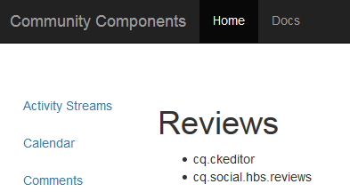

# Bibliothèques clientes pour les composants de Communities {#clientlibs-for-communities-components}

## Présentation {#introduction}

Cette section de la documentation décrit comment ajouter des bibliothèques côté client (clientlibs) à une page pour les composants de Communities.

Pour obtenir des informations de base, voir :

* [Utilisation des bibliothèques côté client](/help/sites-developing/clientlibs.md) qui fournit des détails d’utilisation et des outils de débogage
* [Clientlibs pour SCF](/help/communities/client-customize.md#clientlibs) qui fournit des informations utiles pour la personnalisation des composants SCF

## Pourquoi les bibliothèques clientes sont-elles requises ? {#why-clientlibs-are-required}

Les bibliothèques clientes sont requises pour le bon fonctionnement (JavaScript) et le style (CSS) d’un composant.

Lorsqu’il existe une [fonction de communauté](/help/communities/functions.md) pour une fonctionnalité, tous les composants et configurations nécessaires, y compris les bibliothèques clientes requises, sont présents dans le site de la communauté. D’autres bibliothèques clientes doivent être ajoutées uniquement si des composants supplémentaires doivent être disponibles pour les auteurs.

Lorsque les bibliothèques clientes requises sont manquantes, [ l’ajout d’un composant Communities à une page](/help/communities/author-communities.md) peut entraîner des erreurs JavaScript et une apparence inattendue.

### Exemple : révisions effectuées sans Clientlibs {#example-placed-reviews-without-clientlibs}

### Exemple : commentaires placés avec Clientlibs {#example-placed-reviews-with-clientlibs}

## Identification des bibliothèques clientes requises {#identifying-required-clientlibs}

Les informations essentielles sur les fonctionnalités destinées aux développeurs identifient les bibliothèques clientes requises.

En outre, à partir d’une instance AEM, en accédant au [guide des composants de la communauté](/help/communities/components-guide.md) vous pouvez accéder à une liste des catégories de bibliothèques clientes requises pour un composant.

Par exemple, en haut de la page [Examens](https://localhost:4502/content/community-components/en/reviews.html) les bibliothèques clientes requises répertoriées sont les suivantes :

* cq.ckeditor
* cq.social.hbs.views

## Ajout des bibliothèques clientes requises {#adding-required-clientlibs}

Lorsque vous souhaitez ajouter un composant Communities à une page, il est nécessaire d’ajouter les bibliothèques clientes requises pour le composant, si elles ne sont pas déjà présentes.

Utilisez [CRXDE|Lite](#using-crxde-lite) pour modifier une liste de bibliothèques clientes existante pour une page de site communautaire.

Pour ajouter une bibliothèque cliente pour un site communautaire à l’aide de  :

* Accédez à [https://&lt;server>:&lt;port>/crx/de](https://localhost:4502/crx/de).
* Recherchez le nœud `clientlibslist` de la page sur laquelle vous souhaitez ajouter le composant :

  * `/content/sites/sample/en/page/jcr:content/clientlibslist`

* Avec `clientlibslist` nœud sélectionné :

  * Recherchez le `scg:requiredClientLibs` de propriété String[] .
  * Sélectionnez son `Value` pour accéder à la boîte de dialogue Tableau de chaînes.

    * Faites défiler l’écran vers le bas si nécessaire.
    * Sélectionnez + pour saisir une nouvelle bibliothèque cliente.

      * Répétez l’opération pour ajouter d’autres bibliothèques clientes.

      * Sélectionnez **OK**.

  * Sélectionnez **Enregistrer tout**.

>[!NOTE]
>
>Si le site n’est pas un site communautaire, l’existence ou l’emplacement des bibliothèques clientes utilisées pour le site doit être découvert.

En reprenant l’exemple [Prise en main d’AEM Communities](/help/communities/getting-started.md), où `site-name` est *engage*, voici à quoi la liste de bibliothèques clientes s’afficherait si vous ajoutiez le composant révisions :

