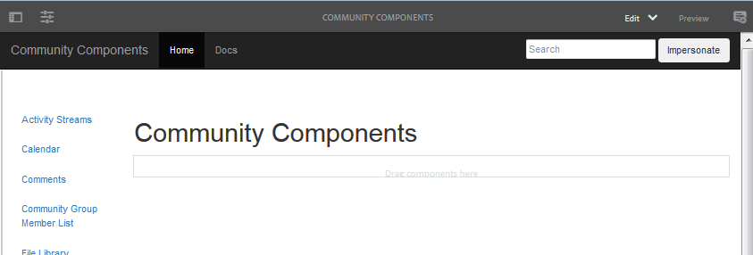
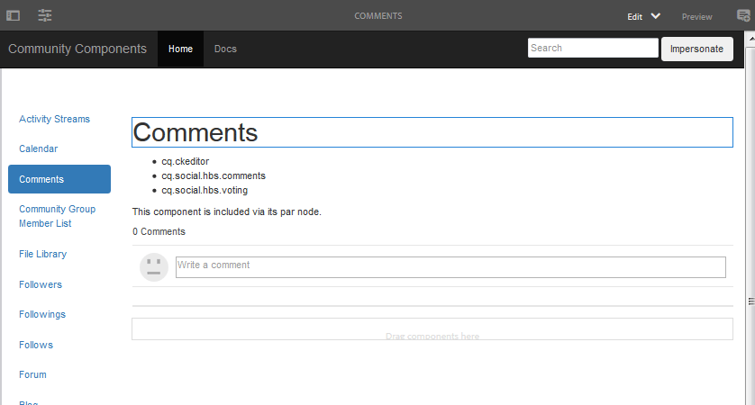
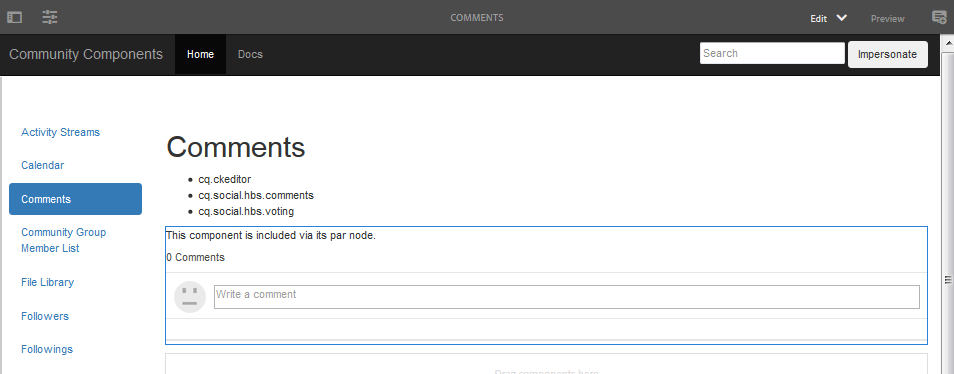
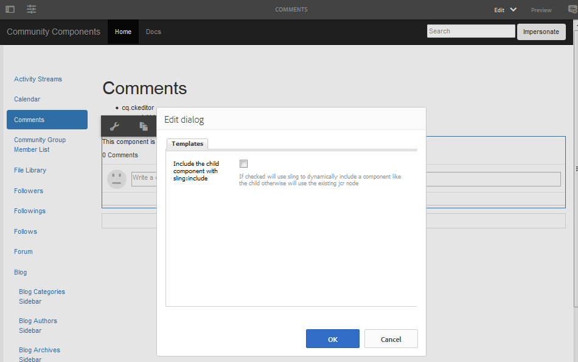
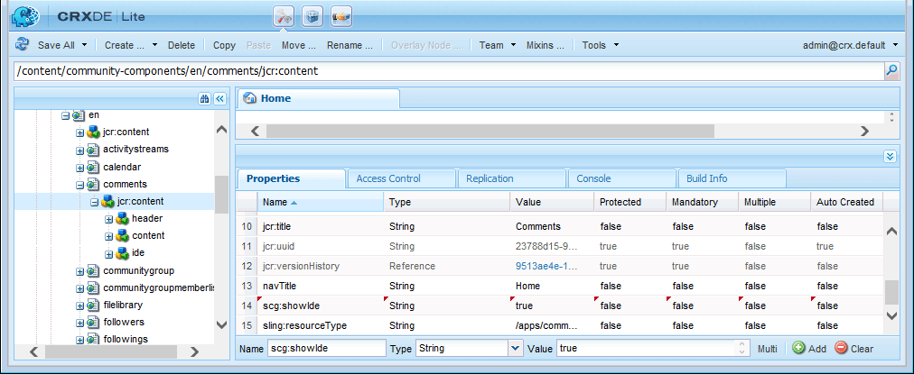
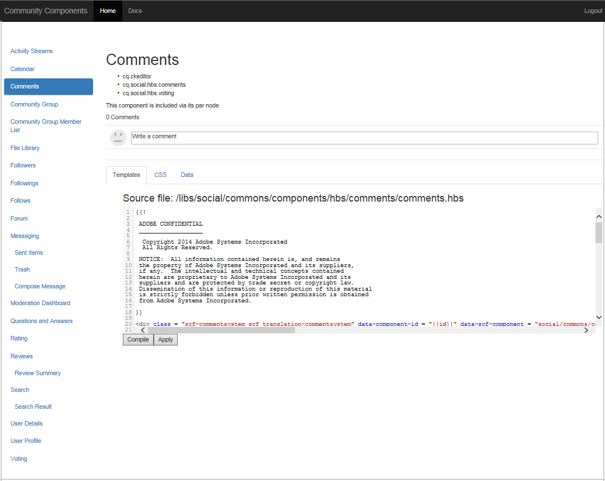

# Guide des composants de communauté  {#community-components-guide}

Le guide des composants de communauté est un outil de développement interactif pour le [framework de composants sociaux (SCF)](scf.md). Elle fournit une liste des composants de communautés Adobe Experience Manager (AEM) disponibles ou des fonctionnalités plus complexes créées à partir de plusieurs composants.

Outre des informations de base sur chaque composant, le guide permet de tester le fonctionnement des composants/fonctionnalités SCF et leur configuration ou personnalisation.

Pour plus d’informations sur Development Essentials relatif à chaque composant, voir [Fonctionnalités et composants essentiels](essentials.md).

## Prise en main {#getting-started}

Ce guide est destiné aux installations de développement des instances d’auteur (localhost:4502) et des instances de publication (localhost:4503).

Pour accéder au site Composants de communauté , accédez à .

* [https://&lt;server>:&lt;port>/content/community-components/en.html](http://localhost:4502/content/community-components/en.html)

Les interactions avec les composants de Communities varient selon :

* Le serveur (auteur ou publication).
* Si le visiteur du site est connecté ou non.
* Si vous êtes connecté, privilèges affectés au membre.
* Indique si le SRP par défaut, [JSRP](jsrp.md), est en cours d’utilisation.

En mode de création, pour passer en mode de modification, insérez `editor.html` ou `cf#` comme premier segment de chemin d’accès après le nom du serveur :

* Interface utilisateur standard :

  [https://&lt;server>:&lt;port>/editor.html/content/community-components/en.html](http://localhost:4502/editor.html/content/community-components/en.html)

* Interface utilisateur classique :

  [https://&lt;serveur>:&lt;port>/cf#/content/community-components/en.html](http://localhost:4502/cf#/content/community-components/en.html)

>[!NOTE]
>
>En mode d’édition sur l’auteur, les liens d’une page ne sont pas actifs.
>
>Pour accéder à une page de composant, sélectionnez d’abord le mode Aperçu pour activer les liens.
>
>Une fois la page de composant affichée dans le navigateur, revenez au mode Modifier pour ouvrir la boîte de dialogue de modification du composant.
>
>Pour obtenir des informations générales sur la création, consultez le [guide rapide de création de pages](../../help/sites-authoring/qg-page-authoring.md).
>
>Si vous ne connaissez pas AEM, consultez la documentation sur la [manipulation de base](../../help/sites-authoring/basic-handling.md).

### Page d’accueil {#home-page}

Le guide fournit une liste des composants SCF disponibles pour la prévisualisation et le prototypage le long du côté gauche de la page.

Guide des composants tel qu’affiché sur une instance de création en mode d’édition :

## Pages de composants {#component-pages}

Sélectionnez un composant dans la liste située sur le côté gauche de la page.

Le corps principal du guide affiche :

1. Titre : nom du composant sélectionné
1. [Bibliothèques côté client](#client-side-libraries) : liste d’une ou de plusieurs catégories requises
1. [Inclusible](scf.md#add-or-include-a-communities-component) : si le composant peut être inclus dynamiquement, l’état peut être activé/désactivé en mode d’édition Auteur :

   * S’il est ajouté, le texte affiché est le suivant : « Ce composant est inclus via son nœud par ».
   * Le cas échéant, le texte affiché est le suivant : « Ce composant est inclus dynamiquement ».
   * S’il n’est pas inclus, aucun texte n’est affiché.

1. Exemple de composant ou de fonction : instance active du composant ou de la fonction. Si un composant est modifié, il peut l’être avec des modifications apportées aux modèles, au CSS et aux données fournis dans la section d’onglet.

>[!NOTE]
>
>Après avoir effectué une sélection dans la partie gauche, le composant s’affiche sous la liste des composants et non à côté lorsque la fenêtre du navigateur est trop étroite.

### Interactions de création {#author-interactions}

Lors de l’utilisation du guide sur une instance de création, il est possible de configurer un composant en ouvrant sa boîte de dialogue. Les informations destinées aux développeurs sont fournies dans la section [Composants et fonctionnalités essentiels](essentials.md) de la documentation, tandis que les paramètres de boîte de dialogue sont décrits dans la section [Composants de communautés](author-communities.md) pour les auteurs.

Pour le guide des composants de communauté, certains paramètres de la boîte de dialogue des composants sont superposés à l’état de basculement [Inclusible](scf.md#add-or-include-a-communities-component). Pour basculer entre l’utilisation de la ressource existante ou d’une ressource incluse dynamiquement, en mode d’édition , sélectionnez le composant et le texte inclusible et double-cliquez pour ouvrir la boîte de dialogue de modification :

Sous l’onglet **Modèles** :

* **Incluez le composant enfant avec sling:include**

  Si cette option n’est pas cochée, le guide du composant utilise la ressource existante dans le référentiel (un nœud jcr qui est l’enfant d’un nœud par).

  * Le texte affiché est le suivant : « Ce composant est inclus via son nœud par ».

  Si cette case est cochée, le guide du composant utilise sling pour inclure dynamiquement un composant du type de ressource du nœud enfant (ressource non existante).

  * Le texte affiché est le suivant : « Ce composant est inclus dynamiquement. »

  La valeur par défaut n’est pas cochée.

### Interactions de publication {#publish-interactions}

Lors de l’utilisation du guide sur une instance de publication, il est possible de tester les composants et les fonctionnalités en tant que visiteur du site (non connecté) et en tant que membres avec différents privilèges lorsqu’ils sont connectés.

>[!NOTE]
>
>Gardez à l’esprit que si le SRP reste défini par défaut sur [JSRP](jsrp.md), le contenu créé par l’utilisateur entré dans l’instance de publication n’est visible que lors de la publication et ne le sera *pas* à partir de la console [modération](moderate-ugc.md) sur l’instance de création.

## Bibliothèques côté client {#client-side-libraries}

Les bibliothèques côté client (clientlibs) répertoriées pour chaque composant sont celles *requises* à référencer lorsque le composant est placé sur une page. Les bibliothèques clientes offrent un moyen de gérer et d’optimiser le téléchargement du JavaScript et du CSS utilisés pour effectuer le rendu du composant dans le navigateur.

Pour plus d’informations, consultez [Clientlibs pour les composants de communautés](clientlibs.md).

## Emprunt d’identité {#impersonation}

Sur l’instance d’auteur, où l’un d’eux est souvent connecté en tant qu’administrateur ou développeur, pour tester le composant connecté en tant qu’autre utilisateur, utilisez la zone de texte à gauche du bouton **[!UICONTROL Emprunter l’identité]** pour saisir le nom d’utilisateur ou sélectionnez-le dans la liste déroulante, puis cliquez sur le bouton. Cliquez sur Rétablir pour vous déconnecter et terminer l’emprunt d’identité.

L’instance de publication n’a pas besoin d’emprunter l’identité. Il vous suffit d’utiliser le lien Connexion/Déconnexion pour emprunter l’identité de différents utilisateurs, tels que les [ utilisateurs de démonstration](tutorials.md#demo-users).

## Personnalisation {#customization}

Lorsqu’il est activé, chaque composant SCF est disponible pour le prototypage des personnalisations possibles en modifiant temporairement le modèle, le CSS et les données du composant.

### Activation de la personnalisation {#enabling-customization}

>[!NOTE]
>
>**Cet outil est en lecture seule**. Aucune des modifications apportées aux modèles, aux feuilles CSS ou aux données n’est enregistrée dans le référentiel.

Pour tester rapidement les personnalisations, la propriété `scg:showIde` doit être ajoutée au nœud JCR de contenu de la page des composants et définie sur true.

Utilisation du composant Comments à titre d’exemple, sur l’instance d’auteur ou de publication, connectée avec des droits d’administrateur :

1. Accéder à 

   Par exemple, 

1. Sélectionnez le nœud de `jcr:content` du composant

   Par exemple, `/content/community-components/en/comments/jcr:content`.

1. Ajouter une propriété

   * **Nom** `scg:showIde`
   * **Type** `String`
   * **Valeur** `true`

1. Sélectionnez **[!UICONTROL Enregistrer tout]**
1. Recharger la page Commentaires du guide

   

1. Notez qu’il existe désormais trois onglets pour Modèles, CSS et Données.

### Onglet Modèles {#templates-tab}

Sélectionnez l’onglet Modèles pour afficher les modèles associés au composant.

L’éditeur de modèles permet de compiler et d’appliquer les modifications locales à l’instance de composant d’exemple en haut de la page sans affecter le composant dans le référentiel.

L’exécution de la compilation sur les modifications locales met en évidence les erreurs le long de la page en plaçant un point dans la gouttière et en marquant le texte en rouge.

### Onglet CSS {#css-tab}

Sélectionnez l’onglet CSS pour afficher le fichier CSS associé au composant.

Si un composant est un composite de plusieurs composants, certains CSS peuvent être répertoriés sous l’un des autres composants.

L’éditeur CSS permet de modifier le CSS et de l’appliquer à l’exemple d’instance de composant en haut de la page.

Une règle peut être sélectionnée pour mettre en surbrillance les parties du DOM à l’aide de cette règle en cliquant en regard de la règle dans la gouttière.

### Onglet Données {#data-tab}

Sélectionnez l’onglet Données pour afficher les données du point d’entrée .social.json. Ces données sont modifiables et sont appliquées à l’exemple d’instance de composant.

Les erreurs de syntaxe peuvent être marquées dans la gouttière et mises en surbrillance dans l’éditeur.
