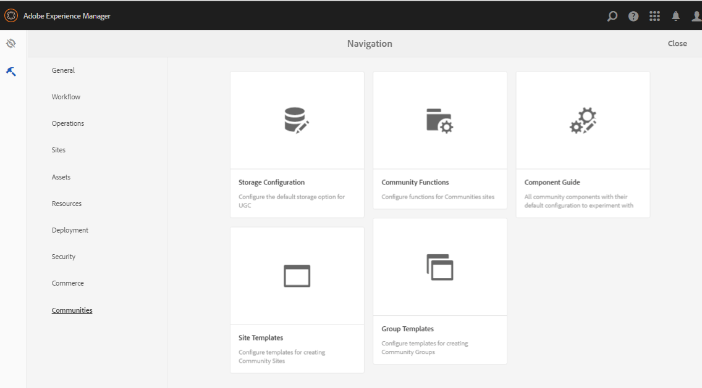
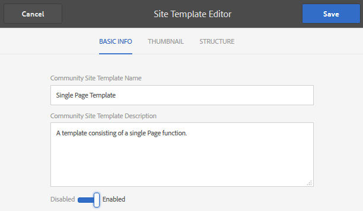
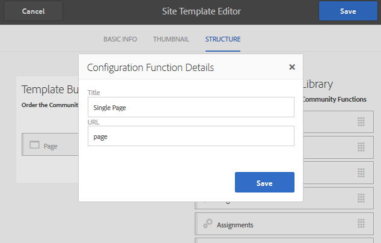
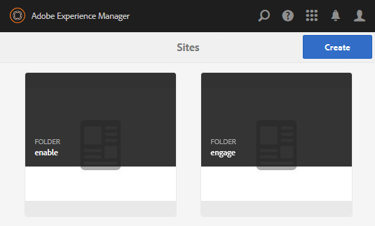
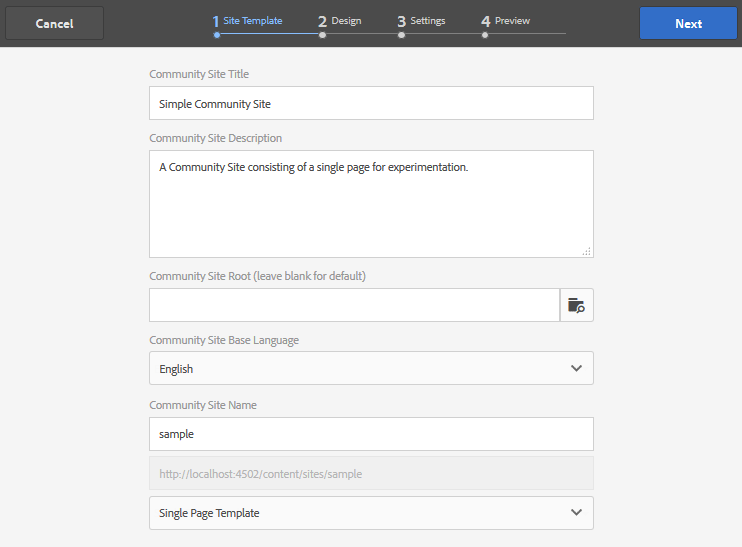
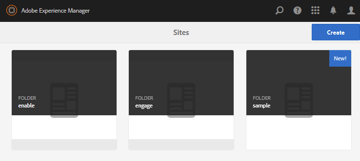
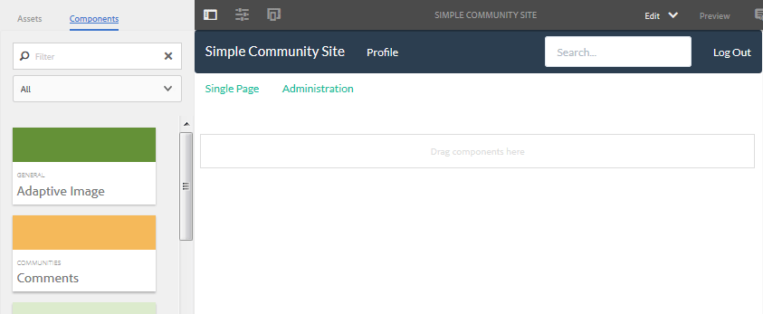

# Créer un exemple de page {#create-a-sample-page}

Depuis AEM 6.1 Communities, le moyen le plus simple de créer un exemple de page consiste à créer un site de communauté simple, composé simplement d’une fonction Page .

Cela inclut un composant parsys afin que vous puissiez [activer les composants pour la création](basics.md#accessing-communities-components).

Une autre option pour l’exploration avec des exemples de composants consiste à utiliser les fonctionnalités présentées dans le [Guide des composants de la communauté](components-guide.md).

## Créer un site communautaire {#create-a-community-site}

Cela revient à créer un site décrit dans la section [Prise en main d’AEM Communities](getting-started.md).

La principale différence réside dans le fait que ce tutoriel crée un modèle de site communautaire qui ne contient que la fonction [Page](functions.md#page-function) pour créer un site communautaire simple. Il le fait sans autres fonctionnalités (autres que les fonctionnalités pré-câblées de base pour tous les sites de la communauté).

### Créer un modèle de site {#create-new-site-template}

Pour commencer, créez un [modèle de site communautaire](sites.md) simple.

Dans la navigation globale sur une instance d’auteur, sélectionnez **[!UICONTROL Outils]** > **[!UICONTROL Communautés]** > **[!UICONTROL Modèles de site]**.

* Sélectionnez `Create button`.
* INFORMATIONS DE BASE

  * `Name` : modèle de page unique
  * `Description` : modèle constitué d’une seule fonction Page .
  * Sélectionnez `Enabled`.

* STRUCTURE

  * Faites glisser une fonction `Page` vers le Créateur de modèles
  * Pour les détails de la fonction de configuration, saisissez .

    * `Title` : Une seule page
    * `URL` : page

* Sélectionnez **`Save`** pour la configuration
* Sélectionner des **`Save`** pour le modèle de site

### Créer un nouveau site communautaire {#create-new-community-site}

Créez maintenant un site communautaire basé sur le modèle de site simple.

Après avoir créé le modèle de site, dans la navigation globale, sélectionnez **[!UICONTROL Communities > Sites]**.

* Icône Sélectionner un **`Create`**

* Étape `1 - Site Template`

  * `Title` : site de la communauté simple
  * `Description` : site communautaire composé d’une seule page pour l’expérimentation.
  * `Community Site Root: (leave blank)`
  * `Community Site Base Language: English`
  * `Name` : exemple

    * url = http://localhost:4502/content/sites/sample

    * `Template` : choisissez `Single Page Template`

    

* Sélectionnez `Next`.
* Étape `2 - Design`

  * Sélectionner n’importe quelle conception

* Sélectionnez `Next`.
* Sélectionnez `Next`.

  (Accepter tous les paramètres par défaut)

* Sélectionnez `Create`.

  

## Publication du site {#publish-the-site}

Dans la [console de sites de la communauté](sites-console.md), sélectionnez l’icône de publication pour publier le site, par défaut à http://localhost:4503.

## Ouvrez le site en mode de création en mode d’édition {#open-the-site-on-author-in-edit-mode}

Sélectionnez l’icône Ouvrir le site pour pouvoir afficher le site en mode d’édition.

L&#39;URL est [&#128279;](http://localhost:4502/editor.html/content/sites/sample/en.html)

Sur la page d’accueil simple, il est possible de voir ce qui est pré-câblé via les fonctions et modèles de la communauté, et de jouer avec l’ajout et la configuration de composants de la communauté.

## Afficher le site sur l’instance de publication {#view-site-on-publish}

Après avoir publié la page, ouvrez-la sur l’[instance de publication](http://localhost:4503/content/sites/sample/en.html) pour tester les fonctionnalités en tant que visiteur anonyme du site, membre connecté ou administrateur. Le lien Administration visible dans l’environnement de création n’apparaît pas dans l’environnement de publication, sauf si un administrateur se connecte.
