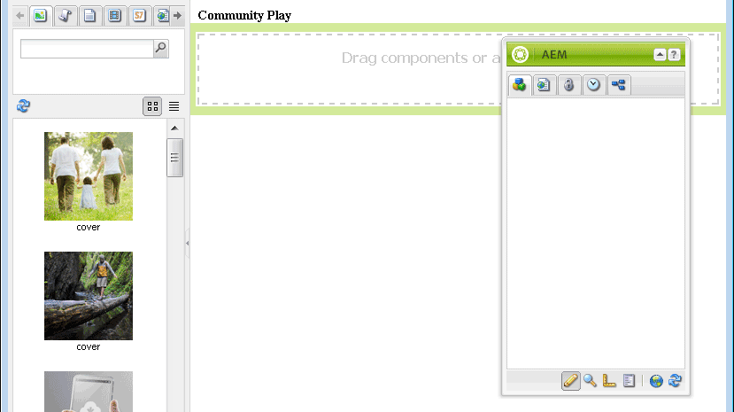

# Développement d’une application Sandbox  {#develop-sandbox-application}

Dans cette section, maintenant que le modèle est configuré dans la section [application initiale](initial-app.md) et les pages initiales établies dans la section [contenu initial](initial-content.md), vous pouvez développer l’application. Pour ce faire, utilisez des scripts de base qui incluent la possibilité d’activer la création avec des composants de Communities. À la fin de cette section, vous disposez d’un site web entièrement fonctionnel.

## Utilisation des scripts de page de base {#using-foundation-page-scripts}

Le script par défaut, créé lors de l’ajout du composant qui effectue le rendu du modèle de page de lecture, est modifié afin d’inclure le fichier head.jsp de la page de base et un fichier body.jsp local.

### Super Type De Ressource {#super-resource-type}

La première étape consiste à ajouter une propriété de super type de ressource au nœud `/apps/an-scf-sandbox/components/playpage` afin qu’il hérite des scripts et des propriétés du super type.

Utilisation de CRXDE Lite :

1. Sélectionnez l’`/apps/an-scf-sandbox/components/playpage` de nœud.
1. Dans l’onglet Propriétés , saisissez une nouvelle propriété avec les valeurs suivantes :

   Nom : `sling:resourceSuperType`

   Type : `String`

   Valeur : `foundation/components/page`

1. Cliquez sur le bouton vert **[!UICONTROL +Ajouter]**.
1. Cliquez sur **[!UICONTROL Enregistrer tout]**.

   

### Scripts d’en-tête et de corps {#head-and-body-scripts}

1. Dans le volet de l’explorateur **&#x200B;**, accédez à `/apps/an-scf-sandbox/components/playpage` et double-cliquez sur le fichier `playpage.jsp` pour l’ouvrir dans le volet d’édition.

   `/apps/an-scf-sandbox/components/playpage/playpage.jsp`

   ```xml
   <%--
   
     An SCF Sandbox Play Component component.
   
     This is the component which renders content for An SCF Sandbox page.
   
   --%><%
   %><%@include file="/libs/foundation/global.jsp"%><%
   %><%@page session="false" %><%
   %><%
    // TODO add your code here
   %>
   ```

1. Conscient des balises de script d’ouverture/de fermeture, remplacez « // Tâche... » avec `includes` de scripts pour les parties head et body de &lt;html>.

   Avec un super type de `foundation/components/page`, tout script non défini dans ce même dossier est résolu en script dans `/apps/foundation/components/page` dossier (s’il existe), ou dans un script dans `/libs/foundation/components/page` dossier.

   `/apps/an-scf-sandbox/components/playpage/playpage.jsp`

   ```xml
   <%--
   
       An SCF Sandbox Play Component component: playpage.jsp
   
     This is the component which renders content for An SCF Sandbox page.
   
   --%><%
   %><%@include file="/libs/foundation/global.jsp"%><%
   %><%@page session="false" %>
   <html>
     <cq:include script="head.jsp"/>
     <cq:include script="body.jsp"/>
   </html>
   ```

1. Le recouvrement du `head.jsp` de script de base n’est pas nécessaire, mais le `body.jsp` de script de base est vide.

   Pour configurer la création, recouvrez `body.jsp` avec un script local et incluez un système de paragraphe (parsys) dans le corps :

   1. Accédez à `/apps/an-scf-sandbox/components`.
   1. Sélectionnez le nœud `playpage`.
   1. Cliquez avec le bouton droit et sélectionnez `Create > Create File...`

      * Nom : **body.jsp**

   1. Cliquez sur **[!UICONTROL Enregistrer tout]**.

   Ouvrez `/apps/an-scf-sandbox/components/playpage/body.jsp` et collez le texte suivant :

   ```xml
   <%--
   
       An SCF Sandbox Play Component component: body.jsp
   
     This is the component which renders content for An SCF Sandbox page.
   
   --%><%
   %><%@include file="/libs/foundation/global.jsp"%><%
   %><%@page session="false" %>
   <body>
       <h2>Community Play</h2>
       <cq:include path="par" resourceType="foundation/components/parsys" />
   </body>
   ```

1. Cliquez sur **[!UICONTROL Enregistrer tout]**.

**Afficher la page dans un navigateur en mode d’édition :**

* Interface utilisateur standard : `http://localhost:4502/editor.html/content/an-scf-sandbox/en/play.html`

Vous devriez voir non seulement l’en-tête **Lecture de communauté**, mais également l’interface utilisateur pour modifier le contenu de la page.

Le panneau latéral Assets/Component s’affiche lorsque vous basculez l’un sur l’autre et que la fenêtre est suffisamment large pour afficher à la fois le contenu latéral et le contenu de la page.


* Interface utilisateur classique : `http://localhost:4502/cf#/content/an-scf-sandbox/en/play.html`

Voici comment la page de lecture s’affiche dans l’IU classique, y compris avec l’outil de recherche de contenu (cf) :



## Composants de Communities {#communities-components}

Pour activer les composants de Communities pour la création, commencez par suivre les instructions suivantes :

* [Accès aux composants de Communities](basics.md#accessing-communities-components)

Pour les besoins de ce sandbox, commencez par les composants **Communities** suivants (activez en cochant la case) :

* Commentaires
* Forum
* Évaluation
* Révisions
* Résumé des révisions (affichage)
* Votant

En outre, choisissez les composants **[!UICONTROL Général]**, tels que

* Image
* Tableau
* Texte
* Titre (Foundation)

>[!NOTE]
>
>Les composants activés pour le par de page sont stockés dans le référentiel en tant que valeur de la propriété `components` du
>
>`/etc/designs/an-scf-sandbox/jcr:content/playpage/par` du nœud.

## Page de destination {#landing-page}

Dans un environnement multilingue, la page racine comprend un script qui analyse la requête du client pour déterminer la langue souhaitée.

Dans cet exemple, la page racine est définie de manière statique pour être redirigée vers la page en anglais, qui pourra être développée dans le futur pour devenir la page de destination principale avec un lien vers la page de lecture.

Modifiez l’URL du navigateur en page racine : `http://localhost:4502/editor.html/content/an-scf-sandbox.html`

* Sélectionnez l’icône Informations sur la page .
* Sélectionnez **[!UICONTROL Ouvrir les propriétés]**
* Dans l’onglet AVANCÉ

  * Pour l’entrée de redirection, accédez à **[!UICONTROL Sites web]** > **[!UICONTROL Site de sandbox SCF]** > **[!UICONTROL Sandbox SCF]**
  * Cliquez sur **[!UICONTROL OK]**

* Cliquez sur **[!UICONTROL OK]**

Une fois le site publié, accéder à la page racine sur une instance de publication redirige vers la page en anglais.

La dernière étape avant de lire les composants SCF de Communities consiste à ajouter un dossier de bibliothèques clientes (clientlibs) .... [&#x200B; Ajouter des bibliothèques clientes &#x200B;](add-clientlibs.md)
