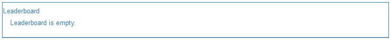
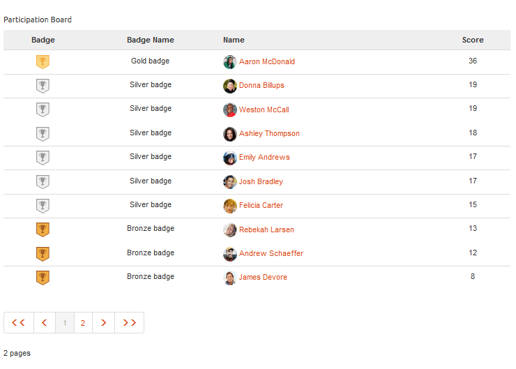
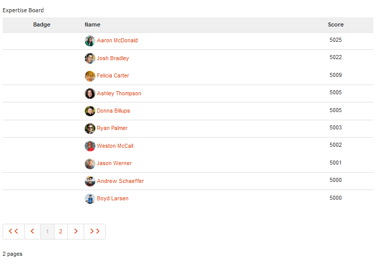

# Fonction du tableau de classement {#leaderboard-feature}

## Présentation {#introduction}

Le composant `Leaderboard` vous permet d’avoir une idée de la manière dont les membres interagissent au sein de la communauté en classant les membres en fonction des points gagnés (score de base) ou de leur expertise (score avancé).

Avant d’inclure le composant Tableau des scores sur une page, il est nécessaire de configurer [Notation et pastilles de communautés](/help/communities/implementing-scoring.md).

Cette section de la documentation décrit les éléments suivants :

* Ajout du composant `Leaderboard` à un [site communautaire](/help/communities/overview.md#community-sites).
* Paramètres de configuration du composant `Leaderboard`.

### Ajout d’un tableau des scores à une page {#adding-a-leaderboard-to-a-page}

Pour ajouter un composant `Leaderboard` à une page en mode création, localisez-le

* `Communities / Leaderboard`

Et faites-le glisser sur une page.

Pour plus d’informations, consultez [Principes de base des composants de communautés](/help/communities/basics.md).

Lorsque vous placez le composant sur une page d’un site communautaire pour la première fois, voici comment il s’affiche :

### Configuration de Leaderboard {#configuring-leaderboard}

Sélectionnez le composant de `Leaderboard` placé afin de pouvoir accéder à l’icône de `Configure` qui ouvre la boîte de dialogue de modification et de la sélectionner.

#### Onglet Paramètres {#settings-tab}

Sous l’onglet **[!UICONTROL Paramètres]**, spécifiez les informations relatives au membre qui s’affichent :

* **Nom d’affichage**

  Nom descriptif à afficher pour le panorama, reflétant les règles sélectionnées pour l’affichage des badges et des scores.
  La valeur par défaut est `Leaderboard` si rien n’est saisi.

* **Badge**

  Si cette case est cochée, une colonne pour les icônes de badge est incluse dans le tableau des scores.
  La valeur par défaut n’est pas cochée.

* **Nom du badge**

  Si cette case est cochée, une colonne pour le nom du badge est incluse dans le tableau des scores.
  La valeur par défaut n’est pas cochée.

* **Utiliser l’avatar**

  Si cette case est cochée, l’image de l’avatar du membre est incluse dans le classement, en regard du lien de son nom vers son profil de membre.
  La valeur par défaut n’est pas cochée.

#### Onglet Règles {#rules-tab}

Sous l’onglet **Règles**, le site de la communauté, ainsi que ses règles de score et de badge

* **Emplacement de la règle**

  (Obligatoire) Emplacement où la règle de notation/badge est configurée.

* **Règle de score**

  (Obligatoire) Règle spécifique générant les scores à afficher.

* **Règle de badge**

  (Obligatoire) Règle spécifique générant le badge à afficher.

* **Limite d’affichage**

  Nombre de membres à afficher par page. La valeur par défaut est 10.

### Exemple : Tableau des scores des participants {#example-participants-leaderboard}

Ce tableau des scores présente les résultats de l’application des règles de score de base.

Configuration du composant Tableau des scores :

* Onglet Paramètres :

  * Nom d’affichage = `Participation Board`
  * `checked` :

    * Badge
    * Nom du badge
    * Utiliser l’avatar

* Onglet Règles :

  * Emplacement de la règle = `/content/sites/<site name>/jcr:content`
  * Règle de score = `/libs/settings/community/scoring/rules/forums-scoring`
  * Règle de badge = `/libs/settings/community/badging/rules//reference-badging`
  * Limite d’affichage = `10`

### Exemple : Experts Leaderboard {#example-experts-leaderboard}

Ce tableau des scores présente les résultats de l’application des règles de score avancées.

Configuration du composant Tableau des scores :

* Onglet Paramètres :

  * Nom d’affichage = `Expertise Board`
  * `checked` :

    * Badge
    * Utiliser l’avatar

* Onglet Règles :

  * Emplacement de la règle = `/content/sites/<site name>/jcr:content`
  * Règle de score = `/libs/settings/community/scoring/rules/adv-forums-scoring`
  * Règle de badge = `/libs/settings/community/badging/rules/adv-forums-badging`
  * Limite d’affichage = `10`

### Informations supplémentaires {#additional-information}

Vous trouverez plus d’informations à ce sujet sur la page [Principes de base du tableau de bord](/help/communities/leaderboard.md) destinée aux développeurs.

Les instructions relatives à la création de règles sont fournies à la page [Notation et pastilles des communautés](/help/communities/implementing-scoring.md) à l’intention des administrateurs.
