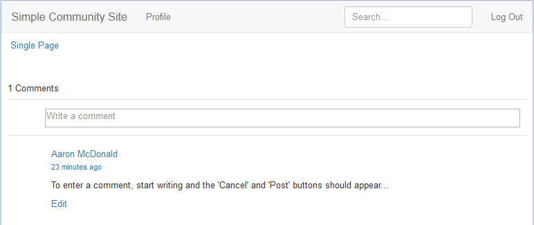

# Modifier l’apparence (HBS) {#alter-the-appearance-hbs}

Maintenant que les composants du système de commentaires personnalisés dans le répertoire d’applications (/apps) sont en place, avec un resourceSuperType référençant le système de commentaires par défaut, et le modèle/la vue personnalisé(e) enregistré(e), vous pouvez modifier l’implémentation.

Pour une simple démonstration, une fonctionnalité visuelle, l’avatar de l’utilisateur connecté qui publie un commentaire, est supprimé.

>[!NOTE]
>
>Pour utiliser l’extension, l’instance du système de commentaires d’un site web à affecter (/content) doit définir son resourceType sur le système de commentaires personnalisé.

## Modification des scripts HBS {#modify-the-hbs-scripts}

Utilisation de [&#128279;](/help/sites-developing/developing-with-crxde-lite.md) :

* Ouvrez [/apps/custom/components/comments/comment/**comment.hbs**](https://localhost:4502/crx/de/index.jsp#/apps/custom/components/comments/comment/comment.hbs)

  * Commentez la balise qui comprend l’avatar pour une publication de commentaire (~ ligne 21) :

    ```
      <!--
       <</img>
       -->
    ```

* Ouvrez [/apps/custom/components/comments/**comments.hbs**](https://localhost:4502/crx/de/index.jsp#/apps/custom/components/comments/comments.hbs)

  * Commentez la balise qui comprend l’avatar pour la prochaine entrée de commentaire (~ ligne 44) :

    ```
      <!--
       </img>
       -->
    ```

* Sélectionnez **Enregistrer tout**

### Répliquer l’application personnalisée {#replicate-custom-app}

Une fois l’application modifiée, il est nécessaire de répliquer à nouveau le composant personnalisé.

Voici un moyen d’y parvenir :

* À partir du menu principal

  * Sélectionnez **[!UICONTROL Outils]** > **[!UICONTROL Opérations]** > **[!UICONTROL Réplication]**.
  * Sélectionnez **[!UICONTROL Activer l’arborescence]**.
  * Définissez `Start Path` sur `/apps/custom`.
  * Désélectionnez **[!UICONTROL Modifié uniquement]**.
  * Sélectionnez le bouton **[!UICONTROL Activer]**.

### Afficher le commentaire modifié sur l’exemple de page publié {#view-modified-comment-on-published-sample-page}

[En poursuivant l’expérience](/help/communities/extend-sample-page.md#publish-sample-page) sur l’instance de publication, toujours connectée en tant que même utilisateur, il est désormais possible d’actualiser la page dans l’environnement de publication pour afficher la modification visant à supprimer l’avatar :



### Exemple de package d’extension de commentaire {#sample-comment-extension-package}

Ci-joint un package de l’application de commentaires personnalisés créée dans ce tutoriel.

[Obtenir le fichier](assets/sample-comment-extension-6-1-fp3.zip)
