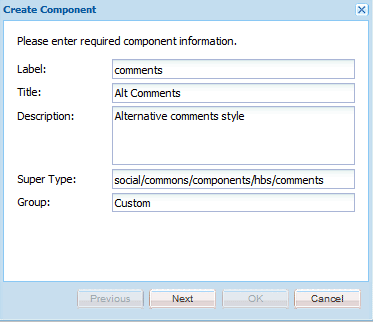
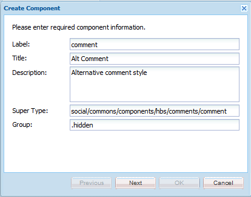
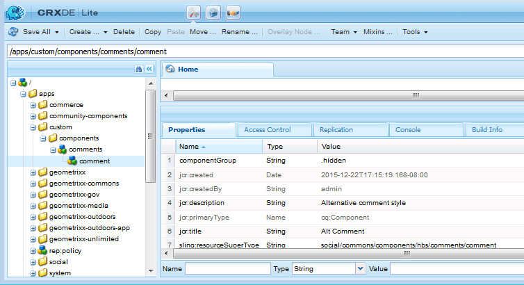
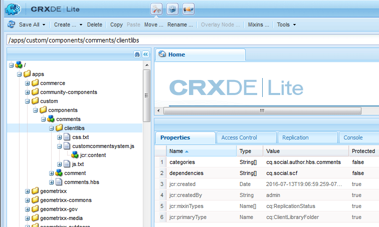

# Création des composants  {#create-the-components}

L’exemple d’extension de composants utilise le système de commentaires, qui est composé de deux composants.

* Commentaires : système de commentaires englobant le composant placé sur une page.
* Commentaire : composant qui capture une instance d’un commentaire publié.

Les deux composants doivent être mis en place, en particulier pour la personnalisation de l’apparence d’un commentaire publié.

>[!NOTE]
>
>Un seul système de commentaires est autorisé par page de site.
>
>De nombreuses fonctionnalités de Communities incluent déjà un système de commentaires dont le type de ressource peut être modifié pour faire référence au système de commentaires étendu.

## Créer le composant Commentaires {#create-the-comments-component}

Ces instructions spécifient une valeur **Group** autre que `.hidden` afin que le composant soit disponible dans le navigateur de composants (sidekick).

La suppression du fichier JSP créé automatiquement est due au fait que le fichier HBS par défaut est utilisé à la place.

1. Accédez à **CRXDE|Lite** ([http://localhost:4502/crx/de/index.jsp](http://localhost:4502/crx/de/index.jsp))

1. Créez un emplacement pour les applications personnalisées :

   * Sélectionnez le nœud de `/apps`

     * **Créer un dossier** nommé **[!UICONTROL personnalisé]**

   * Sélectionnez le nœud de `/apps/custom`

     * **Créer un dossier** nommé **[!UICONTROL composants]**

1. Sélectionnez le nœud de `/apps/custom/components`

   * **[!UICONTROL Créer > Composant...]**

     * **Libellé** : *commentaires*
     * **Titre** : *Commentaires de remplacement*
     * **Description** : *Autre style de commentaires*
     * **Super Type** : *social/commons/components/hbs/comments*
     * **Group** : *Custom*

   * Sélectionnez **[!UICONTROL Suivant]**
   * Sélectionnez **[!UICONTROL Suivant]**
   * Sélectionnez **[!UICONTROL Suivant]**
   * Sélectionnez **[!UICONTROL OK]**.

1. Développez le nœud créé : `/apps/custom/components/comments`.
1. Sélectionnez **[!UICONTROL Enregistrer tout]**
1. Clic avec le bouton droit sur `comments.jsp`
1. Sélectionnez **[!UICONTROL Supprimer]**
1. Sélectionnez **[!UICONTROL Enregistrer tout]**



### Créer le composant Commentaire enfant {#create-the-child-comment-component}

Ces instructions définissent **Group** sur `.hidden`, car seul le composant parent doit être inclus dans une page.

La suppression du fichier JSP créé automatiquement est due au fait que le fichier HBS par défaut est utilisé à la place.

1. Accédez au nœud `/apps/custom/components/comments` .
1. Cliquez avec le bouton droit sur le nœud .

   * Sélectionnez **[!UICONTROL Créer]** > **[!UICONTROL Composant...]**

     * **Libellé** : *commentaire*
     * **Titre** : *Autre commentaire*
     * **Description** : *Autre style de commentaire*
     * **Super Type** : *social/commons/components/hbs/comments/comment*
     * **Groupe** : `*.hidden*`

   * Sélectionnez **[!UICONTROL Suivant]**
   * Sélectionnez **[!UICONTROL Suivant]**
   * Sélectionnez **[!UICONTROL Suivant]**
   * Sélectionnez **[!UICONTROL OK]**.

1. Développez le nœud créé : `/apps/custom/components/comments/comment`.
1. Sélectionnez **[!UICONTROL Enregistrer tout]**
1. Clic avec le bouton droit sur `comment.jsp`
1. Sélectionnez **[!UICONTROL Supprimer]**
1. Sélectionnez **[!UICONTROL Enregistrer tout]**





### Copier et modifier les scripts HBS par défaut {#copy-and-modify-the-default-hbs-scripts}

Utilisation de [](../../help/sites-developing/developing-with-crxde-lite.md) :

* Copier `comments.hbs`

  * Depuis [/libs/social/commons/components/hbs/comments](http://localhost:4502/crx/de/index.jsp#/libs/social/commons/components/hbs/comments)
  * Pour [/apps/custom/components/comments ](http://localhost:4502/crx/de/index.jsp#/apps/custom/components/comments)

* Modifiez le `comments.hbs` en :

  * Modifiez la valeur de l’attribut `data-scf-component` (~ligne 20) :

    * Depuis le `social/commons/components/hbs/comments`
    * À `/apps/custom/components/comments`

  * Modifiez pour inclure le composant de commentaire personnalisé (~ligne 75) :

    * Remplacer le `{{include this resourceType='social/commons/components/hbs/comments/comment'}}`
    * Avec `{{include this resourceType='/apps/custom/components/comments/comment'}}`

* Copier `comment.hbs`

  * Depuis [/libs/social/commons/components/hbs/comments/comment](http://localhost:4502/crx/de/index.jsp#/libs/social/commons/components/hbs/comments/comment)
  * Pour [/apps/custom/components/comments/comment ](http://localhost:4502/crx/de/index.jsp#/apps/custom/components/comments/comment)

* Modifiez le `comment.hbs` en :

  * Modifiez la valeur de l’attribut data-scf-component (~ ligne 19)

    * Depuis le `social/commons/components/hbs/comments/comment`
    * À `/apps/custom/components/comments/comment`

* Sélectionner `/apps/custom` nœud
* Sélectionnez **[!UICONTROL Enregistrer tout]**

## Création d’un dossier de bibliothèques clientes {#create-a-client-library-folder}

Pour éviter d’avoir à inclure cette bibliothèque cliente, la valeur de catégories pour la bibliothèque cliente du système de commentaires par défaut peut être utilisée ( `cq.social.author.hbs.comments`). Cependant, cette bibliothèque cliente doit également être incluse pour toutes les instances du composant par défaut.

Utilisation de [](../../help/sites-developing/developing-with-crxde-lite.md) :

* Sélectionner `/apps/custom/components/comments` nœud
* Sélectionnez **[!UICONTROL Créer un nœud]**

  * **Nom** : `clientlibs`
  * **Type** : `cq:ClientLibraryFolder`
  * Ajoutez à l’onglet **[!UICONTROL Propriétés]** :

    * **Name** `categories` **Type** `String` **Value** `cq.social.author.hbs.comments` `Multi`
    * **Name** `dependencies` **Type** `String` **Value** `cq.social.scf` `Multi`

* Sélectionnez **[!UICONTROL Enregistrer tout]**
* Une fois le nœud `/apps/custom/components/comments/clientlib` sélectionné, créez trois fichiers :

  * **Nom** : `css.txt`
  * **Nom** : `js.txt`
  * **Nom** : customcommentsystem.js

* Saisissez « customcommentsystem.js » comme contenu de `js.txt`
* Sélectionnez **[!UICONTROL Enregistrer tout]**



## Enregistrer le modèle et la vue SCF {#register-the-scf-model-view}

Lors de l’extension (remplacement) d’un composant SCF, le type de ressource est différent (le recouvrement utilise le mécanisme de recherche relative qui effectue une recherche dans les `/apps` avant la `/libs` afin que le type de ressource reste le même). C’est pourquoi il est nécessaire d’écrire JavaScript (dans la bibliothèque cliente) pour enregistrer le modèle JS SCF et la vue pour le resourceType personnalisé.

Saisissez le texte suivant comme contenu de `customcommentsystem.js` :

### customcommentsystem.js {#customcommentsystem-js}

```xml
(function($CQ, _, Backbone, SCF) {
    "use strict";

    var CustomComment = SCF.Components["social/commons/components/hbs/comments/comment"].Model;
    var CustomCommentView = SCF.Components["social/commons/components/hbs/comments/comment"].View;

    var CustomCommentSystem = SCF.Components["social/commons/components/hbs/comments"].Model;
    var CustomCommentSystemView = SCF.Components["social/commons/components/hbs/comments"].View;

    SCF.registerComponent('/apps/custom/components/comments/comment', CustomComment, CustomCommentView);
    SCF.registerComponent('/apps/custom/components/comments', CustomCommentSystem, CustomCommentSystemView);

})($CQ, _, Backbone, SCF);
```

* Sélectionnez **[!UICONTROL Enregistrer tout]**

## Publier l’application {#publish-the-app}

Pour tester le composant étendu dans l’environnement de publication, il est nécessaire de répliquer le composant personnalisé.

Voici un moyen d’y parvenir :

* À partir de la navigation globale,

  * Sélectionnez **[!UICONTROL Outils]** > **[!UICONTROL Déploiement]** > **[!UICONTROL Réplication]**
  * Sélectionnez **[!UICONTROL Activer l’arborescence]**
  * Définissez `Start Path` sur `/apps/custom`.
  * Décochez **[!UICONTROL Modifié uniquement]**
  * Bouton Sélectionner **[!UICONTROL Activer]**
