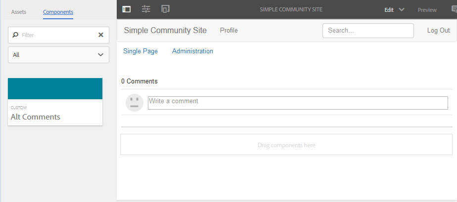

# Ajouter un commentaire à l’exemple de page  {#add-comment-to-sample-page}

Maintenant que les composants du système de commentaires personnalisés sont en place dans le répertoire de l’application (/apps), il est possible d’utiliser le composant étendu. L’instance du système de commentaire dans un site web à affecter doit définir son resourceType sur le système de commentaire personnalisé et inclure toutes les bibliothèques clientes nécessaires.

## Identification des bibliothèques clientes requises {#identify-required-clientlibs}

Les bibliothèques clientes nécessaires pour le style et le fonctionnement des commentaires par défaut sont également nécessaires pour les commentaires étendus.

Le [&#x200B; Guide des composants de communauté &#x200B;](/help/communities/components-guide.md) identifie les bibliothèques clientes requises. Accédez au Guide du composant et affichez le composant Commentaires, par exemple :

[&#128279;](https://localhost:4502/content/community-components/en/comments.html)

Notez les trois bibliothèques clientes requises pour que Comments s’affiche et fonctionne correctement. Ils doivent être inclus là où les commentaires étendus sont référencés, ainsi que la [bibliothèque cliente des commentaires étendus](/help/communities/extend-create-components.md#create-a-client-library-folder) ( `apps.custom.comments`).

### Ajout de commentaires personnalisés à une page {#add-custom-comments-to-a-page}

Comme il ne peut y avoir qu’un seul système de commentaires par page, il est plus simple de créer un exemple de page comme décrit dans le court tutoriel [créer un exemple de page](/help/communities/create-sample-page.md).

Une fois créé, passez en mode Conception et rendez disponible le groupe de composants Personnalisé pour permettre l’ajout du composant `Alt Comments` à la page.

Pour que le Commentaire s’affiche et fonctionne correctement, les bibliothèques clientes de Comments doivent être ajoutées à la liste clientlibs de la page (voir [Clientlibs pour les composants Communities](/help/communities/clientlibs.md)).

#### Bibliothèques clientes de commentaires dans l’exemple de page {#comments-clientlibs-on-sample-page}

#### Auteur : commentaire alternatif sur la page échantillon {#author-alt-comment-on-sample-page}

#### Auteur : Exemple de nœud de commentaires de page {#author-sample-page-comments-node}

Vous pouvez vérifier resourceType dans CRXDE en affichant les propriétés du nœud comments pour l’exemple de page à l’adresse `/content/sites/sample/en/jcr:content/content/primary/comments`.

#### Publier l’exemple de page {#publish-sample-page}

Une fois le composant personnalisé ajouté à la page, il est également nécessaire de (re) [publier la page](/help/communities/sites-console.md#publishing-the-site).

#### Publier : commentaire alternatif sur l’exemple de page {#publish-alt-comment-on-sample-page}

Après avoir publié l’application personnalisée et l’exemple de page, il est possible de saisir un commentaire. Une fois connecté, avec un [utilisateur de démonstration](/help/communities/tutorials.md#demo-users) ou un administrateur, il est possible de publier un commentaire.

Voici aaron.mcdonald@mailinator.com postant un commentaire :

Maintenant qu’il semble que le composant étendu fonctionne correctement avec l’aspect par défaut, il est temps de modifier l’aspect.
