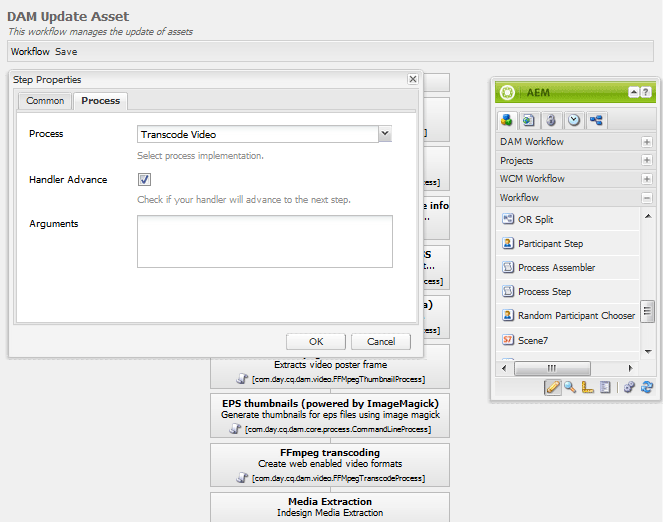

# FFmpeg pour Communities {#ffmpeg-for-communities}

## Vue d’ensemble {#overview}

FFmpeg est une solution de conversion et de diffusion audio et vidéo en continu qui, une fois installée, est utilisée pour le transcodage correct des ressources [vidéo](../../help/sites-authoring/default-components-foundation.md#video).

## Installation De FFmpeg {#installing-ffmpeg}

FFmpeg doit être installé sur le ou les serveurs hébergeant la ou les instances AEM *author*.

1. Accédez à .
1. Téléchargez la dernière version de FFmpeg pour votre environnement spécifique (Macintosh, Windows ou Linux).

   * Il est important de garder FFmpeg à jour en raison des vulnérabilités de sécurité dans les versions plus anciennes.

1. Installez FFmpeg en suivant les instructions pour le système d’exploitation.

1. Assurez-vous que le fichier exécutable FFmpeg est défini dans le chemin d’accès système.

   Vous devriez être en mesure d&#39;exécuter FFmpeg à partir de n&#39;importe quel répertoire de votre système.

   * Par exemple, `ffmpeg -version`.

## Configuration Du Service De Transcodage FFmpeg {#configure-ffmpeg-transcoding-service}

Par défaut, lorsque FFmpeg est installé, plusieurs rendus sont configurés (transcodages) conformément à la définition de workflow [!UICONTROL Ressource de mise à jour de gestion des ressources numériques].

Comme les transcodages utilisent beaucoup CPU, il est recommandé de modifier la liste des rendus cibles. Dans la plupart des cas, le transcodage n’est pas nécessaire.

Pour modifier le workflow [!UICONTROL  Ressource de mise à jour de gestion des ressources numériques ] et, dans cet exemple, pour désactiver le transcodage :

* Connectez-vous à l’instance d’auteur avec les privilèges d’administration.
* Dans la navigation globale, accédez à **[!UICONTROL Outils]** > **[!UICONTROL Workflow]** > **[!UICONTROL Modèles]**.
* Recherchez **[!UICONTROL Ressource de mise à jour de la gestion des ressources numériques]**.
* Double-cliquez pour ouvrir le workflow à modifier dans l’interface utilisateur classique.

  Emplacement résultant : 

* Double-cliquez sur l’étape **[!UICONTROL Transcodage FFmpeg]** pour accéder à la boîte de dialogue Propriétés de l’étape.
* Sous l’onglet **[!UICONTROL Processus]** :

  * **[!UICONTROL Arguments]** : effacer toutes les entrées pour désactiver le transcodage Valeurs par défaut : `profile:format_ogg,profile:format_aac,profile:format_flv,profile:format_aac_ie`

  

* Sélectionnez **[!UICONTROL OK]** pour fermer la boîte de dialogue `Step Properties`.

* Sélectionnez **[!UICONTROL Enregistrer]** pour enregistrer le workflow `DAM Update Asset`.
