# Fonctions de la communauté{#community-functions}

Les types de fonctionnalités attendus d’une expérience de communauté sont bien connus. Les fonctions de communauté sont disponibles en tant que fonctions de communauté. Pour faire simple, il s’agit d’une ou de plusieurs pages pré-câblées pour mettre en œuvre une fonctionnalité de communauté qui nécessite plus que l’ajout d’un composant à une page en mode création. Ils sont les blocs de construction utilisés pour définir la structure d’un [modèle de site de communauté](/help/communities/sites.md) à partir duquel les sites de communauté sont [créés](/help/communities/sites-console.md).

Une fois qu’un site communautaire est créé, vous pouvez ajouter du contenu aux pages résultantes à l’aide du mode de création [AEM standard](/help/sites-authoring/editing-content.md). Diverses fonctions de communauté sont disponibles, comme illustré dans la console Fonctions de communauté .

>[!NOTE]
>
>Les consoles de création de [sites de la communauté](/help/communities/sites-console.md), [modèles de site de la communauté](/help/communities/sites.md), [modèles de groupe de la communauté](/help/communities/tools-groups.md) et [fonctions de la communauté](/help/communities/functions.md) doivent être utilisées uniquement dans l’environnement de création.

## Console des fonctions de la communauté {#community-functions-console}

Pour accéder à la console des fonctions de la communauté dans l’environnement de création :

* Accédez à **[!UICONTROL Outils]** > **[!UICONTROL Communautés]** > **[!UICONTROL Fonctions de la communauté]**.

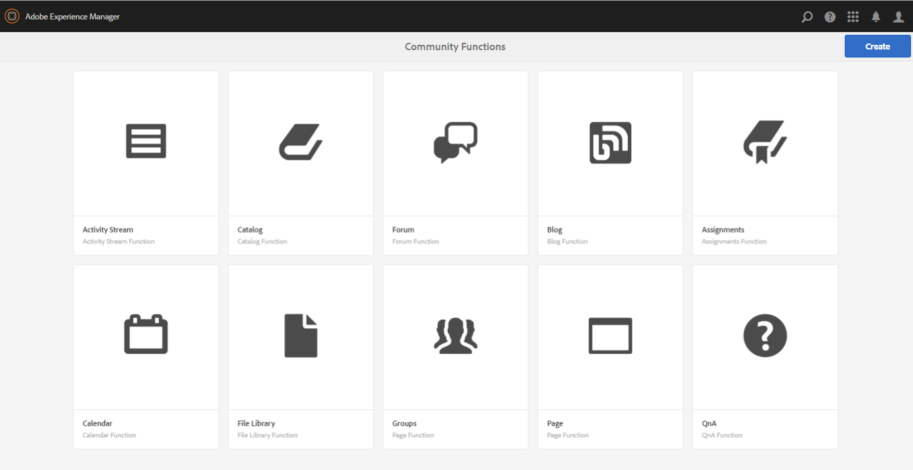

## Fonctions préconfigurées {#pre-built-functions}

Vous trouverez ci-dessous une brève description des fonctions fournies avec AEM Communities. Chaque fonction comprend une ou plusieurs pages AEM contenant des composants de communautés connectés dans une fonction facilement incorporée dans un [modèle de site de communauté](/help/communities/sites.md).

Un modèle de site de communauté fournit la structure d’un site de communauté, y compris la connexion, les profils utilisateur, les notifications, la messagerie, le menu du site, la recherche, le thème et les fonctionnalités de marque.

### Paramètres de titre et d’URL {#title-and-url-settings}

**Title** et **URL** sont des propriétés communes à toutes les fonctions de la communauté.

Lorsqu’une fonction de communauté est ajoutée à un modèle de site de communauté ou lors de la [modification](/help/communities/sites-console.md#modifying-site-properties) de la structure d’un site de communauté, la boîte de dialogue de la fonction s’ouvre afin que le titre et l’URL puissent être configurés.

#### Détails de la fonction de configuration {#configuration-function-details}

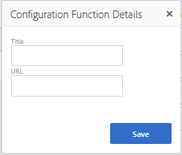

* **Titre**

  (*Obligatoire*) Texte qui apparaît dans le menu des fonctions du site

* **URL**

  (*Obligatoire*) Nom utilisé pour générer l’URI. Le nom doit être conforme aux [conventions de dénomination](/help/sites-developing/naming-conventions.md) imposées par AEM et JCR.

Par exemple, en utilisant le site créé à partir de la suite du tutoriel [Prise en main](/help/communities/getting-started.md), si

* Titre = Page Web
* URL = page

L’URL de la page est alors https://localhost:4503/content/sites/engage/en/page.html

et le lien du menu de la page s’affiche comme suit :

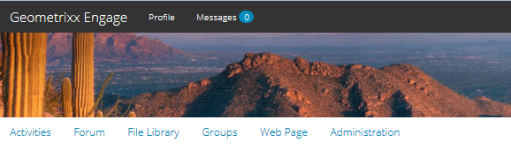

### Fonction Flux d&#39;activités {#activity-stream-function}

La fonction de flux d’activités est une page avec un composant [Flux d’activités](/help/communities/activities.md) où toutes les vues sont sélectionnées (toutes les activités, les activités utilisateur, etc.). Consultez également la section [Essentiels de flux d’activités](/help/communities/essentials-activities.md) pour les développeurs.

Lorsqu’elle est ajoutée à un modèle, la boîte de dialogue suivante s’ouvre :

#### Détails de la fonction de configuration {#configuration-function-details-1}

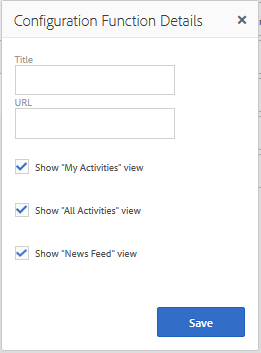

* [Paramètres de titre et d’URL](#title-and-url-settings)

* **Afficher la vue « Mes activités »**

  Si cette option est sélectionnée, la page Activités comprend un onglet qui filtre les activités en fonction de celles générées dans la communauté par le membre actuel. La valeur par défaut est sélectionnée.

* **Afficher la vue « Toutes les activités »**

  Si cette option est sélectionnée, la page Activités comprend un onglet comprenant toutes les activités générées dans la communauté à laquelle le membre actuel a accès. La valeur par défaut est sélectionnée.

* **Afficher la vue « Flux d’actualités »**

  Si cette option est sélectionnée, les pages Activités incluent un onglet qui filtre les activités en fonction de celles que le membre actuel suit. La valeur par défaut est sélectionnée.

### Fonction Blog {#blog-function}

La fonction de blog est une page dont le [composant Blog](/help/communities/blog-feature.md) est configuré pour le balisage, le chargement de fichiers, le suivi, la modification automatique, le vote et la modération. Voir aussi [Blogue Essentials](/help/communities/blog-developer-basics.md) pour les développeurs et les développeuses.

Lorsqu’elle est ajoutée à un modèle, la boîte de dialogue suivante s’ouvre :

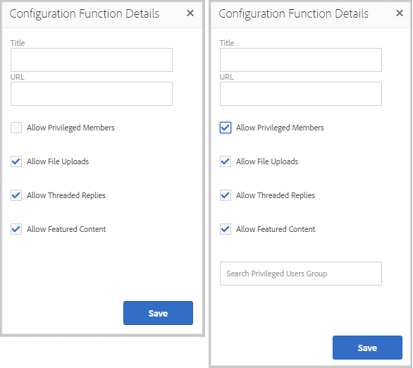

* [Paramètres de titre et d’URL](#title-and-url-settings)

* **Autoriser les membres privilégiés**

  Si cette option est sélectionnée, le blog permet uniquement aux membres privilégiés de créer des articles en autorisant la sélection d’un [groupe de membres privilégiés](/help/communities/users.md#privileged-members-group). Si cette option n’est pas sélectionnée, tous les membres de la communauté sont autorisés à créer. La valeur par défaut est désélectionnée.

* **Autoriser les chargements de fichiers**

  Si cette option est sélectionnée, le blog offre aux membres la possibilité de télécharger des fichiers. La valeur par défaut est sélectionnée.

* **Autoriser les réponses avec thread**

  Si cette option n’est pas sélectionnée, le blog autorise les réponses (commentaires) à un article, mais les réponses aux commentaires ne sont pas autorisées. La valeur par défaut est sélectionnée.

* **Autoriser le contenu en vedette**

  Si cette option est sélectionnée, le blog est identifié comme [contenu présenté](/help/communities/featured.md). La valeur par défaut est sélectionnée.

### Fonction Calendrier {#calendar-function}

La fonction de calendrier est une page avec un composant [Calendrier](/help/communities/calendar.md) configuré pour autoriser le balisage. Consultez également la section [Calendar Essentials](/help/communities/calendar-basics-for-developers.md) pour les développeurs et les développeuses.

Lorsqu’elle est ajoutée à un modèle, la boîte de dialogue suivante s’ouvre :

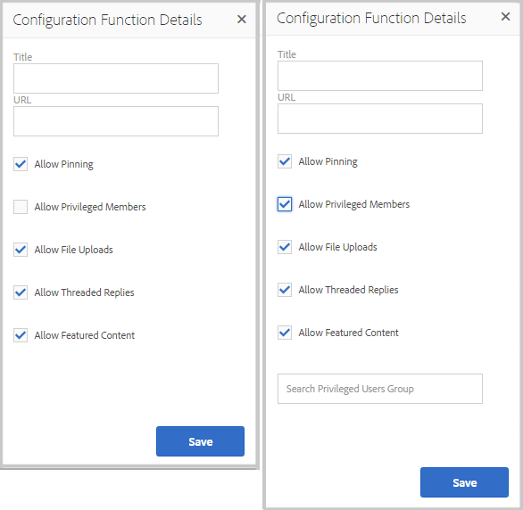

* [Paramètres de titre et d’URL](#title-and-url-settings)

* **Autoriser l’épinglage**

  Si cette option est sélectionnée, le forum permet d’épingler les réponses au sujet au début de la liste des commentaires. La valeur par défaut est sélectionnée.

* **Autoriser les membres privilégiés**

  Si cette option est sélectionnée, le blog permet uniquement aux membres privilégiés de créer des articles en autorisant la sélection d’un [groupe de membres privilégiés](/help/communities/users.md#privileged-members-group). Si cette option n’est pas sélectionnée, tous les membres de la communauté sont autorisés à créer. La valeur par défaut est désélectionnée.

* **Autoriser les chargements de fichiers**

  Si cette option est sélectionnée, le blog offre aux membres la possibilité de télécharger des fichiers. La valeur par défaut est sélectionnée.

* **Autoriser les réponses avec thread**

  Si cette option n’est pas sélectionnée, le blog autorise les réponses (commentaires) à un article, mais les réponses aux commentaires ne sont pas autorisées. La valeur par défaut est sélectionnée.

* **Autoriser le contenu en vedette**

  Si cette option est sélectionnée, son contenu est identifié comme [contenu en vedette](/help/communities/featured.md). La valeur par défaut est sélectionnée.

### Fonction de contenu présentée {#featured-content-function}

La fonction de contenu en vedette est une page dont le [composant de contenu en vedette](/help/communities/featured.md) est configuré pour autoriser l’ajout et la suppression de commentaires.

La possibilité de mettre en avant du contenu peut être autorisée ou non par composant (voir [Fonction Blog](#blog-function), [Fonction Calendrier](#calendar-function), [Fonction Forum](#forum-function), [Fonction Idéation](#ideation-function) et [Fonction QnA](#qna-function)).

Lorsqu’elle est ajoutée à un modèle, la seule configuration est pour les [Paramètres de titre et d’URL](#title-and-url-settings).

### Fonction Bibliothèque de fichiers {#file-library-function}

La fonction de bibliothèque de fichiers est une page dont le [composant Bibliothèque de fichiers](/help/communities/file-library.md) est configuré pour autoriser l’ajout et la suppression de commentaires.

Lorsqu’elle est ajoutée à un modèle, la seule configuration est pour les [Paramètres de titre et d’URL](#title-and-url-settings).

### Fonction Forum {#forum-function}

La fonction de forum est une page dont le [composant Forum](/help/communities/forum.md) est configuré pour le balisage, les chargements de fichiers, le suivi, l’auto-modification, le vote et la modération des membres.

Lorsqu’elle est ajoutée à un modèle, la boîte de dialogue suivante s’ouvre :

#### Détails de la fonction de configuration {#configuration-function-details-2}

* [Paramètres de titre et d’URL](#title-and-url-settings)

* **Autoriser l’épinglage**

  Si cette option est sélectionnée, le forum permet d’épingler les réponses au sujet au début de la liste des commentaires. La valeur par défaut est sélectionnée.

* **Autoriser les membres privilégiés**

  Si cette option est sélectionnée, le forum permet uniquement aux membres privilégiés de publier des sujets en autorisant la sélection d&#39;un [groupe de membres privilégiés](/help/communities/users.md#privileged-members-group). Si cette option n’est pas sélectionnée, tous les membres de la communauté sont autorisés à publier. La valeur par défaut est désélectionnée.

* **Autoriser les chargements de fichiers**

  Si cette option est sélectionnée, les membres du forum pourront charger des fichiers. La valeur par défaut est sélectionnée.

* **Autoriser les réponses avec thread**

  S’il n’est pas sélectionné, le forum autorise les commentaires sur un sujet, mais les réponses à ces commentaires ne sont pas autorisées. La valeur par défaut est sélectionnée.

* **Autoriser le contenu en vedette**

  Si cette option est sélectionnée, le contenu du composant est identifié comme [contenu présenté](/help/communities/featured.md). La valeur par défaut est sélectionnée.

### Fonction de groupes {#groups-function}

>[!CAUTION]
>
>La fonction de groupes doit *pas* être la *première ni la seule* fonction dans la structure d&#39;un site ou dans un modèle de site de communauté.
>
>Toute autre fonction, telle que la fonction [page](#page-function), doit être incluse et répertoriée en premier.

La fonction de groupes permet aux membres de la communauté de créer des sous-communautés dans le site de la communauté dans l’environnement de publication.

Selon [paramètres](/help/communities/sites-console.md#groupmanagement) lorsque la fonction Groupes est incluse dans un [modèle de site de la communauté](/help/communities/sites.md), les groupes peuvent être publics ou privés et un ou plusieurs modèles de groupe de la communauté peuvent être configurés pour fournir un choix de modèles lorsque le groupe de la communauté est réellement créé (à partir de l’environnement de publication, par exemple). Un modèle [groupe de communautés](/help/communities/tools-groups.md) spécifie les fonctionnalités de communautés créées pour les pages de groupe, telles que les forums et les calendriers.

Lors de la création d’un groupe de la communauté, un groupe de membres est créé dynamiquement pour le nouveau groupe, auquel des membres peuvent être affectés ou rejoints. Pour plus d’informations, voir [Gestion des utilisateurs et des groupes d’utilisateurs](/help/communities/users.md).

Depuis Communities [pack de fonctionnalités 1](/help/communities/deploy-communities.md#latestfeaturepack), les groupes de communautés sont créés dans l’environnement de création à l’aide de la console [Groupes de Communities Sites](/help/communities/groups.md) et peuvent être créés dans l’environnement de publication lorsqu’ils sont activés.

Lorsqu’elle est ajoutée à un modèle, la boîte de dialogue suivante s’ouvre :

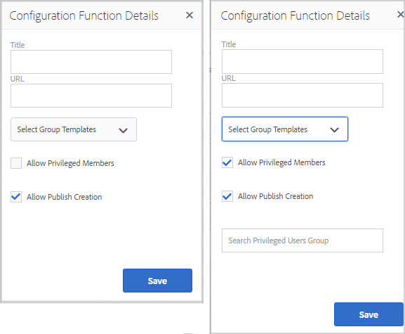

* [Paramètres de titre et d’URL](#title-and-url-settings)

* **Sélectionner les modèles de groupe**

  Liste déroulante permettant de sélectionner un ou plusieurs modèles de groupe activés parmi lesquels le futur créateur d’un nouveau groupe de la communauté (dans l’environnement de publication) peut choisir.

* **Autoriser les membres privilégiés**

  Si cette option est sélectionnée, le forum permet uniquement aux membres privilégiés de publier des sujets en autorisant la sélection d&#39;un [groupe de sécurité des membres privilégiés](/help/communities/users.md#privileged-members-group). Si cette option n’est pas sélectionnée, tous les membres de la communauté sont autorisés à publier. La valeur par défaut est désélectionnée.

* **Autoriser la création de la publication**

  Si cette option est sélectionnée, les membres autorisés de la communauté peuvent créer un groupe dans l’environnement de publication. Si cette option est désélectionnée, les nouveaux groupes (sous-communautés) ne peuvent être créés que dans l’environnement de création à partir de la console Groupes de Sites de communautés.
  La valeur par défaut est sélectionnée.

### Fonction de conceptualisation {#ideation-function}

La fonction d’idéation est une page avec un [composant d’idéation](/help/communities/ideation-feature.md).

Lorsqu’elle est ajoutée à un modèle, la boîte de dialogue suivante s’ouvre. Elle indique les noms de titre et d’URL par défaut, ainsi que les paramètres d’affichage par défaut du modèle :

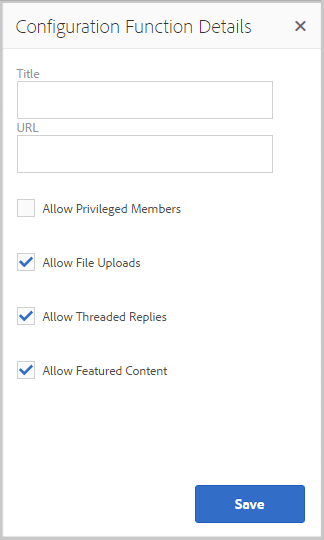

* [Paramètres de titre et d’URL](#title-and-url-settings)

* **Autoriser les membres privilégiés**

  Si cette option est sélectionnée, le forum permet uniquement aux membres privilégiés de publier des sujets en autorisant la sélection d&#39;un [groupe de sécurité des membres privilégiés](/help/communities/users.md#privileged-members-group). Si cette option n’est pas sélectionnée, tous les membres de la communauté sont autorisés à publier. La valeur par défaut est désélectionnée.

* **Autoriser les chargements de fichiers**

  Si cette option est sélectionnée, les membres pourront charger des fichiers. La valeur par défaut est sélectionnée.

* **Autoriser les réponses avec thread**

  Si cette option n’est pas sélectionnée, l’idée autorise les réponses (commentaires) à un sujet, mais les réponses aux commentaires ne sont pas autorisées. La valeur par défaut est sélectionnée.

* **Autoriser le contenu en vedette**

  Si cette option est sélectionnée, son contenu est identifié comme [contenu en vedette](/help/communities/featured.md). La valeur par défaut est sélectionnée.

### Fonction de classement {#leaderboard-function}

La fonction Tableau des scores est une page comportant un [composant Tableau des scores](/help/communities/enabling-leaderboard.md).

**REMARQUE** : le composant Tableau des scores doit être davantage configuré *après* la création d’un site communautaire à partir d’un modèle de communauté qui inclut la fonction Tableau des scores. Spécifiez les [règles](/help/communities/enabling-leaderboard.md#rules-tab) du composant Tableau des scores, qui dépendent de la configuration du [score et des badges](/help/communities/implementing-scoring.md) pour le site de la communauté.

Lorsqu’elle est ajoutée à un modèle, la boîte de dialogue suivante s’ouvre. Elle indique les noms de titre et d’URL par défaut, ainsi que les paramètres d’affichage par défaut du modèle :

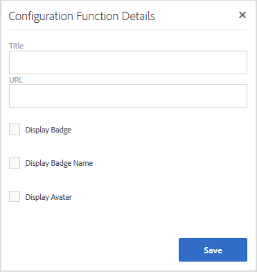

* [Paramètres de titre et d’URL](#title-and-url-settings)

* **Afficher le badge**

  Si cette option est sélectionnée, une colonne pour les icônes de badge est incluse dans le tableau des scores.
  La valeur par défaut est désélectionnée.

* **Afficher le nom du badge**

  Si cette option est sélectionnée, une colonne pour le nom du badge est incluse dans le tableau des scores.
  La valeur par défaut est désélectionnée.

* **Afficher l’avatar**

  Si cette option est sélectionnée, l&#39;image de l&#39;avatar du membre est incluse dans le tableau des scores, à côté de son nom et de son lien vers son profil de membre.
  La valeur par défaut est désélectionnée.

### Fonction Page {#page-function}

La fonction de page ajoute une page vierge au site de la communauté, qui est connectée aux fonctionnalités du site de la communauté : connexion, menu, notifications, messagerie, thème et valorisation de marque. Le contenu est ajouté à la page à l’aide du [mode de création AEM standard](/help/sites-authoring/editing-content.md).

Lorsqu’elle est ajoutée à un modèle, la seule configuration est pour les [Paramètres de titre et d’URL](#title-and-url-settings).

### Fonction Q&amp;R {#qna-function}

La fonction QnA est une page dont le composant [QnA](/help/communities/working-with-qna.md) est configuré pour le balisage, le chargement de fichiers, le suivi, la modification automatique, le vote et la modération.

Lorsqu’elle est ajoutée à un modèle, la configuration permet de restreindre les membres dotés de privilèges :

* [Paramètres de titre et d’URL](#title-and-url-settings)

* **Autoriser l’épinglage**

  Si cette option est sélectionnée, le forum permet d’épingler les réponses au sujet au début de la liste des commentaires. La valeur par défaut est sélectionnée.

* **Autoriser les membres privilégiés**

  Si cette option est sélectionnée, le forum QnA permet uniquement aux membres privilégiés de poser des questions en autorisant la sélection d’un [groupe de membres privilégiés](/help/communities/users.md#privileged-members-group). Si cette option n’est pas sélectionnée, tous les membres de la communauté sont autorisés à publier. La valeur par défaut est désélectionnée.

* **Autoriser les chargements de fichiers**

  Si cette option est sélectionnée, le forum QnA permet aux membres de télécharger des fichiers. La valeur par défaut est sélectionnée.

* **Autoriser les réponses avec thread**

  Si cette option n’est pas sélectionnée, le forum QnA autorise les commentaires (réponses) à une question publiée, mais les réponses aux questions ne sont pas autorisées. La valeur par défaut est sélectionnée.

* **Autoriser le contenu en vedette**

  Si cette option est sélectionnée, son contenu est identifié comme [contenu en vedette](/help/communities/featured.md). La valeur par défaut est sélectionnée.

## Créer une fonction de communauté {#create-community-function}

Pour créer une fonction de communauté, sélectionnez l’icône `Create Community Function` située en haut de la console Fonctions de communauté. Il est possible de créer plusieurs fonctions basées sur le même plan directeur AEM, puis de les personnaliser de manière unique en les ouvrant en mode d’édition Auteur.

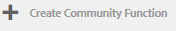

### Nom de fonction de la communauté {#community-function-name}

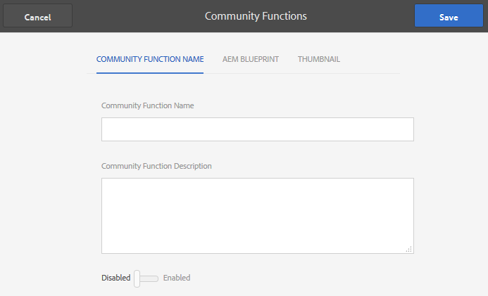

Dans le panneau Nom de la fonction de la communauté, un nom, une description et si la fonction est activée ou désactivée sont configurés :

* **Nom de la fonction communautaire**

  Nom de la fonction utilisé pour l’affichage et le stockage.

* **Description de la fonction communautaire**

  Description de la fonction à afficher.

* **Désactivé/Activé**

  Bouton bascule contrôlant si la fonction est référençable.

### Plan directeur AEM {#aem-blueprint}

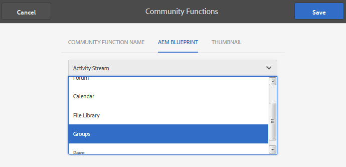

Dans le panneau `AEM Blueprint`, il est possible de sélectionner le plan directeur qui est la mise en œuvre sous-jacente de la fonction communautaire.

La fonction de communauté est un mini site qui comprend une ou plusieurs pages, pré-câblées pour l’inclusion dans un site communautaire, y compris les connexions, les profils utilisateur, les notifications, la messagerie, le menu du site, la recherche, les thèmes et les fonctionnalités d’image de marque. Une fois la fonction créée, il est possible de l’[ouvrir](#open-community-function) en mode d’édition Auteur et de personnaliser les paramètres de la page ou du composant.

Puisque la fonction de communauté est implémentée en tant que [ Live Copy ](/help/sites-administering/msm.md#live-copies) d’un [plan directeur](/help/sites-administering/msm-livecopy.md#creatingablueprint), il est possible de déployer les modifications apportées à une fonction qui affecte toutes les pages du site de la communauté créées à partir du [modèle de site de la communauté](/help/communities/sites.md) ou [modèle de groupe de la communauté](/help/communities/tools-groups.md) qui incluait la fonction. Il est également possible de dissocier une page de son plan directeur parent pour apporter des modifications au niveau de la page.

Voir aussi [Multi Site Manager](/help/sites-administering/msm.md).

### Miniature {#thumbnail}

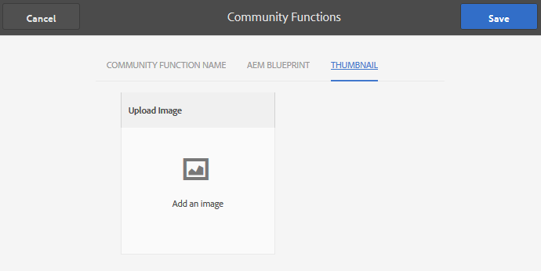

Sur le panneau Miniature, une image peut être chargée pour s’afficher dans la console [Fonctions de la communauté](#community-functions-console).

## Ouvrir la fonction de communauté {#open-community-function}

Sélectionnez l’icône `Open Community Function` pour passer en mode d’édition Auteur afin de créer le contenu de la page et de modifier la configuration du ou des composants de fonctionnalité.

### Configuration des composants {#configuring-components}

Une fonction de communauté est implémentée en tant que Live Copy d’un plan directeur AEM, dont les détails sont documentés sous [Multi Site Manager](/help/sites-administering/msm.md).

Il est possible non seulement de créer du contenu de page, mais aussi de configurer des composants.

Si vous configurez un composant sur une page d’un site communautaire créé, il peut être nécessaire d’annuler l’[héritage](/help/sites-administering/msm-livecopy.md#changing-live-copy-content) pour configurer le composant. L’héritage doit être rétabli une fois la configuration terminée.

Pour plus d’informations sur la configuration, consultez [Composants de communautés](/help/communities/author-communities.md) pour les auteurs.

## Modifier la fonction de communauté {#edit-community-function}

Sélectionnez l’icône `Edit Community Function` pour modifier les propriétés de la fonction à l’aide des mêmes panneaux que [création d’une fonction de communauté](#create-community-function), y compris en activant ou en désactivant la fonction.
