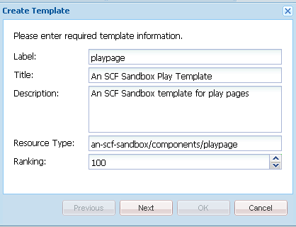
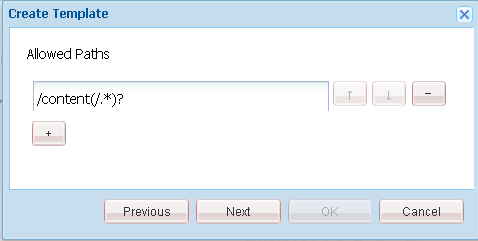
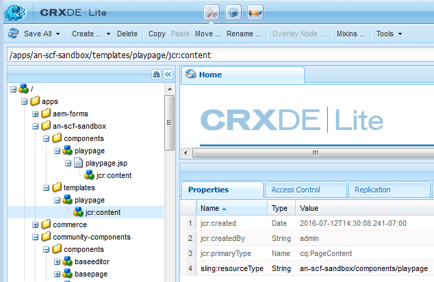

# Application Sandbox Initiale {#initial-sandbox-application}

Dans cette section, vous allez créer les éléments suivants :

* Le **[modèle](#createthepagetemplate)** utilisé pour créer des pages de contenu dans l’exemple de site web.
* Le **[composant et script](#create-the-template-s-rendering-component)** utilisé pour effectuer le rendu des pages du site web.

## Création du modèle de contenu {#create-the-content-template}

Un modèle définit le contenu par défaut d’une nouvelle page. Les sites web complexes peuvent utiliser plusieurs modèles pour créer les différents types de pages du site. De plus, l’ensemble de modèles peut devenir un plan directeur utilisé pour déployer les modifications sur un cluster de serveurs.

Dans cet exercice, toutes les pages sont basées sur un modèle simple.

1. Dans le volet d’exploration de CRXDE Lite :

   * Sélectionnez `/apps/an-scf-sandbox/templates`.
   * **[!UICONTROL Créer]** > **[!UICONTROL Créer un modèle]**

1. Dans la boîte de dialogue Créer un modèle, entrez les valeurs ci-dessous et cliquez ensuite sur **[!UICONTROL Suivant]** :

   * Libellé : `playpage`
   * Titre : `An SCF Sandbox Play Template`
   * Description : `An SCF Sandbox template for play pages`
   * Type de ressource : `an-scf-sandbox/components/playpage`
   * Classement : &lt;Leave as default>

   Le libellé est utilisé pour le nom du nœud.

   Le type de ressource s’affiche sur le nœud de `jcr:content` de l’`playpage` en tant que `sling:resourceType` de propriété. Il identifie le composant (ressource) qui effectue le rendu du contenu lorsqu’un navigateur le demande.

   Dans ce cas, toutes les pages créées à l’aide du modèle de `playpage` sont rendues par le composant `an-scf-sandbox/components/playpage` . Par convention, le chemin d’accès au composant est relatif, ce qui permet à Sling de rechercher la ressource d’abord dans le dossier `/apps` et, si elle n’est pas trouvée, dans le dossier `/libs`.

   

1. Si vous effectuez un copier/coller, assurez-vous que la valeur Type de ressource ne comporte pas d’espaces de début ou de fin.

   Cliquez sur **[!UICONTROL Suivant]**.

1. « Chemins autorisés » fait référence aux chemins d’accès des pages qui utilisent ce modèle, de sorte que le modèle soit répertorié pour la boîte de dialogue **[!UICONTROL Nouvelle page]**.

   Pour ajouter un chemin d’accès, cliquez sur le bouton Plus `+` et saisissez `/content(/.&ast;)?` dans la zone de texte qui s’affiche. Si vous utilisez le copier/coller, assurez-vous qu’il n’y a pas d’espaces de début ou de fin.

   Remarque : la valeur de la propriété de chemin autorisée est une *expression régulière*. Les pages de contenu dont le chemin d’accès correspond à cette expression peuvent utiliser le modèle. Dans ce cas, l’expression régulière correspond au chemin du dossier **/content** et à toutes ses sous-pages.

   Lorsqu’un auteur crée une page sous `/content`, le modèle de `playpage` intitulé « Modèle de page Sandbox SCF » apparaît dans la liste des modèles pouvant être utilisés.

   Une fois la page racine créée à partir du modèle, l’accès au modèle peut être limité à ce site web en modifiant la propriété afin d’inclure le chemin racine dans l’expression régulière.

   `/content/an-scf-sandbox(/.&ast;)?`

   

1. Cliquez sur **[!UICONTROL Suivant]**.

   Cliquez sur **[!UICONTROL Suivant]** dans le panneau **[!UICONTROL Parents autorisés]**.

   Cliquez sur **[!UICONTROL Suivant]** dans le panneau **[!UICONTROL Enfants autorisés]**.

   Cliquez sur **[!UICONTROL OK]**.

1. Une fois que vous avez cliqué sur OK et terminé de créer le modèle, remarquez les triangles rouges qui s’affichent dans les coins des valeurs de l’onglet Propriétés pour le nouveau modèle de `playpage`. Ces triangles rouges indiquent les modifications qui n’ont pas été enregistrées.

   Cliquez sur **[!UICONTROL Enregistrer tout]** pour enregistrer le nouveau modèle dans le référentiel.

   

### Créer le composant de rendu du modèle {#create-the-template-s-rendering-component}

Créez le *composant* qui définit le contenu et effectue le rendu des pages créées à partir du [modèle de page de lecture](#createthepagetemplate).

1. Dans CRXDE Lite, cliquez avec le bouton droit sur **`/apps/an-scf-sandbox/components`**, puis cliquez sur **[!UICONTROL Créer > Composant]**.
1. En définissant le nom du nœud (libellé) sur *playpage*, le chemin d’accès au composant est .

   `/apps/an-scf-sandbox/components/playpage`

   qui correspond au Type de ressource du modèle de page de lecture (éventuellement sans la partie **`/apps/`** initiale du chemin d’accès).

   Dans la boîte de dialogue **[!UICONTROL Créer un composant]**, saisissez les valeurs de propriété suivantes :

   * Libellé : **playpage**
   * Titre : **composant de lecture de sandbox SCF**
   * Description : **Il s’agit du composant qui effectue le rendu du contenu pour une page Sandbox SCF.**
   * Super type : *&lt;Leave blank>*
   * Groupe : *&lt;Leave blank>*

   

1. Cliquez sur **[!UICONTROL Suivant]** jusqu’à ce que le panneau **[!UICONTROL Enfants autorisés]** de la boîte de dialogue s’affiche :

   * Cliquez sur **[!UICONTROL OK]**.
   * Cliquez sur **[!UICONTROL Enregistrer tout]**.

1. Vérifiez que le chemin d’accès au composant et le resourceType du modèle correspondent.

   >[!CAUTION]
   >
   >La correspondance entre le chemin d’accès au composant playpage et la propriété `sling:resourceType` du modèle playpage est essentielle au bon fonctionnement du site web.

   
