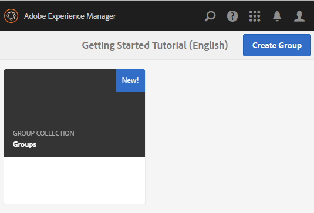
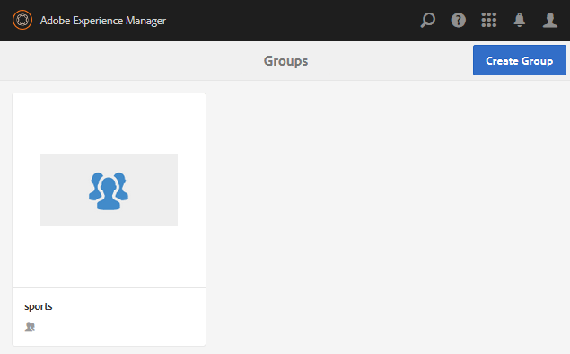
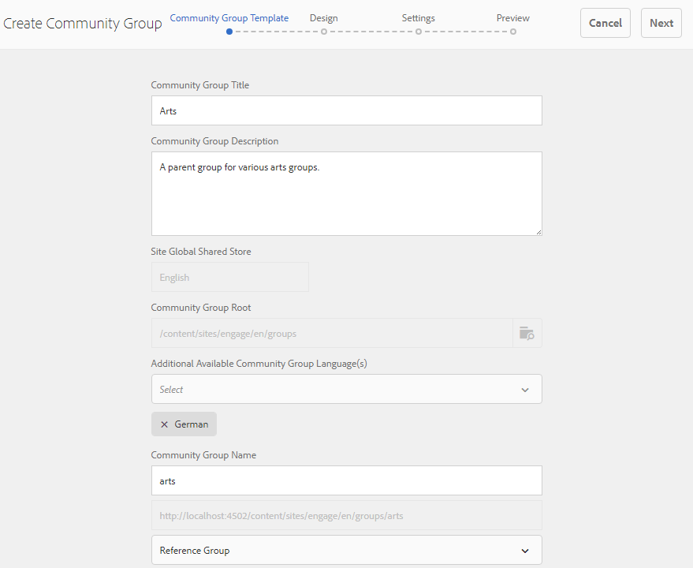
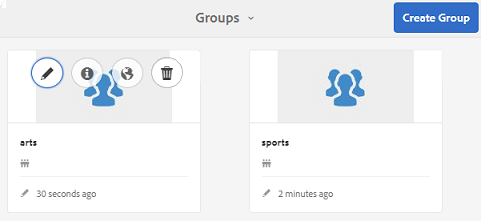
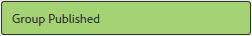
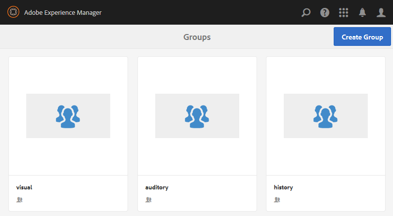

# Création de groupes imbriqués{#authoring-nested-groups}

## Création de groupes sur l’instance de création {#creating-groups-on-author}

Sur l’instance d’auteur AEM, à partir de la navigation globale :

* Sélectionnez **[!UICONTROL Communities]** > **[!UICONTROL Sites]**.
* Sélectionnez **[!UICONTROL dossier engage]** pour l’ouvrir.
* Sélectionnez la vignette du site Anglais **[!UICONTROL Tutoriel de prise en main]**.

  * Sélectionnez l’image de la carte.
  * Ne sélectionnez *d* icône.

Vous pouvez ainsi accéder à la console [Groupes](/help/communities/groups.md) :

La fonction groups s’affiche sous la forme d’un dossier dans lequel les instances de groupes sont créées. Pour l’ouvrir, sélectionnez le dossier Groupes . Le groupe créé lors de la publication est visible.

## Créer un groupe artistique principal {#create-main-arts-group}

Ce groupe peut être créé, car la structure du site pour l’engagement inclut la fonction d’un groupe. La configuration de la fonction dans le `Reference Template` du site autorise par défaut la sélection de n’importe quel modèle de groupe activé. Ainsi, le modèle choisi pour ce nouveau groupe est le `Reference Group`.

Ces consoles sont similaires à la console Sites de communautés .

* Sélectionnez **[!UICONTROL Créer un groupe]**

* **Modèle de groupe de la communauté** :

  * **[!UICONTROL Titre du groupe communautaire]** : Arts
  * **[!UICONTROL Description du groupe communautaire]** : groupe parent pour divers groupes artistiques
  * **[!UICONTROL Racine du groupe de la communauté]** : *laissez l’option par défaut*
  * **[!UICONTROL Langue(s) de groupe de la communauté disponible(s)]** : utilisez le menu déroulant pour sélectionner les langues de groupe de la communauté disponibles. Le menu affiche toutes les langues dans lesquelles le site communautaire parent est créé. Les utilisateurs peuvent sélectionner l’une de ces langues pour créer des groupes dans plusieurs paramètres régionaux au cours de cette seule étape. Le même groupe est créé dans plusieurs langues spécifiées dans la console Groupes des sites communautaires respectifs.
  * **[!UICONTROL Nom du groupe communautaire]** : arts
  * **[!UICONTROL Modèle]** : liste déroulante pour sélectionner `Reference Group`
  * Sélectionnez **[!UICONTROL Suivant]**

Parcourez les autres panneaux avec les paramètres suivants :

* **[!UICONTROL Conception]**

  * Modifiez la conception ou autorisez la conception par défaut du site parent.
  * Sélectionnez **[!UICONTROL Suivant]**.

* **[!UICONTROL Paramètres]**

  * **[!UICONTROL Modération]**

    * Laisser vide (hériter du site parent).

  * **[!UICONTROL Abonnement]**

    * Utiliser les `Optional Membership.` par défaut

    * **[!UICONTROL Miniature]**
      * `optional.*`

    * **[!UICONTROL Sélectionnez Suivant]**.

* Sélectionnez **[!UICONTROL Créer]**.

### Imbrication de groupes dans le groupe Arts {#nesting-groups-within-arts-group}

Le dossier `groups` contient désormais deux groupes (actualisez la page).

#### Publier le groupe {#publish-group}

Avant de créer des groupes imbriqués dans le groupe de `arts`, placez le pointeur de la souris sur la carte de `arts` et sélectionnez l’icône de publication pour la publier.

Attendez la confirmation de la publication du groupe.

Le groupe de `arts` doit également contenir un dossier `groups`, mais un dossier vide dans lequel de nouveaux groupes peuvent être créés. Accédez au dossier de groupes d’arts et créez trois groupes imbriqués, chacun avec un paramètre d’appartenance différent :

1. **[!UICONTROL Visuel]**

   * Titre : `Visual Arts`
   * Nom : `visual`
   * Modèle : `Reference Group`
   * Adhésion : sélectionnez `Optional Membership`, un groupe public, ouvert à tous les membres.

1. **[!UICONTROL Auditif]**

   * Titre : `Auditory Arts`
   * Nom : `auditory`
   * Modèle : `Reference Group`
   * Adhésion : sélectionnez `Required Membership`, un groupe ouvert, auquel les membres peuvent adhérer.

1. **[!UICONTROL Historique]**

   * Titre : `Art History`
   * Nom : `history`
   * Modèle : `Reference Group`
   * Appartenance : sélectionnez `Restricted Membership`, un groupe secret, visible uniquement pour les membres invités. Par exemple, invitez [utilisateur de démonstration](/help/communities/tutorials.md#demo-users) `emily.andrews@mailinator.com`.

Actualisez la page pour afficher les trois groupes imbriqués (sous-communautés).

Pour accéder aux groupes imbriqués à partir de la console Sites de communautés :

* Sélectionnez le dossier **[!UICONTROL engage]**
* Sélectionnez **[!UICONTROL Carte Prise en main du tutoriel]**
* Sélectionnez le dossier **[!UICONTROL Groupes]**
* Sélectionnez **[!UICONTROL carte d’arts]**
* Sélectionnez le dossier **[!UICONTROL Groupes]**

## Groupes de publication {#publishing-groups}

Après avoir publié le site de la communauté principale :

* Publiez chaque groupe individuellement :

  * En attente de confirmation de la publication du groupe.

* Publiez le groupe parent avant de publier tout groupe imbriqué dans :

  * Tous les groupes doivent être publiés de manière descendante.

## Expérience lors de la publication {#experience-on-publish}

Il est possible de tester les différents groupes lors de la connexion, par exemple, avec le [utilisateurs de démonstration](/help/communities/tutorials.md#demo-users) utilisé pour :

* Membre du groupe Art/Histoire : `emily.andrews@mailinator.com/password`
  * Le groupe restreint (secret), arts/history, est visible :
  * Permet d’afficher les groupes facultatifs (publics).
  * Possibilité de rejoindre des groupes restreints (ouverts).

* Responsable de groupe : `aaron.mcdonald@mailinator.com/password`

  * Permet d’afficher les groupes facultatifs (publics).
  * Possibilité de rejoindre des groupes restreints (ouverts).
  * Impossible d’afficher les groupes restreints (secrets).

Accédez aux consoles Communautés [Membres et groupes](/help/communities/members.md) en mode de création pour ajouter d’autres utilisateurs aux différents groupes de membres qui correspondent aux groupes de la communauté.
