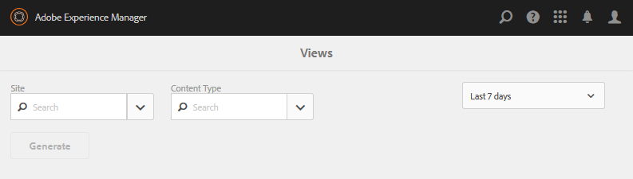
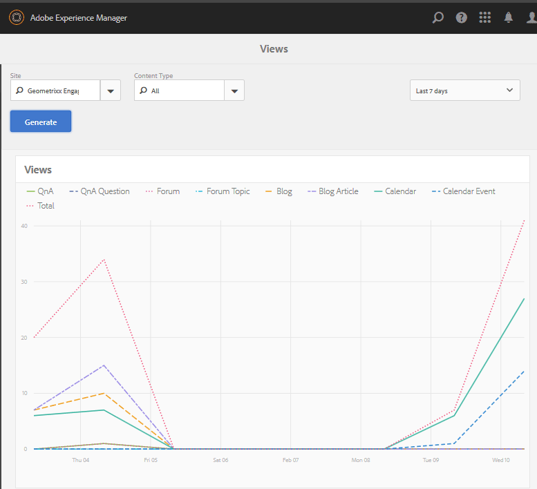
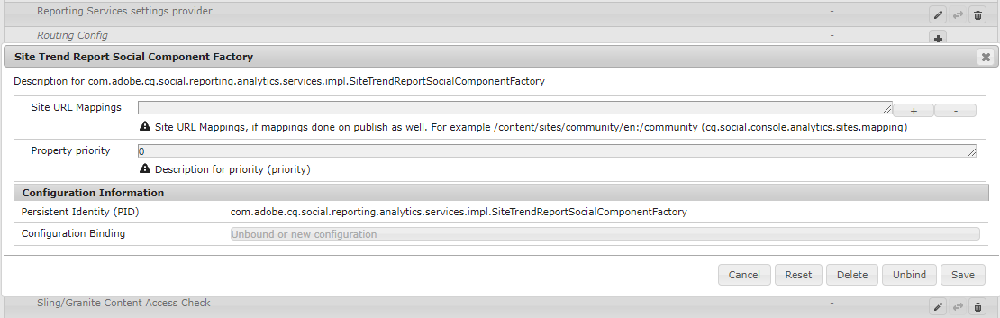

# Console Rapports {#reports-console}

## Vue d’ensemble {#overview}

Pour AEM Communities, différents rapports sont accessibles de différentes manières à partir de l’environnement de création.

En général, les différents rapports sont les suivants :

* [Rapport Vues](#views-report)

  Fournit un graphique des vues du contenu par les membres de la communauté et les visiteurs de n’importe quel site de la communauté.

* [Rapport Publications](#posts-report)

  Fournit un graphique des différents types de publications des membres de la communauté sur n’importe quel site de la communauté.

Les rapports tabulaires peuvent être exportés au format .csv pour un traitement ultérieur.

## Consoles de création de rapports {#reporting-consoles}

### Rapports pour les sites de la communauté {#reports-for-community-sites}

* À partir de la navigation globale : **[!UICONTROL Navigation]** > **[!UICONTROL Communities]** > **[!UICONTROL Reports]**

* Choisir parmi :

  * **[!UICONTROL Rapport d&#39;affectations]**

    * Générer un rapport pour le site, l’utilisateur ou le groupe de la communauté sélectionné et l’affectation.

  * **[!UICONTROL Rapport Publications]**

    * Générer un rapport pour le site communautaire, le type de contenu et la période sélectionnés.

  * **[!UICONTROL Rapport Vues]**

    * générer un rapport pour le site de la communauté, le type de contenu et la période sélectionnés.

## Rapport des vues {#views-report}

La console Vues permet de générer des rapports sur les pages vues par les fonctionnalités de communauté pendant une période donnée.

Sélectionnez les critères du rapport :

* **[!UICONTROL Site]**

  Sélectionnez un site communautaire.

* **[!UICONTROL Type de contenu]**

  Vous pouvez choisir Tout le contenu ou sélectionner l’une des fonctionnalités présentes sur le site.

* **[!UICONTROL Période]**

  Sélectionnez l’une des options suivantes :

  * 7 derniers jours
  * 30 derniers jours
  * 90 derniers jours
  * Année dernière

Sélectionnez **[!UICONTROL Générer]** pour créer le rapport.

## Rapport des publications {#posts-report}

La console Publications permet de générer des rapports sur le nombre de publications dans les fonctionnalités de la communauté pour une période donnée.

Sélectionnez les critères du rapport :

* **[!UICONTROL Site]**

  Sélectionnez un site communautaire.

* **[!UICONTROL Type de contenu]**

  Vous pouvez choisir Tout le contenu ou sélectionner l’une des fonctionnalités présentes sur le site.

* **[!UICONTROL Période]**

  Sélectionnez l’une des options suivantes :

  * 7 derniers jours
  * 30 derniers jours
  * 90 derniers jours
  * Année dernière

Sélectionnez **[!UICONTROL Générer]** pour créer le rapport.

## Résolution des problèmes {#troubleshooting}

### Aucun site communautaire répertorié {#no-community-sites-listed}

Si aucun site communautaire n’est répertorié, assurez-vous qu’Adobe Analytics a été activé pour un site. Si vous choisissez des rapports sur les affectations, assurez-vous que la fonction Affectations figure dans la structure du site de la communauté.

### Les rapports ne s’affichent pas dans l’instance d’auteur AEM {#reports-do-not-show-in-aem-author-instance}

Si les rapports ne s’affichent pas dans l’instance de création AEM, recherchez les personnalisations, telles que le mappage d’URL sur l’instance de publication. Si le mappage des URL est effectué uniquement sur l’instance de publication AEM du site des communautés, assurez-vous que le même élément a été configuré dans l’instance de création AEM dans la configuration **Fabrique de composants sociaux du rapport de tendance du site**.

