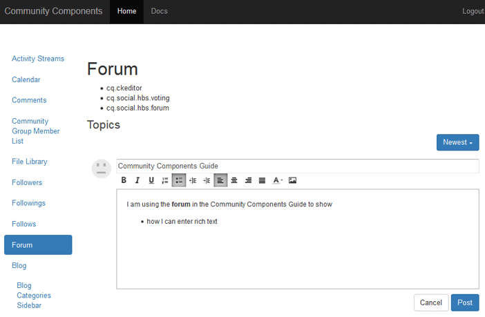

# Principes de base de l’éditeur de texte enrichi {#rich-text-editor-essentials}

## Vue d’ensemble {#overview}

L’éditeur de texte enrichi vous permet de saisir du texte avec des balises.

Pour les composants de communautés, tout en étant similaire à l’éditeur de texte enrichi [&#x200B; dans l’environnement de création](../../help/sites-authoring/rich-text-editor.md), il affecte le texte saisi dans l’environnement de publication.



## Activation de l’éditeur de texte enrichi {#enabling-rich-text-editor}

Les composants de Communities qui autorisent le contenu généré par l’utilisateur peuvent être activés pour autoriser l’éditeur de texte enrichi. Si le composant a été ajouté à une page ou inclus dans une [fonction](functions.md), l’éditeur de texte enrichi peut être activé ou non par défaut.

Si cette option n’est pas activée, passez simplement en mode d’édition [auteur](sites-console.md#authoring-site-content), sélectionnez le composant à modifier, puis cochez la case `Rich Text Editor`.

L’éditeur de texte enrichi est disponible pour les composants de communautés suivants :

* [Blog](blog-feature.md)
* [Calendrier](calendar.md)
* [Commentaires](comments.md)
* [Filelibrary](file-library.md)
* [Forum](forum.md)
* [Message](configure-messaging.md)
* [Q&amp;R](working-with-qna.md)
* [Révisions](reviews.md)

## Personnalisation {#customization}

La personnalisation de l’éditeur de texte enrichi est possible, car l’implémentation est basée sur [CKEditor](https://ckeditor.com/).

La configuration actuelle des composants de Communities se trouve dans le `cq.social.  scf   clientlib` , dans le référentiel à l’adresse .

`/libs/clientlibs/social/commons/scf/ckrte.js`

La modification de la bibliothèque cliente cq.social.scf n’est pas recommandée, car les mises à niveau ultérieures peuvent remplacer toutes les modifications.

### Exemple de personnalisation : liens intégrés {#example-customization-inline-links}

Pour des raisons de sécurité, les options d’hyperlien ne sont pas incluses dans l’ensemble d’icônes de texte enrichi présenté aux membres par défaut. La possibilité de méfait est étendue lorsque les hrefs sont autorisés dans le contenu créé par l’utilisateur.

Pour ajouter les options de lien hypertexte à la barre d’outils :

* Ajoutez une barre d’outils nommée « `links` »
  * `{ name: 'links', items: [ 'Link','Unlink','Anchor' ] }`
* Sélectionnez **[!UICONTROL Enregistrer tout]**

#### /libs/clientlibs/social/commons/scf/ckrte.js {#libs-clientlibs-social-commons-scf-ckrte-js}

```
CKRte.prototype.config = {
    toolbar: [
        { name: "basicstyles",
           items: ["Bold", "Italic", "Underline", "NumberedList", "BulletedList", "Outdent", "Indent", "JustifyLeft", "JustifyCenter", "JustifyRight", "JustifyBlock", "TextColor"]
        },
        { name: 'links',
           items: [ 'Link','Unlink','Anchor' ]
        }
    ],
    autoParagraph: false,
    autoUpdateElement: false,
    removePlugins: "elementspath",
    resize_enabled: false
};
```
