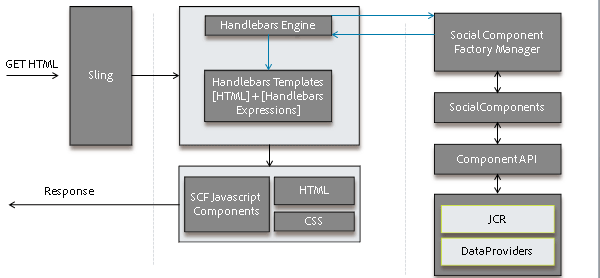
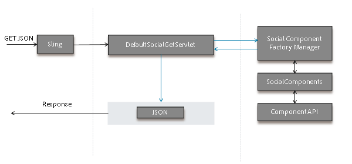
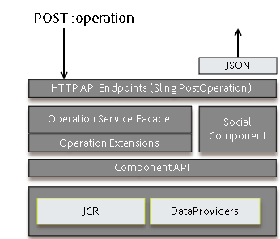

# Structure des composants sociaux {#social-component-framework}

La structure des composants sociaux (SCF) simplifie le processus de configuration, de personnalisation et d’extension des composants de communautés à la fois côté serveur et côté client.

Avantages du cadre :

* **Fonctionnel** : facilité d’intégration prête à l’emploi avec peu ou pas de personnalisation pour 80 % des cas d’utilisation.
* **Enveloppable** : utilisation cohérente des attributs HTML pour le style CSS.
* **Extensible** : l’implémentation des composants est orientée objet et s’appuie sur une logique commerciale simple : il est facile d’ajouter un identifiant professionnel incrémentiel sur le serveur.
* **Flexible** : modèles JavaScript simples, sans logique, qui sont facilement superposés et personnalisés.
* **Accessible** : l’API HTTP prend en charge la publication depuis n’importe quel client, y compris les applications mobiles.
* **Portable** : intégration à une page web quelle qu’elle soit, quelle que soit la technologie utilisée.

Explorez une instance de création ou de publication à l’aide du guide interactif [Guide des composants de communauté](components-guide.md).

## Vue d’ensemble {#overview}

Dans SCF, un composant est composé d’un POJO SocialComponent, d’un modèle JS Handlebars (pour effectuer le rendu du composant) et d’un CSS (pour appliquer un style au composant).

Un modèle JS Handlebars peut étendre les composants JS de modèle/vue afin de gérer l’interaction de l’utilisateur avec le composant sur le client.

Si un composant doit prendre en charge la modification des données, l’implémentation de l’API SocialComponent peut être écrite de manière à prendre en charge la modification/l’enregistrement de données similaires aux objets de modèle/données dans les applications web traditionnelles. En outre, des opérations (contrôleurs) et un service d’opération peuvent être ajoutés pour gérer les demandes d’opération, exécuter la logique commerciale et appeler les API sur les objets de modèle/données.

L’API SocialComponent peut être étendue pour fournir les données requises par un client pour une couche de vue ou un client HTTP.

### Rendu des pages pour le client {#how-pages-are-rendered-for-client}



### Personnalisation et extension des composants {#component-customization-and-extension}

Pour personnaliser ou étendre les composants, vous écrivez uniquement les recouvrements et les extensions dans votre répertoire /apps, ce qui simplifie le processus de mise à niveau vers les versions ultérieures.

* Pour l’application d’une peau :
  * Seule la [CSS doit être modifiée](client-customize.md#skinning-css).
* Pour l’apparence :
  * Modifiez le modèle JS et le CSS.
* Pour l’apparence et l’expérience utilisateur :
  * Modifiez le modèle JS, le CSS et [extend/override JavaScript](client-customize.md#extending-javascript).
* Pour modifier les informations disponibles pour le modèle JS ou le point d’entrée GET :
  * Étendez le [SocialComponent](server-customize.md#socialcomponent-interface).
* Pour ajouter un traitement personnalisé lors des opérations :
  * Écrivez une [OperationExtension](server-customize.md#operationextension-class).
* Pour ajouter une opération personnalisée :
  * Créez une [opération de publication Sling](server-customize.md#postoperation-class).
  * Utilisez les [OperationServices](server-customize.md#operationservice-class) existants si nécessaire.
  * Ajoutez le code JavaScript pour appeler votre opération du côté client selon les besoins.

## Framework Côté Serveur {#server-side-framework}

La structure fournit des API pour accéder aux fonctionnalités sur le serveur et prendre en charge l’interaction entre le client et le serveur.

### API Java™ {#java-apis}

Les API Java™ fournissent des classes et des interfaces abstraites qui sont facilement héritées ou sous-classées.

Les principales classes sont décrites sur la page [Personnalisation côté serveur](server-customize.md).

Consultez [Présentation du fournisseur de ressources de stockage](srp.md) pour en savoir plus sur l’utilisation du contenu créé par l’utilisateur.

### API HTTP {#http-api}

L’API HTTP prend en charge la personnalisation et le choix faciles des plateformes clientes pour les applications PhoneGap, les applications natives et d’autres intégrations et schémas. En outre, l’API HTTP permet à un site communautaire de s’exécuter en tant que service sans client, de sorte que les composants de structure puissent être intégrés dans n’importe quelle page web reposant sur n’importe quelle technologie.

### API HTTP - Requêtes GET {#http-api-get-requests}

Pour chaque composant social, le framework fournit un point d’entrée d’API basé sur HTTP. Le point d’entrée est accessible en envoyant une requête GET à la ressource avec un sélecteur « .social.json » + extension. Avec Sling, la requête est transmise au `DefaultSocialGetServlet`.

**`DefaultSocialGetServlet`**

1. Transmet la ressource (resourceType) au `SocialComponentFactoryManager` et reçoit un SocialComponentFactory capable de sélectionner un `SocialComponent` représentant la ressource.

1. Elle appelle la fabrique et reçoit une `SocialComponent` capable de gérer la ressource et la requête.
1. Elle appelle la `SocialComponent`, qui traite la requête et renvoie une représentation JSON des résultats.
1. Renvoie la réponse JSON au client.

**`GET Request`**

Un servlet GET par défaut écoute les requêtes .social.json auxquelles le composant social répond avec du code JSON personnalisable.



### API HTTP - Requêtes POST {#http-api-post-requests}

Outre les opérations GET (lecture), le framework définit un modèle de point d’entrée pour activer d’autres opérations sur un composant, y compris Créer, Mettre à jour et Supprimer. Ces points d’entrée sont des API HTTP qui acceptent des entrées et répondent avec un code d’état HTTP ou un objet de réponse JSON.

Ce modèle de point d’entrée de framework rend les opérations CUD extensibles, réutilisables et testables.

**`POST Request`**

Il existe un POST Sling:operation pour chaque opération de SocialComponent. La logique commerciale et le code de maintenance de chaque opération sont enveloppés dans un OperationService accessible via l’API HTTP ou depuis un autre emplacement en tant que service OSGi. Des crochets sont fournis pour prendre en charge les extensions d’opération enfichables pour les actions avant/après.



### Fournisseur de ressources de stockage (SRP) {#storage-resource-provider-srp}

Pour en savoir plus sur la gestion du contenu créé par l’utilisateur stocké dans le [magasin de contenu de la communauté](working-with-srp.md), voir :

* [Présentation du fournisseur de ressources de stockage](srp.md) - Introduction et présentation de l’utilisation du référentiel.
* [SRP et UGC Essentials](srp-and-ugc.md) - Méthodes et exemples d’utilitaires d’API SRP.
* [Accès au contenu créé par l’utilisateur avec SRP](accessing-ugc-with-srp.md) - Instructions de codage.

### Personnalisations côté serveur {#server-side-customizations}

Consultez [Personnalisations côté serveur](server-customize.md) pour plus d’informations sur la personnalisation de la logique commerciale et du comportement d’un composant Communities côté serveur.

## Langage de modèle JS Handlebars {#handlebars-js-templating-language}

L’un des changements les plus remarquables du nouveau cadre est l’utilisation du langage de modèle `Handlebars JS` (HBS), une technologie open source populaire pour le rendu serveur-client.

Les scripts HBS sont simples, sans logique, compilés sur le serveur et le client, faciles à superposer et à personnaliser et naturellement liés à l’expérience utilisateur client, car HBS prend en charge le rendu côté client.

Le framework fournit plusieurs [assistants Handlebars](handlebars-helpers.md) qui sont utiles lors du développement de SocialComponents.

Sur le serveur, lorsque Sling résout une requête GET, il identifie le script utilisé pour répondre à la requête. Si le script est un modèle HBS (.hbs), Sling délègue la requête au moteur Handlebars. Le moteur Handlebars récupère ensuite le SocialComponent dans le SocialComponentFactory approprié, crée un contexte et effectue le rendu de l’HTML.

### Aucune restriction d’accès {#no-access-restriction}

Les fichiers de modèle Handlebars (HBS) (.hbs) sont analogues aux fichiers de modèle .jsp et .html, sauf qu’ils peuvent être utilisés pour le rendu à la fois dans le navigateur client et sur le serveur. Par conséquent, un navigateur client qui demande un modèle côté client reçoit un fichier .hbs du serveur.

Pour ce faire, tous les modèles HBS du chemin de recherche Sling (tous les fichiers .hbs situés sous /libs/ ou /apps) doivent pouvoir être récupérés par n’importe quel utilisateur à partir de l’instance de création ou de publication.

L’accès HTTP aux fichiers .hbs ne peut pas être interdit.

### Ajouter ou inclure un composant de communautés {#add-or-include-a-communities-component}

La plupart des composants de Communities doivent être *ajoutés* comme ressource adressable Sling. Certains composants de Communities peuvent être *inclus* dans un modèle en tant que ressource non existante afin de permettre l’inclusion dynamique et la personnalisation de l’emplacement d’écriture du contenu créé par l’utilisateur.

Dans les deux cas, les [bibliothèques clientes requises](clientlibs.md) du composant doivent également être présentes.

**Ajouter un composant**

L’ajout d’un composant fait référence au processus d’ajout d’une instance d’une ressource (composant), par exemple lorsqu’elle est glissée depuis le navigateur de composant (sidekick) sur une page en mode d’édition création.

Le résultat est un nœud enfant JCR sous un nœud par, qui est adressable Sling.

**Inclure un composant**

L’inclusion d’un composant fait référence au processus d’ajout d’une référence à une [ ressource « non existante »](srp.md#for-non-existing-resources-ners) (aucun nœud JCR) dans le modèle, par exemple à l’aide d’un langage de script.

Depuis Adobe Experience Manager (AEM) 6.1, lorsqu’un composant est inclus dynamiquement au lieu d’être ajouté, il est possible de modifier les propriétés du composant en mode de création *conception*.

Seuls quelques-uns des composants AEM Communities sélectionnés peuvent être inclus dynamiquement. Il s’agit des éléments suivants :

* [Commentaires](essentials-comments.md)
* [Évaluation](rating-basics.md)
* [Révisions](reviews-basics.md)
* [Votant](essentials-voting.md)

Le [Guide des composants de communauté](components-guide.md) permet d’activer/désactiver les composants inclusibles de leur ajout à leur inclusion.

**Lors de l’utilisation de Handlebars** le langage de modèle, la ressource non existante est incluse à l’aide de l’[assistant d’inclusion](handlebars-helpers.md#include) en spécifiant son resourceType :

`{{include this.id path="comments" resourceType="social/commons/components/hbs/comments"}}`

**Lors de l’utilisation de JSP**, une ressource est incluse à l’aide de la balise [cq:include](../../help/sites-developing/taglib.md#lt-cq-include) :

```
<cq:include path="votes"
 resourceType="social/tally/components/voting" />
```

>[!NOTE]
>
>Pour ajouter dynamiquement un composant à une page, au lieu de l’ajouter ou de l’inclure dans un modèle, consultez [Chargement latéral de composants](sideloading.md).

### Handlebars Helpers {#handlebars-helpers}

Consultez [Assistant Handlebars SCF](handlebars-helpers.md) pour obtenir une liste et une description des assistants personnalisés disponibles dans SCF.

## Framework Côté Client {#client-side-framework}

### Framework JavaScript de vue de modèle {#model-view-javascript-framework}

Ce framework comprend une extension de [Backbone.js](https://backbonejs.org/), un framework JavaScript de vue de modèle, pour faciliter le développement de composants riches et interactifs. La nature orientée objet prend en charge une structure extensible/réutilisable. La communication entre le client et le serveur est simplifiée avec l’API HTTP.

La structure utilise des modèles Handlebars côté serveur pour effectuer le rendu des composants pour le client. Les modèles sont basés sur les réponses JSON générées par l’API HTTP. Les vues se lient à HTML générées par les modèles Handlebars et offrent de l’interactivité.

### Conventions CSS {#css-conventions}

Les conventions suivantes sont recommandées pour définir et utiliser des classes CSS :

* Utilisez des noms de sélecteur de classe CSS avec un espace de noms clair et évitez les noms génériques tels que « titre » et « image ».
* Définissez des styles de sélecteur de classe spécifiques pour que les feuilles de style CSS fonctionnent bien avec d’autres éléments et styles de la page. Par exemple : `.social-forum .topic-list .li { color: blue; }`
* Gardez les classes CSS pour le style séparées des classes CSS pour l’expérience utilisateur pilotée par JavaScript.

### Personnalisations côté client {#client-side-customizations}

Pour personnaliser l’aspect et le comportement d’un composant Communities côté client, reportez-vous à la section [Personnalisations côté client](client-customize.md) qui contient des informations sur :

* [Recouvrements](client-customize.md#overlays)
* [Extensions](client-customize.md#extensions)
* [Balisage HTML](client-customize.md#htmlmarkup)
* [CSS d’application de la peau](client-customize.md#skinning-css)
* [Extension de JavaScript](client-customize.md#extending-javascript)
* [Bibliothèques clientes pour SCF](client-customize.md#clientlibs-for-scf)

## Principes de base des fonctionnalités et composants {#feature-and-component-essentials}

Les informations essentielles pour l’équipe de développement sont décrites dans la section [Principes de base des fonctionnalités et des composants](essentials.md).

Pour plus d’informations sur le développeur, consultez la section [Consignes de codage](code-guide.md).

## Résolution des problèmes {#troubleshooting}

Les problèmes courants et connus sont décrits dans la section [Dépannage](troubleshooting.md).
