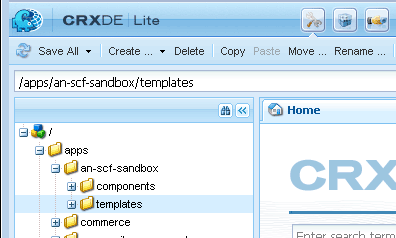
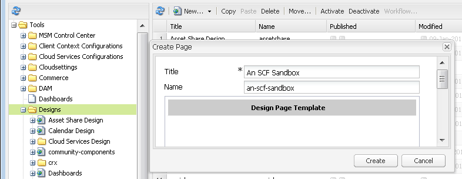
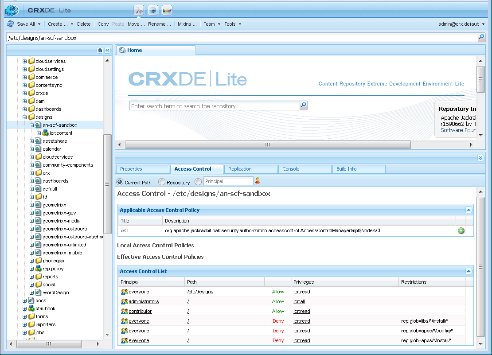

# Configuration de la structure du site web {#setup-website-structure}

Pour configurer votre site web, les instructions ci-dessous décrivent les dossiers à créer dans les emplacements suivants :

* `/apps/an-scf-sandbox`

  C’est là que se trouvent les applications et les modèles personnalisés.

* `/etc/designs/an-scf-sandbox`

  C’est là que se trouvent les éléments de conception téléchargeables.

* `/content/an-scf-sandbox`

  C’est là que se trouvent les pages web téléchargeables.

Le code de ce tutoriel repose sur le fait que le nom du dossier principal est le même pour l’application, la conception et le contenu. Si vous choisissez un autre nom pour votre site web, remplacez toujours `an-scf-sandbox` par le nom que vous avez choisi.

>[!NOTE]
>
>À propos des noms :
>
>* Les noms affichés dans CRXDE sont des noms de nœud qui forment le chemin d’accès au contenu adressable.
>* Les noms de nœud peuvent contenir des espaces, mais lorsqu’ils sont utilisés dans un URI, l’espace doit être codé sous la forme « %20 » ou « + ».
>* Les noms de nœud peuvent contenir des tirets et des traits de soulignement, mais ils doivent être codés lorsqu’ils sont référencés en tant que nom de package dans un fichier Java™. Les tirets et les traits de soulignement sont placés dans une séquence d’échappement avec un trait de soulignement suivi de leur valeur Unicode :
>
>   * le tiret devient &#39;_002d&#39;
>   * le trait de soulignement devient &#39;_005f&#39;

## Configurer le répertoire d’applications (/apps) {#setup-the-application-directory-apps}

Le répertoire /apps du référentiel contient le code avec implémente le comportement et le rendu des pages diffusées à partir du répertoire /content.

Le répertoire /apps est protégé et n’est pas accessible au public, tout comme les répertoires /content et /etc/designs.

1. Créez un dossier `/apps/an-scf-sandbox`.

   Utilisation de ****, dans le volet de l&#39;explorateur

   1. Sélectionnez le dossier `/apps`.
   1. Cliquez avec le bouton droit de la souris **[!UICONTROL Créer]**... ou faites glisser le menu **[!UICONTROL Créer...]** vers le bas.
   1. Sélectionnez **[!UICONTROL Créer un dossier...]**.
   1. Dans la boîte de dialogue **[!UICONTROL Créer un dossier]**, saisissez `an-scf-sandbox`.
   1. Cliquez sur **[!UICONTROL OK]**.

1. Créez le sous-dossier **[!UICONTROL components]**.

   1. Sélectionnez le dossier `/apps/an-scf-sandbox`.
   1. Cliquez sur **[!UICONTROL Créer > Créer un dossier]**.
   1. Dans la boîte de dialogue **[!UICONTROL Créer un dossier]**, saisissez **[!UICONTROL composants]**.
   1. Cliquez sur **[!UICONTROL OK]**.

1. Créez **[!UICONTROL modèles]** sous-dossier .

   1. Sélectionnez le dossier `/apps/an-scf-sandbox`.
   1. Cliquez sur **[!UICONTROL Créer > Créer un dossier]**.
   1. Dans la boîte de dialogue **[!UICONTROL Créer un dossier]**, saisissez **[!UICONTROL modèles]**.
   1. Cliquez sur **[!UICONTROL OK]**.
   1. Sélectionnez à nouveau `/apps/an-scf-sandbox`.
   1. Sélectionnez **[!UICONTROL Enregistrer tout]**.

   Comme pour tout processus de modification, vous devez enregistrer souvent. Si vous rencontrez des problèmes lors de la saisie des données, cela peut être dû au fait que votre connexion a expiré ou que vous devez enregistrer les modifications précédentes.

1. La structure du volet d’exploration de CRXDE Lite doit maintenant ressembler à ceci :

   

## Configurer le répertoire de conception (/etc/designs) {#setup-the-design-directory-etc-designs}

Le répertoire /etc/designs contient les images, scripts et feuilles de style à télécharger ainsi que le contenu de la page.

1. Pour utiliser l’outil Designer dans l’interface utilisateur classique, accédez à [https://&lt;server>:&lt;port>/miscadmin](http://localhost:4502/miscadmin).

   Remarque : si vous utilisez CRXDE Lite pour créer un nœud de type `cq:Page`, le contrôle d’accès et la réplication ne sont pas définis sur les paramètres par défaut d’une page.

1. Dans le volet d’exploration, sélectionnez le dossier **[!UICONTROL Conceptions]**, puis cliquez sur **[!UICONTROL Nouveau]** > **[!UICONTROL Nouvelle page]**.

   Enter :

   * Titre : **[!UICONTROL un sandbox SCF]**
   * Nom : **[!UICONTROL an-scf-sandbox]**
   * Sélectionnez **[!UICONTROL Modèle de page de conception]**

   Cliquez sur **[!UICONTROL Créer]**.

   

1. Actualisez le volet de l’explorateur si le dossier « Sandbox SCF » n’apparaît pas.

1. Revenez à CRXDE Lite (http:// localhost:4502/crx/de) et développez /etc/designs pour afficher le nœud nommé « an-scf-sandbox ».

   Dans le volet inférieur droit de CRXDE, vous pouvez afficher les onglets Propriétés, Contrôle d’accès et Réplication pour voir ce qui a été défini à l’aide du modèle de page de conception.

   

## Configurer le répertoire de contenu (/content) {#setup-the-content-directory-content}

Le répertoire /content dans le référentiel est l’emplacement où réside le contenu du site web. Les chemins d’accès situés sous /content comprennent ceux de l’URL pour les requêtes de navigateur.

*Après* le [modèle de page](initial-app.md#createthepagetemplate) est créé dans le cadre de l’application initiale, le contenu de page initial peut être créé en fonction du modèle.... [**⇒**](initial-app.md)
