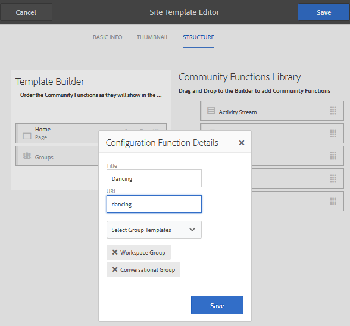

# Modèles de site {#site-templates}

La console Modèles de site est similaire à la console [Modèles de groupe](tools-groups.md), qui se concentre sur les fonctions présentant un intérêt pour les groupes de la communauté.

>[!NOTE]
>
>Les consoles de création de [sites de la communauté](sites-console.md), [modèles de site de la communauté](sites.md), [modèles de groupe de la communauté](tools-groups.md) et [fonctions de la communauté](functions.md) doivent être utilisées uniquement dans l’environnement de création.

## Console Modèles de site {#site-templates-console}

Dans l’environnement de création, pour accéder à la console des sites de la communauté :

* Dans la navigation globale : **[!UICONTROL Outils > Communautés > Modèles de site]**

Cette console affiche les modèles à partir desquels un [site communautaire](sites-console.md) peut être créé et permet de créer de nouveaux modèles de site.

## Créer un modèle de site {#create-site-template}

Pour commencer à créer un modèle de site, sélectionnez `Create`.

Cette action ouvre le panneau Éditeur de site qui contient trois sous-panneaux :

### Informations de base {#basic-info}

Dans le panneau Informations de base , un nom, une description et si le modèle est activé ou désactivé sont configurés :

* **[!UICONTROL Nom du modèle de site communautaire]**

  Identifiant du nom du modèle.

* **[!UICONTROL Description du modèle de site communautaire]**

  Description du modèle.

* **[!UICONTROL Désactivé/Activé]**

  Bouton bascule contrôlant si le modèle est référençable.

### Miniature {#thumbnail}

(Facultatif) Sélectionnez l’icône Charger l’image pour afficher une miniature avec le nom et la description aux créateurs et créatrices de sites de la communauté.

### Structure {#structure}

Pour ajouter des fonctions de communauté, faites glisser du côté droit vers la gauche dans l’ordre dans lequel les liens du menu du site doivent apparaître. Les styles sont appliqués au modèle lors de la création du site.

Par exemple, si vous souhaitez une page d’accueil, faites glisser la fonction Page depuis la bibliothèque et déposez-la sous le créateur de modèles. La boîte de dialogue de configuration de la page s’ouvre alors. Voir la [console des fonctions](functions.md) pour plus d’informations sur les boîtes de dialogue de configuration.

Continuez à faire glisser et à déposer toutes les autres fonctions de communauté souhaitées pour un site de communauté basé sur ce modèle.

La fonction page fournit une page vide. La fonction Groupes permet de créer un site de groupe (sous-communauté) dans le site de la communauté.

>[!CAUTION]
>
>La fonction Groupes ne doit *pas être la première ni la seule* fonction de la structure du site.
>
>Toute autre fonction, telle que la fonction [page](functions.md#page-function), doit être incluse et répertoriée en premier.

### Modèles de groupe pour la fonction Groupes {#group-templates-for-groups-function}

Lors de l’inclusion d’une fonction Groupes dans le modèle de site, la configuration nécessite la spécification des choix de modèle de groupe autorisés lorsqu’un nouveau groupe est créé dans l’environnement de publication.

>[!CAUTION]
>
>La fonction Groupes ne doit *pas être la première ni la seule* fonction de la structure du site.

En sélectionnant au moins deux modèles de groupe de la communauté, l’administrateur du groupe a le choix lors de la création réelle d’un groupe dans la communauté.

## Modifier le modèle de site {#edit-site-template}

Lors de l’affichage des modèles de site dans la console principale [Modèles de site](#site-templates-console), il est possible de sélectionner un modèle de site existant à modifier.

Ce processus fournit les mêmes panneaux que [création d’un modèle de site](#create-site-template).
