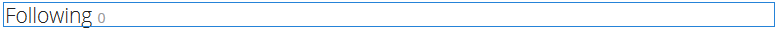

# Utilisation du graphique des réseaux sociaux {#using-social-graph}

## Présentation {#introduction}

La capacité d’un membre de la communauté à suivre des [activités](activities.md) et à être suivi est établie par deux volets : `Follow` et `Following`.

Le composant `Follow` doit être associé à une autre ressource. Cette association est déjà établie pour les membres et les fonctionnalités de la communauté.

Le composant `Following` répertorie simplement les membres qui suivent le membre actif ou qui sont suivis par le membre actif. Ce graphique social des relations entre les membres est inclus dans le profil utilisateur établi pour un [site communautaire](overview.md#communitiessites).

## Ajout des éléments suivants à une page {#adding-following-to-a-page}

Si vous souhaitez ajouter un composant `Following` à une page en mode de création, localisez le composant `Communities / Following` et faites-le glisser sur une page où le graphique de réseau social doit apparaître.

Pour plus d’informations, consultez [Principes de base des composants de communautés](basics.md).

Lorsque les [bibliothèques côté client requises](essentials-socialgraph.md#essentials-for-client-side) sont incluses, le composant `Following` s’affiche de la manière suivante :

## Configuration des éléments suivants {#configuring-following}

Actuellement, il est nécessaire de définir la propriété pour déterminer si le composant affiche la relation `follows` ou la relation `following`.

## Informations supplémentaires {#additional-information}

Pour plus d’informations, consultez la page [Social Graph Essentials](essentials-socialgraph.md) destinée aux développeurs et développeuses.
