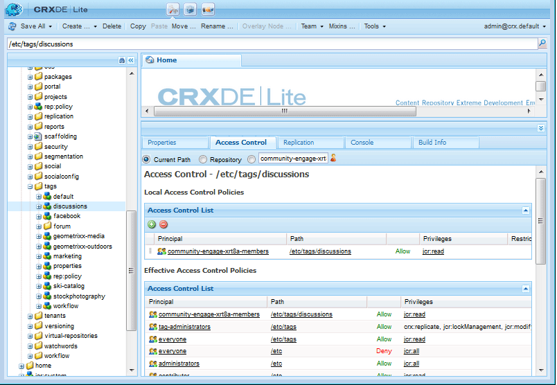

# Balisage de contenu généré par l’utilisateur {#tagging-user-generated-content}

## Vue d’ensemble {#overview}

Le balisage du contenu créé par l’utilisateur est le moyen par lequel les membres de la communauté peuvent aider d’autres membres à rechercher du contenu.

En règle générale, les balises sont appliquées par les auteurs et les administrateurs dans l’environnement de création. Le balisage du contenu créé par l’utilisateur est unique dans la mesure où les balises UGC sont appliquées par les membres de la communauté dans l’environnement de publication.

Les espaces de noms de balises et les taxonomies sont identiques pour les deux applications.

## Fonctionnalités de Communities {#communities-features}

Les fonctionnalités d’AEM Communities qui peuvent être configurées pour permettre le balisage sont les suivantes :

* [Blog](blog-feature.md)
* [Calendrier](calendar.md)
* [Bibliothèque de fichiers](file-library.md)
* [Forum](forum.md#configuretheaddedforum)
* [Questions et réponses](working-with-qna.md)

## Administration des balises {#administering-tags}

Voir [Administration des balises](../../help/sites-administering/tags.md#tagging-console) pour créer et gérer des espaces de noms de balises et des taxonomies.

Voir [Tag Essentials](tag.md) pour plus d’informations sur le développement.

Consultez la section [Utilisation du cloud de balises sociales](tagcloud.md) pour ajouter un composant cloud de balises sociales à une page afin de faciliter la recherche du contenu créé par l’utilisateur publié à l’aide des balises appliquées.

### Autorisations des balises {#tag-permissions}

Les autorisations par défaut sont définies de manière à ne pas autoriser la lecture des espaces de noms de balises par tout le monde dans l’environnement de publication.

Étant donné que les balises sont appliquées au contenu créé par l’utilisateur dans l’environnement de publication, l’autorisation de lecture doit être activée pour que les membres de la communauté puissent sélectionner les balises à appliquer.

Voir [ Définition des autorisations de balises ](../../help/sites-administering/tags.md#setting-tag-permissions).

Voici comment cela apparaît dans CRXDE lorsqu’un administrateur applique des autorisations de lecture aux `/etc/tag/discussions` pour le groupe `Community Engage Members`.

