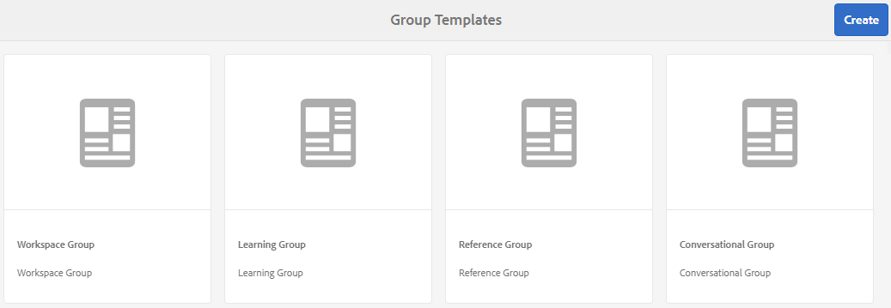
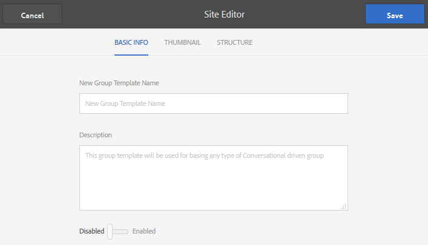
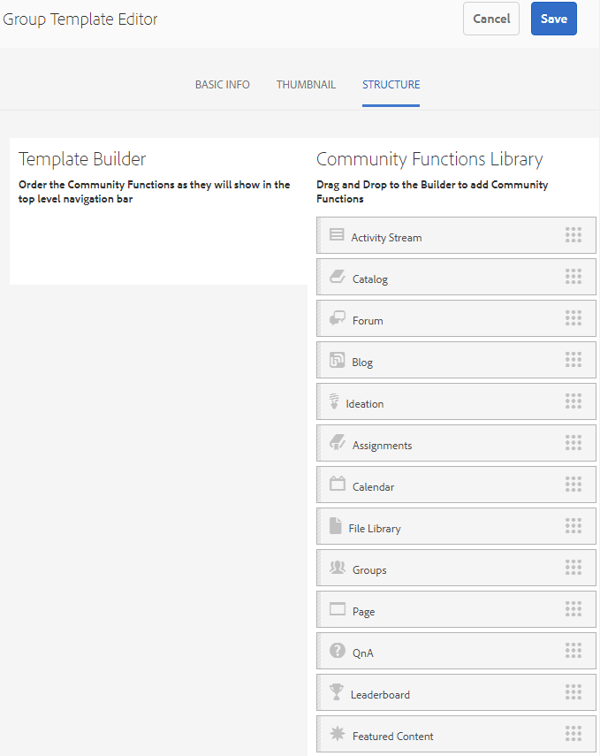
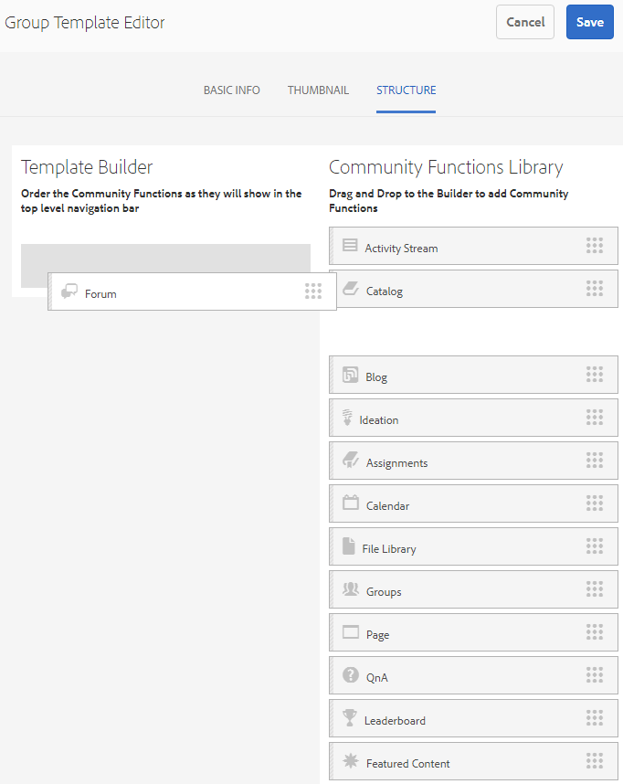

# Modèles de groupe {#group-templates}

La console Modèles de groupe est similaire à la console [Modèles de site](/help/communities/sites.md). Les deux sont des plans directeurs pour un ensemble de pages pré-câblées et de fonctionnalités qui forment un site communautaire. La différence est qu’un modèle de site est pour la communauté principale et qu’un modèle de groupe est pour un groupe de la communauté, une sous-communauté imbriquée dans la communauté principale.

Un groupe de communautés est intégré à un modèle de site en incluant la fonction [Groups](/help/communities/functions.md#groups-function) (qui peut ne pas être la première ni la seule fonction du modèle).

À partir de Communities [pack de fonctionnalités 1](/help/communities/deploy-communities.md#latestfeaturepack), il est possible d’imbriquer des groupes en incluant la fonction Groupes dans un modèle de groupe.

Au moment où une action est entreprise pour créer un groupe communautaire, le modèle (structure) du groupe est sélectionné. La sélection dépend de la configuration de la fonction Groupes lors de l’ajout au site ou au modèle de groupe.

>[!NOTE]
>
>Les consoles de création de [sites de la communauté](/help/communities/sites-console.md), [modèles de site de la communauté](/help/communities/sites.md), [modèles de groupe de la communauté](/help/communities/tools-groups.md) et [fonctions de la communauté](/help/communities/functions.md) doivent être utilisées uniquement dans l’environnement de création.

## Console Modèles de groupe {#group-templates-console}

Pour accéder à la console des modèles de groupe dans l’environnement de création AEM :

* Sélectionnez **Outils | Communautés | Modèles de groupe,** dans la navigation globale.

Cette console affiche les modèles à partir desquels un [site communautaire](/help/communities/sites-console.md) peut être créé et permet de créer de nouveaux modèles de groupe.

## Créer un modèle de groupe {#create-group-template}

Pour commencer à créer un modèle de groupe, sélectionnez `Create`.

Le panneau Éditeur de site s’affiche, avec trois sous-panneaux :

### Informations de base {#basic-info}

Dans le panneau Informations de base , un nom, une description et si le modèle est activé ou désactivé sont configurés :

* **Nom du nouveau modèle de groupe**

  Identifiant du nom du modèle.

* **Description**

  Description du modèle.

* **Désactivé/Activé**

  Bouton bascule contrôlant si le modèle est référençable.

#### Miniature {#thumbnail}

(Facultatif) Sélectionnez l’icône Charger l’image pour afficher une miniature avec le nom et la description aux créateurs et créatrices de sites de la communauté.

#### Structure {#structure}

>[!CAUTION]
>
>Si vous utilisez AEM 6.1 Communities FP4 ou une version antérieure, n’ajoutez pas de fonction de groupes à un modèle de groupe.
>
>La fonctionnalité de groupes imbriqués est disponible à partir de Communities [FP1](/help/communities/communities.md#latestfeaturepack).
>
>Il n’est toujours pas autorisé d’ajouter une fonction Groupes en tant que première ou seule fonction dans un modèle.

Pour ajouter des fonctions de communauté, faites glisser du côté droit vers la gauche dans l’ordre dans lequel les liens du menu du site doivent apparaître. Les styles sont appliqués au modèle lors de la création du site.

Par exemple, si vous souhaitez un forum, faites glisser la fonction forum depuis la bibliothèque et déposez-la sous le créateur de modèles. La boîte de dialogue de configuration du forum s’ouvre alors. Voir la [console des fonctions](/help/communities/functions.md) pour plus d’informations sur les boîtes de dialogue de configuration.

Continuez à faire glisser et à déposer toutes les autres fonctions de communauté souhaitées pour un site (groupe) de sous-communauté basé sur ce modèle.

Une fois toutes les fonctions souhaitées déposées dans la zone du créateur de modèles et configurées, sélectionnez **Enregistrer** dans le coin supérieur droit.

## Modifier le modèle de groupe {#edit-group-template}

Lors de l’affichage des groupes de communautés dans la console principale [Modèles de groupe](#group-templates-console), il est possible de sélectionner un modèle de groupe existant à modifier.

La modification d’un modèle de groupe n’affecte pas les sites communautaires déjà créés à partir du modèle. Il est plutôt possible de [modifier directement](/help/communities/sites-console.md#modify-structure) la structure d’un site communautaire.

Ce processus fournit les mêmes panneaux que [création d’un modèle de groupe](#create-group-template).
