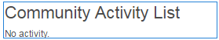
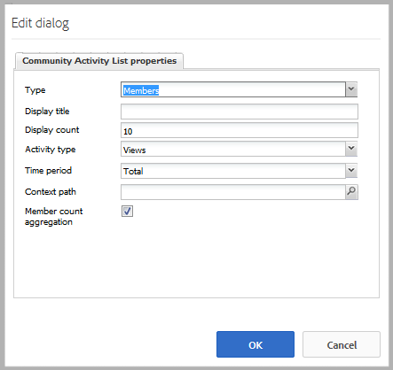
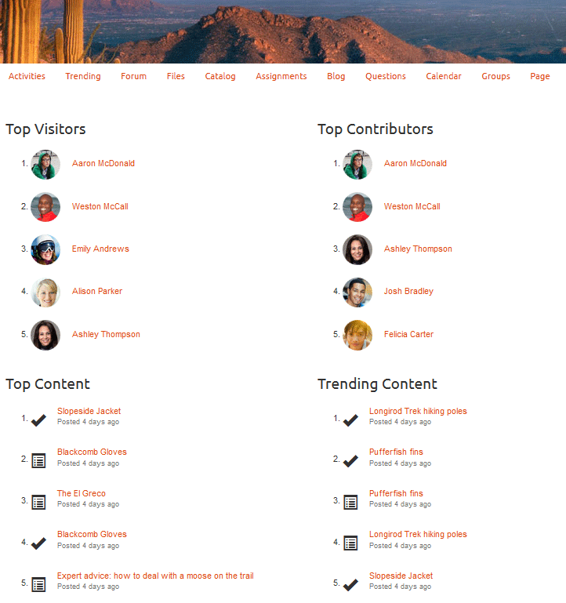

# Tendances des activités {#activity-trends}

## Présentation {#introduction}

Le composant `Community Activity List` vous permet d’ajouter des informations de tendance concernant les publications et les vues par les membres, ainsi que les publications et les vues de contenu.

Le document décrit :

* Ajout du composant `Community Activity List` à un [site communautaire](/help/communities/overview.md#community-sites).

* Paramètres de configuration du composant `Community Activity List`.

### Condition requise {#requirement}

Les données du `Community Activity List` ne sont disponibles que lorsqu’Adobe Analytics dispose d’une licence et est configuré pour le site de la communauté.

Voir [Configuration d’Analytics pour les fonctionnalités de Communities](/help/communities/analytics.md).

### Ajout d’une liste d’activités de la communauté à une page {#adding-a-community-activity-list-to-a-page}

Pour ajouter un composant `Community Activity List` à une page en mode création, localisez-le `Communities / Community Activity List` et faites-le glisser sur une page.

Pour plus d’informations, consultez [Principes de base des composants de communautés](/help/communities/basics.md).

Lorsque vous placez le composant sur une page d’un site communautaire pour la première fois, voici comment il s’affiche :

### Configuration de la liste des activités de la communauté  {#configuring-community-activity-list}

Sélectionnez le composant de `Community Activity List` placé, puis sélectionnez l’icône `Configure` pour ouvrir la boîte de dialogue de modification.

Sous l’onglet **Commentaires**, indiquez si et comment les commentaires des fichiers chargés s’affichent :

* **Type**

  Indiquez s’il faut afficher les données concernant les membres de la communauté ou le contenu créé par l’utilisateur.

  Faites un choix parmi les éléments suivants :

  * `Members`
  * `Content`

  La valeur par défaut est `Members`.

* **Afficher le titre**

  Titre descriptif à afficher au-dessus des données, tel que `Trending Content`.
  La valeur par défaut est aucun titre.

* **Afficher le nombre**

  Nombre d’éléments à répertorier.
  La valeur par défaut est 10.

* **Type d’activité**

  Sélectionnez l’une des options suivantes :

  * `Views` (visites de page)
  * `Posts`(création du contenu créé par l’utilisateur)
  * `Follows`
  * `Likes`

  La valeur par défaut est Vues.

* **Période**

  Sélectionnez l’une des options suivantes :

  * `Last 24 hours`
  * `Last 7 days`
  * `Last 30 days`
  * `Last 90 days`
  * `This year (since Jan 1)`
  * `Total`

  La valeur par défaut est `Total`.

* **Chemin du contexte**

  Vous pouvez ainsi étendre l’activité à un sous-ensemble du site, tel qu’un blog spécifique.
  La valeur par défaut est l’ensemble du site de la communauté.

* **Agrégation des nombres de membres**

  Lorsque cette option est désélectionnée (désactivée), seules les publications de niveau supérieur sont comptabilisées. Par exemple, si le contexte est la page racine (valeur par défaut), une `Activity Type` de `Posts` n’affiche jamais d’activité, car il n’est pas possible de publier du contenu sur la page racine. Lorsque cette case est cochée, les nombres de toutes les pages descendantes sont inclus.
  La valeur par défaut est cochée.

### Exemple de page avec quatre composants {#example-page-with-components}

**Principaux visiteurs** configuration : Type = Membres, Type d’activité = Vues

**Principaux contributeurs** configuration : Type = Membres, Type d’activité = Publications

**Contenu principal** configuration : Type = Contenu, Type d’activité = Vues,

**Contenu en tendance** configuration : Type = Contenu, Type d’activité = Publications

