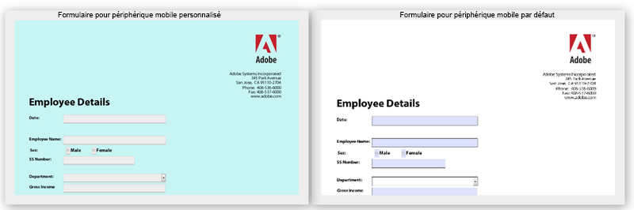

# Modifiier les styles par défaut des formulaires HTML5{#changing-default-styles-of-html-forms}

Les formulaires HTML5 sont rendu utilisant des fonctionnalités HTML5 et le style du formulaire rendu est fait utilisant CSS. L’apparence par défaut des formulaires HTML5 est similaire à son rendu PDF. Les développeurs et développeuses peuvent utiliser des CSS personnalisés pour modifier l’apparence par défaut des formulaires HTML5.

Cet article contient des informations détaillées sur la modification du style d’un formulaire HTML5 et l’article [Introduction aux styles](/help/forms/using/css-styles.md) contient des informations détaillées sur divers aspects de style de formulaires HTML5. Assurez-vous d’avoir lu l’article Introduction aux styles avant d’effectuer les étapes mentionnées dans cet article.

Les deux images qui suivent montrent la différence entre les styles par défaut et les styles personnalisés.

## Donner du style à vos formulaires {#style-your-forms}

1. **Sélectionner un profil auquel ajouter des styles personnalisés**

   Accédez à l’interface de CRX DE à lʼadresse suivante :**https://&lt;server>:&lt;port>/crx/de** et créez un profil ou sélectionnez un profil existant. Pour savoir comment créer un profil, consultez [Création d’un profil](/help/forms/using/custom-profile.md).

1. **Création d’une feuille de style CSS pour le style des formulaires HTML5**

   Accédez au dossier dans lequel vous avez créé le rendu de profil et créez un fichier de feuille de style CSS. Les étapes à suivre sont :

   1. Cliquez avec le bouton droit sur le dossier et sélectionnez **Créer** -> **Créer un fichier** à partir du menu

   1. Dans la boîte de dialogue Création de fichier, entrez le nom de la feuille de style. Assurez-vous d’utiliser l’extension .css (par exemple stylesheet.css)
   1. Dans le volet du navigateur, ouvrez le fichier CSS que vous avez créé.
   1. Définissez les classes CSS des composants dont vous souhaitez modifier le style et ajoutez des styles dans ces classes.

   Pour savoir quelles classes CSS il convient de créer pour un composant particulier de vos formulaires HTML5, consultez [Introduction aux styles](/help/forms/using/css-styles.md).

1. **Inclusion de la feuille de style dans le rendu de profil**

   Ouvrez la page Rendu du profil (fichier jsp) dans CRX DE et insérez le fichier CSS dans la page juste en dessous de la bibliothèque cliente XFA. Effectuez les étapes suivantes pour inclure le fichier CSS dans le profil.

   1. Recherchez la ligne suivante dans la page du rendu :

      &lt;cq:includeClientLib categories=« xfaforms.profile » />

   1. Insérez les éléments suivants sous la ligne ci-dessus pour inclure la feuille de style :

      &lt;link href=&quot;/path/to/stylesheet&quot; rel=&quot;stylesheet&quot; type=&quot;text/css&quot;/>

   1. Enregistrez le fichier.
