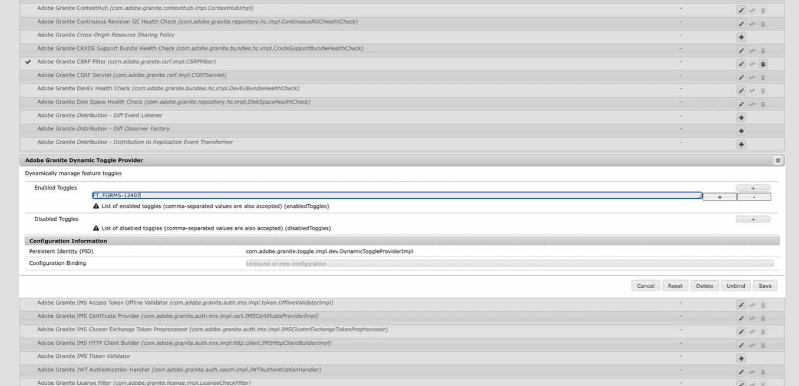
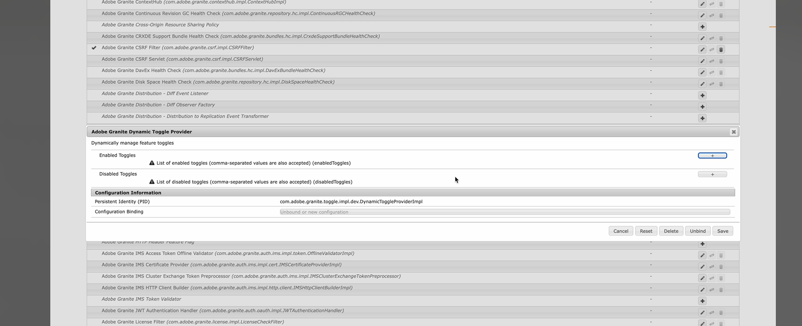

# Fonction d’activation/désactivation des fonctionnalités dans Adobe Experience Manager (AEM) 6.5{#enable-feature-toggle-aem-forms-65}

La fonction d’activation/désactivation des fonctionnalités est une fonctionnalité d’AEM qui permet aux administrateurs et aux administratrices d’activer ou de désactiver des fonctionnalités spécifiques de manière dynamique. Cette fonctionnalité est particulièrement utile pour gérer les **fonctionnalités destinées aux utilisateurs et utilisatrices précoces** et les **fonctionnalités de version préliminaire** sans nécessiter de déploiements ou de modifications importants de la base du code. Elle offre de la flexibilité et du contrôle sur les fonctionnalités accessibles dans un environnement AEM.

## Pourquoi utiliser la fonction d’activation/désactivation des fonctionnalités dans une configuration AEM 6.5 ?

Lorsque vous travaillez dans une configuration AEM 6.5, les fonctions d’activation/désactivation des fonctionnalités aident à :

* Tester des fonctionnalités expérimentales en toute sécurité.

* Déployer de nouveaux composants en plusieurs phases.

* Disposer d’une base de code unique pour plusieurs environnements.

* Réduire les risques lors des déploiements et des mises à niveau.

## Remarque

À partir du pack de services 23 d’AEM 6.5, vous n’avez pas besoin d’installer le bundle [com.adobe.granite.toggle.impl.dev](http://com.adobe.granite.toggle.impl.dev/), car il est déjà installé avec le module complémentaire AEM de Forms.

## Prérequis

Avant d’activer la fonction d’activation/désactivation des fonctionnalités dans votre configuration AEM 6.5, vérifiez les points suivants :

* L’utilisateur ou l’utilisatrice est membre du groupe `forms-users`.

* Accédez à `http://<author-instance-url>:portnumber/system/console/bundles` et vérifiez si le lot **(com.adobe.granite.toggle.impl.dev-1.1.8.jar)** est présent ou non. S’il n’est pas présent, [téléchargez le bundle à partir de ce lien](https://experience.adobe.com/#/downloads/content/software-distribution/en/aem.html?package=%2Fcontent%2Fsoftware-distribution%2Fen%2Fdetails.html%2Fcontent%2Fdam%2Faem%2Fpublic%2Fadobe%2Fpackages%2Fcq650%2Fhotfix%2Fcom.adobe.granite.toggle.impl.dev-1.1.8.jar).

## Bouton (bascule) Activer la fonction {#enable-feature-toggle-65}

La fonction d’activation/désactivation des fonctionnalités pour les utilisateurs et les utilisatrices précoces ou pour les nouvelles fonctionnalités peut être configurée via la **console web d’AEM** en suivant les étapes ci-dessous :

1. Connectez-vous à votre instance AEM Forms.
2. Accédez à `http://<author-instance-url>:portnumber/system/console/configMgr`.
3. Recherchez **Fournisseur de fonction bascule dynamique Adobe Granite** dans le gestionnaire de configuration.
4. Cliquez sur l’icône .
5. Dans la section [!UICONTROL Fonctions bascules activées], cliquez sur .
6. Ajoutez l’identifiant du bouton d’activation de fonctionnalités, comme illustré dans l’image ci-dessous.
   

   >[!NOTE]
   >
   >Vous trouverez l’identifiant de la fonction d’activation/désactivation des fonctionnalités dans le document spécifique aux fonctions destinées aux utilisateurs et aux utilisatrices précoces.

7. Cliquez sur Enregistrer.

## Désactiver la fonction d’activation/désactivation des fonctionnalités {#disable-feature-toggle-65}

Pour désactiver la fonction d’activation/désactivation des fonctionnalités pour les fonctionnalités sur lesquelles celle-ci est activée, procédez comme suit :

1. Connectez-vous à votre instance AEM Forms.
2. Accédez à `http://<author-instance-url>:portnumber/system/console/configMgr`.
3. Recherchez **Fournisseur de fonction bascule dynamique Adobe Granite** dans le gestionnaire de configuration.
4. Cliquez sur l’icône .
5. Dans la section [!UICONTROL Fonctions bascules désactivées], cliquez sur .
6. Ajoutez le numéro de bascule de la fonctionnalité à désactiver.
   
7. Cliquez sur Enregistrer.

## Considérations techniques

Les fonctions d’activation/désactivation de fonctionnalités sont spécifiques à un environnement et sont gérées au moment de l’exécution. Il n’est donc pas nécessaire de redémarrer le serveur. Cependant, certaines fonctionnalités peuvent nécessiter d’actualiser les pages concernées ou d’effacer le cache pour refléter les modifications.
Vous pouvez accéder à la liste des fonctionnalités activées par le biais de la fonction d’activation/désactivation des fonctionnalités pour votre environnement via `http://<author-instance-url>:4502/etc.clientlibs/toggles.json`.
