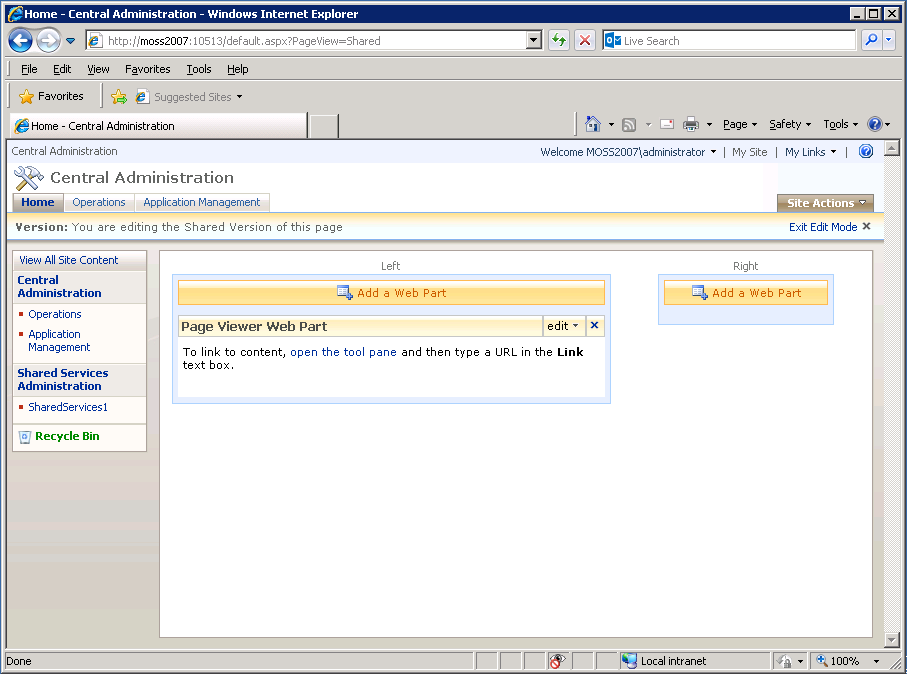

# Intégration d’AEM Forms Workspace à Microsoft Office SharePoint Server{#integrating-aem-forms-workspace-with-microsoft-office-sharepoint-server}

**- Conditions requises**

**Connaissances préalables**
Avant de pouvoir ajouter AEM Forms Workspace au serveur SharePoint, vous devez avoir accès au serveur SharePoint avec les privilèges appropriés et vous devez connaître l’URL d’accès à Workspace. Les étapes ci-dessous impliquent que vous connaissez SharePoint Server. Pour plus d’informations sur les composants web dans SharePoint Server, consultez Composants Web dans les services SharePoint Windows.

**Niveau utilisateur**
Début

Vous pouvez utiliser AEM Forms Workspace comme composant Web dans Microsoft Office SharePoint Server (par exemple, Microsoft Office SharePoint Server 2007). Les utilisateurs et utilisatrices peuvent accéder à AEM Forms Workspace en se connectant à votre serveur SharePoint à l’aide d’un navigateur web pour offrir une expérience unifiée. Dans cet article, vous découvrez les étapes de base pour afficher AEM Forms Workspace en tant que composant Web dans Microsoft Office SharePoint Server. Vous pouvez suivre les étapes décrites dans cet article pour offrir une expérience unifiée aux utilisateurs et utilisatrices afin qu’ils puissent se connecter à votre serveur SharePoint et accéder à AEM Forms Workspace à partir du même port.

>[!NOTE]
>
>Les étapes répertoriées dans cet article sont spécifiques à Microsoft SharePoint Server 2007. Vous pouvez également configurer HTML Workspace avec d’autres versions prises en charge de Microsoft SharePoint.

## Intégrer AEM Forms Workspace à Microsoft Office SharePoint Server 2007 {#integrate-aem-forms-workspace-with-microsoft-office-sharepoint-server}

Pour intégrer AEM Forms Workspace à un composant Web, procédez comme suit :

1. Dans un navigateur web, accédez au site SharePoint, à savoir `https://[myMOSSserver]:44299/default.aspx` où `[myMOSSserver]` est le nom ou l’adresse IP du serveur Sharepoint.

   >[!NOTE]
   >
   >44299 est le numéro de port par défaut du serveur SharePoint. Le numéro de port dépend de votre installation du serveur SharePoint.

1. Dans le coin supérieur droit de la page web, cliquez sur **Actions du site** et sélectionnez **Modifier la page**.
1. Cliquez sur le bouton **Ajouter un composant Webpart.**
1. Dans la boîte de dialogue Ajouter des composants Web - Boîte de dialogue de la page web, sous Divers, sélectionnez **Composant web de la visionneuse de pages** puis cliquez sur **Ajouter**.
1. Dans la zone Composant Web de la visionneuse de pages, cliquez sur **Modifier** et sélectionnez **Modifier le composant Web partagé**.

   >[!NOTE]
   >
   >La zone Composant Web de la visionneuse de pages s’affiche sous le bouton **Ajouter un composant Web** sur lequel vous avez cliqué à l’étape 3, comme illustré ci-dessous (Figure 1) :

   

   Figure 1. - La zone Composant Web de la visionneuse de pages de Microsoft Office SharePoint Server.

1. Sur la page Visionneuse de pages, effectuez les tâches suivantes :

   1. Dans la zone Lien, saisissez l’URL d’AEM Forms Workspace, à savoir `https://[AEM_forms_Server]:8080/lc/ws` où `[AEM_forms_Server]` représente l’adresse IP ou le nom du serveur AEM Forms.
   1. Cliquez sur **Apparence** et modifiez la hauteur, la largeur et le titre de sorte que vous puissiez voir l’ensemble de l’interface utilisateur de Workspace. Par exemple, vous pouvez définir la hauteur et la largeur sur 6 pouces et 11 pouces, respectivement.
   1. Cliquez sur **Tester le lien**. Une nouvelle fenêtre de navigateur web contenant Workspace s’affiche.
   1. (Facultatif) Cliquez sur **Disposition** et modifiez la disposition de Workspace dans le composant Web.
   1. (Facultatif) Cliquez sur **Avancé** et modifiez d’autres paramètres, tels que la description et si Workspace peut être réduit ou fermé dans le composant Web.

      Cliquez sur **Appliquer**.

1. Cliquez sur **Quitter le mode de modification** et vérifiez que vous pouvez accéder à Workspace.

Une fois les étapes ci-dessus effectuées, votre site SharePoint ressemble à l’illustration suivante (Figure 2) :

Figure 2 : AEM Forms Workspace intégré à Microsoft Office SharePoint Server
