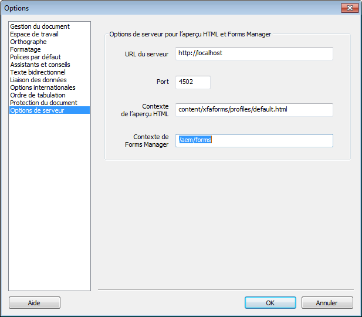

# Générer l’aperçu HTML5 d’un formulaire XDP{#generate-html-preview-of-an-xdp-form}

Lors de la conception d’un formulaire dans AEM Forms Designer, en plus de la prévisualisation du rendu du PDF d’un formulaire, vous pouvez également prévisualiser un rendu HTML5 de celui-ci. Vous pouvez utiliser l’onglet **Aperçu HTML** pour prévisualiser un formulaire tel qu’il apparaîtra dans un navigateur.

## Activation de l’aperçu HTML pour les formulaires XDP dans Designer {#html-preview-of-forms-in-forms-designer}

Pour permettre à Designer de générer l’aperçu HTML des formulaires XDP, effectuez les procédures suivantes :

* Configurer le service d’authentification Apache Sling
* Désactiver le mode Protégé
* Spécification des détails sur le serveur AEM Forms

### Configurer le service d’authentification Apache Sling {#configure-apache-sling-authentication-service}

1. Accédez à `https://'[server]:[port]'/system/console/configMgr` sur AEM Forms s’exécutant sur OSGi ou
   `https://'[server]:[port]'/lc/system/console/configMgr` sur AEM Forms s’exécutant sur JEE.
1. Localisez et cliquez sur la boîte de configuration **Service d’authentification Apache Sling** pour l’ouvrir en mode d’édition.

1. Selon que vous exécutez AEM Forms sur OSGi ou JEE, ajoutez ce qui suit dans le **champ** Conditions d’authentification requises :

   * d’AEM Forms sur JEE

     * -/content/xfaforms
     * -/etc/clientlibs

   * AEM Forms sur OSGi

     * -/content/xfaforms
     * -/etc/clientlibs/fd/xfaforms

   >[!NOTE]
   >
   >N’effectuez pas de copier-coller de la valeur spécifiée dans le champ des conditions d’authentification requises, car ceci risquerait de corrompre les caractères spéciaux dans la valeur. Saisissez plutôt la valeur spécifiée dans le champ.

1. Indiquez un nom d’utilisateur ou d’utilisatrice et un mot de passe respectivement dans les champs **[!UICONTROL Nom d’utilisateur anonyme]** et **[!UICONTROL Mot de passe utilisateur anonyme]**. Les informations d’identification spécifiées sont utilisées pour gérer l’authentification anonyme et autoriser l’accès aux utilisateurs et utilisatrices anonymes.
1. Cliquez sur **Enregistrer** pour enregistrer la configuration.

### Désactiver le mode Protégé {#disable-protected-mode}

Le [mode protégé](../../forms/using/get-xdp-pdf-documents-aem.md) est activé par défaut. Laissez-le activé pour les environnements de production. Vous pouvez le désactiver pour qu’un environnement de développement effectue un aperçu HTML5 de formulaires dans Designer. Procédez comme suit pour le désactiver :

1. Connectez-vous à la console web AEM en tant qu’administrateur ou administratrice.

   * L’URL d’AEM Forms on OSGi est `https://'[server]:[port]'/system/console/configMgr`
   * L’URL d’AEM Forms on JEE est `https://'[server]:[port]'/lc/system/console/configMgr`

1. Ouvrez les **[!UICONTROL configurations de formulaires mobiles]** pour modification.
1. Désélectionnez l’option **[!UICONTROL Mode protégé]** et cliquez sur **[!UICONTROL Enregistrer]**.

### Fournir des détails sur le serveur AEM Forms {#provide-details-of-aem-forms-server}

1. Dans Designer, cliquez sur **Tools** > **Options**.
1. Dans la fenêtre Options, sélectionnez la page **Options du serveur**, fournissez les détails suivants, puis cliquez sur **OK**.

   * **URL de serveur** : URL du serveur d’AEM Forms.

   * **Numéro de port HTTP** : port du serveur AEM. La valeur par défaut est 4502.
   * **Contexte d’aperçu HTML :** chemin du profil pour le rendu des formulaires XFA. Les profils par défaut suivants sont utilisés pour afficher l’aperçu du formulaire dans Designer. Cependant, vous pouvez également spécifier un chemin vers un profil personnalisé.

     * `/content/xfaforms/profiles/default.html` (AEM Forms on OSGi)

     * `/lc/content/xfaforms/profiles/default.html` (AEM Forms on JEE)

   * **Contexte de Forms Manager :** chemin de contexte du déploiement de l’interface utilisateur de Forms Manager. Les valeurs par défaut sont :

     * `/aem/forms` (AEM Forms on OSGi)
     * `/lc/forms` (AEM Forms on JEE)

   >[!NOTE]
   >
   >Assurez-vous que le serveur AEM Forms est opérationnel. L’aperçu HTML se connecte au serveur CRX pour *générer* un aperçu.

   

   Options d’AEM Forms Designer

1. Pour prévisualiser un formulaire au format HTML, cliquez sur l’onglet **Aperçu HTML**.

   >[!NOTE]
   >
   >
   >
   >
   >    * Si l’onglet Aperçu HTML est fermé, appuyez sur la touche F4 pour l’ouvrir. Vous pouvez également sélectionner Aperçu HTML dans le menu Affichage pour ouvrir l’onglet Aperçu HTML.
   >    * l’aperçu HTML ne prend pas en charge les documents PDF, il est uniquement dédié aux documents au format XDP.
   >
   >

   >[!CAUTION]
   >
   >Pour tester l’expérience de l’utilisateur final, prévisualisez également vos formulaires dans des navigateurs externes (Google Chrome, Microsoft Edge, Mozilla Firefox, etc.). Chaque navigateur utilise un moteur distinct pour effectuer le rendu en format HTML. Il peut donc y avoir des différences dans la manière dont les aperçus de formulaire sont affichés dans Designer et dans un navigateur externe.

## Prévisualisation d’un formulaire contenant des données d’exemple {#to-preview-a-form-using-sample-data}

Designer vous permet de prévisualiser et de tester votre formulaire à l’aide de données XML d’exemple. Il est recommandé de tester fréquemment votre formulaire à l’aide de données d’exemple afin de vous assurer qu’il s’affiche correctement.

Si vous ne disposez pas de données d’exemple, Designer peut les créer ou vous pouvez en créer vous-même. (Voir [Génération automatique de données d’exemple pour la prévisualisation du formulaire](https://help.adobe.com/fr_FR/AEMForms/6.1/DesignerHelp/WS107c29ade9134a2c136ae6f212a1f379c94-8000.2.html#WS92d06802c76abadb-728f46ac129b395660c-7efe.2) et [Création de données d’exemple afin de prévisualiser le formulaire](https://help.adobe.com/fr_FR/AEMForms/6.1/DesignerHelp/WS107c29ade9134a2c136ae6f212a1f379c94-8000.2.html#WS92d06802c76abadb-728f46ac129b395660c-7eff.2).)

Le test de votre formulaire à l’aide d’une source de données d’exemple permet de s’assurer que les données et les champs sont mappés et que les sous-formulaires qui se répètent le font comme prévu. Vous pouvez créer une disposition de formulaire équilibrée qui offre un espace approprié à chaque objet pour afficher les données fusionnées.

1. Sélectionnez **Fichier > Propriétés du formulaire**.

1. Cliquez sur l’onglet **Aperçu** et, dans la zone Fichier de données, indiquez le chemin d’accès complet au fichier de données de test. Vous pouvez également vous servir du bouton Parcourir pour naviguer jusqu’au fichier.

1. Cliquez sur **OK**. La prochaine fois que vous prévisualiserez le formulaire dans l’onglet **Aperçu HTML**, les valeurs des données de l’exemple de fichier XML apparaîtront dans les objets respectifs.

## Aperçu des formulaires dans un référentiel {#html-preview-of-forms-in-forms-manager}

Dans AEM Forms, vous pouvez prévisualiser des formulaires et des documents dans un référentiel. L’aperçu permet de savoir exactement à quoi ressemblent les formulaires et comment se comportent les utilisateurs et utilisatrices finaux.
