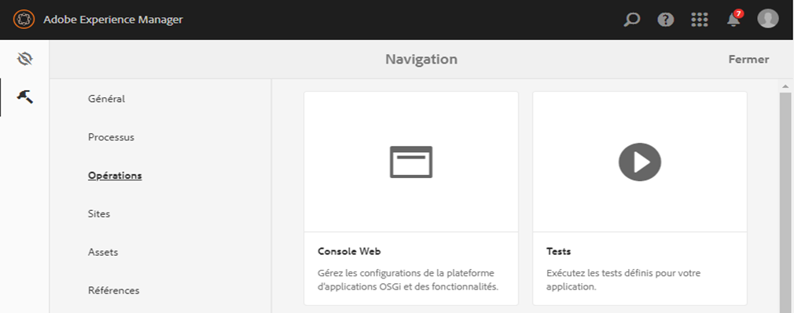
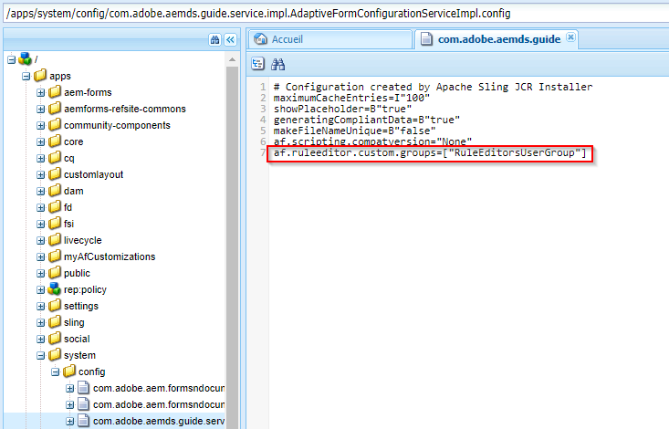
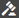
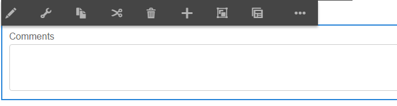

# Autorisation d’accès à l’éditeur de règles pour des groupes d’utilisateurs et d’utilisatrices sélectionnés{#grant-rule-editor-access-to-select-user-groups}

 Adobe recommande d’utiliser les [composants principaux](https://experienceleague.adobe.com/docs/experience-manager-core-components/using/adaptive-forms/introduction.html?lang=fr) de capture de données modernes et extensibles pour [créer de nouveaux formulaires adaptatifs](/help/forms/using/create-an-adaptive-form-core-components.md) ou [ajouter des formulaires adaptatifs à des pages AEM Sites](/help/forms/using/create-or-add-an-adaptive-form-to-aem-sites-page.md). Ces composants représentent une avancée significative dans la création de formulaires adaptatifs, ce qui garantit des expériences utilisateur impressionnantes. Cet article décrit une approche plus ancienne de la création de formulaires adaptatifs à l’aide de composants de base. 

## Vue d’ensemble {#overview}

Il est possible que plusieurs types d’utilisateurs et d’utilisatrices dotés de différentes compétences utilisent les formulaires adaptatifs. Les utilisateurs chevronnés peuvent avoir les connaissances requises pour utiliser des scripts et des règles complexes. Toutefois, certains utilisateurs peu expérimentés utilisent uniquement les propriétés de mise en page et de base des formulaires adaptatifs.

AEM Forms permet de limiter l’accès à l’éditeur de règles à certains utilisateurs et certaines utilisatrices en fonction de leur rôle ou de leur poste. Dans les paramètres du service de configuration des formulaires adaptatifs, vous pouvez spécifier les [groupes d’utilisateurs](/help/sites-administering/security.md) qui pourront afficher l’éditeur de règles et y accéder.

## Spécification des groupes d’utilisateurs et d’utilisatrices qui peuvent accéder à l’éditeur de règles {#specify-user-groups-that-can-access-rule-editor}

1. Connectez-vous à AEM Forms en tant qu’administrateur.
1. Dans l’instance de création, cliquez sur Adobe Experience Manager > Outils  > Opérations > Console web. La console web s’ouvre dans une nouvelle fenêtre.

   

1. Dans la fenêtre de la console web, recherchez et cliquez sur **[!UICONTROL Configuration de canal web du formulaire adaptatif et de la communication interactive]**. La boîte de dialogue **[!UICONTROL Configuration du canal web du formulaire adaptatif et de la communication interactive]** sʼaffiche. Ne modifiez aucune valeur, puis cliquez sur **Enregistrer**.

   Cela crée un fichier /apps/system/config/com.adobe.aemds.guide.service.impl.AdaptiveFormConfigurationServiceImpl.config dans le référentiel CRX.

1. Connectez-vous à CRXDE en tant qu’administrateur. Ouvrez le fichier /apps/system/config/com.adobe.aemds.guide.service.impl.AdaptiveFormConfigurationServiceImpl.config pour le modifier.
1. Utilisez la propriété suivante pour spécifier le nom d’un groupe pouvant accéder à l’éditeur de règles (par exemple, RuleEditorsUserGroup) et cliquez sur **Enregistrer tout**.

   `af.ruleeditor.custom.groups=["RuleEditorsUserGroup"]`

   Pour autoriser l’accès à plusieurs groupes, spécifiez une liste de valeurs séparées par des virgules :

   `af.ruleeditor.custom.groups=["RuleEditorsUserGroup", "PermittedUserGroup"]`

   

   Désormais, lorsqu’un utilisateur ou une utilisatrice qui ne fait pas partie du groupe d’utilisateurs ou d’utilisatrices spécifié (ici RuleEditorsUserGroup) appuie sur un champ, l’icône d’édition de règle () n’est pas disponible dans la barre d’outils de composants :

   

   Barre d’outils de composants comme visible pour un utilisateur ayant un accès à l’éditeur de règles

   

   Barre d’outils de composants comme visible pour un utilisateur sans accès à l’éditeur de règles

   Pour obtenir des instructions sur l’ajout d’utilisateurs aux groupes, voir [Administration et sécurité des utilisateurs](/help/sites-administering/security.md).
