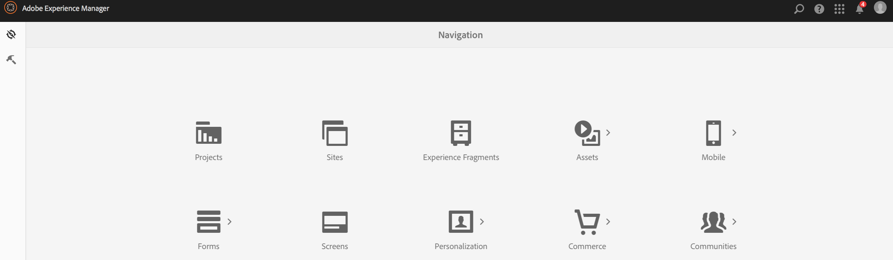

# Définitions d’application{#app-definitions}

{{ue-over-mobile}}

Les définitions d’application sont un moyen d’identifier les espaces et autres configurations appropriés pour l’application. Les définitions d’application permettent à l’utilisateur d’ajouter de l’espace sans avoir à recompiler l’application. La définition de l’application est mise à jour et inclut les informations de tout nouvel espace.

>[!NOTE]
>
>Les définitions d’application sont liées à une application. Par conséquent, elles nécessitent la création d’une application dans la console Application d’AEM Mobile.

## Création d&#39;une définition d&#39;application {#creating-a-new-app-definition}

1. Sélectionnez **Mobile** dans la console de navigation AEM.

   

1. Choisissez **Applications** dans **Mobile**, puis cliquez sur **Créer.**

   Sélectionnez **Application** dans et saisissez les détails pour créer votre application.

   

### Les étapes suivantes {#the-next-steps}

Une fois que vous serez familiarisé avec les définitions d’application, découvrez les ressources de création suivantes :

* [Importer une application hybride existante](/help/mobile/phonegap-adding-content-to-imported-app.md)
* [Créer une application à l’aide de l’assistant Créer une application](/help/mobile/phonegap-create-new-app.md)
* [Content Services](/help/mobile/develop-content-as-a-service.md)

## Ressources supplémentaires {#additional-resources}

Pour en savoir plus sur les rôles et les responsabilités d’un administrateur et d’un développeur, consultez les ressources ci-dessous :

* [Développement pour Adobe PhoneGap Enterprise avec AEM](/help/mobile/developing-in-phonegap.md)
* [Administration de contenu pour Adobe PhoneGap Enterprise avec AEM](/help/mobile/administer-phonegap.md)
