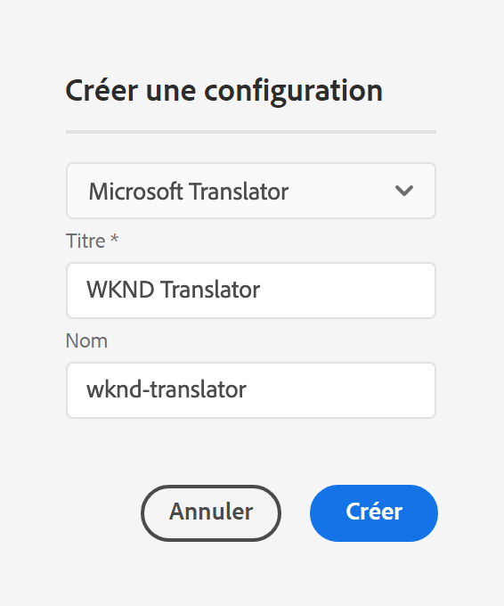
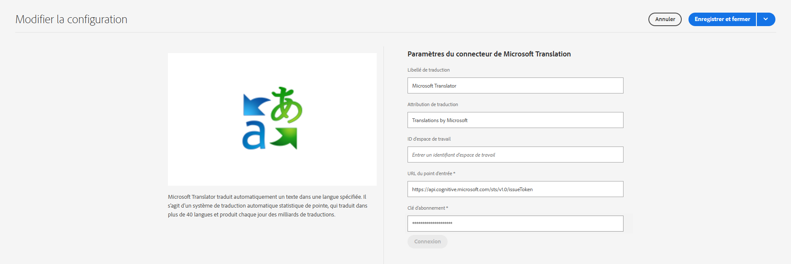

# Connexion à Microsoft Translator {#connecting-to-microsoft-translator}

AEM fournit un connecteur intégré pour [Microsoft Translator](https://www.microsoft.com/fr-fr/translator/business/) afin de traduire le contenu des pages ou des ressources. Après obtention d’une licence Microsoft pour utiliser Microsoft Translator, configurez le connecteur en suivant les instructions de cette page.

| Propriété | Description |
|---|---|
| Libellé de traduction | Nom d’affichage du service de traduction |
| Attribution de traduction | (Facultatif) Pour le contenu créé par l’utilisateur ou l’utilisatrice, l’attribution qui apparaît à côté du texte traduit, par exemple `Translations by Microsoft`. |
| ID d’espace de travail | (Facultatif) L’ID de votre moteur Microsoft Translator personnalisé à utiliser |
| Clé d’abonnement | Votre clé d’abonnement Microsoft pour Microsoft Translator |

La procédure suivante crée une configuration Microsoft Translator.

1. Dans le [panneau de navigation](/help/sites-authoring/basic-handling.md#first-steps), cliquez sur **Outils** -> **Services cloud** -> **Services cloud de traduction**.
1. Accédez à l’emplacement où vous souhaitez créer la configuration. Normalement, il s’agit de la racine de votre site, mais il peut s’agir aussi d’une configuration globale par défaut.
1. Cliquez sur le bouton **Créer**.
1. Définissez votre configuration.
   1. Sélectionnez **Microsoft Translator** dans la liste déroulante.
   1. Indiquez un titre pour votre configuration. Le titre identifie la configuration dans la console Services cloud, ainsi que dans les listes déroulantes de propriétés de la page.
   1. Éventuellement, saisissez un nom à utiliser pour le nœud du référentiel qui stocke la configuration.

   

1. Cliquez sur **Créer**.
1. Dans la fenêtre **Modifier la configuration**, indiquez les valeurs du service de traduction décrit dans le tableau précédent.

   

1. Cliquez sur **Connexion** pour vérifier la connexion.
1. Cliquez sur **Enregistrer et fermer**.

## Publication des configurations du service Translator {#publishing-the-translator-service-configurations}

La dernière étape consiste à publier les configurations de Microsoft Translator pour prendre en charge le contenu traduit publié à l’aide de l’action [publication d’une arborescence](/help/sites-authoring/publishing-pages.md#publishing-and-unpublishing-a-tree).

## Mappage des champs de l’API Microsoft Translator {#microsoft-translator-api-field-mapping}

L’API Microsoft Translator v3 accepte les demandes de traduction à l’adresse `https://api.cognitive.microsofttranslator.com/translate?api-version=3.0`. Consultez la [référence de l’API de traduction Microsoft](https://learn.microsoft.com/en-us/azure/ai-services/translator/text-translation/reference/v3/translate) pour connaître les paramètres requis, y compris la langue cible.

Le tableau suivant met en relation les champs de configuration AEM avec l’API Microsoft.

| Champ AEM | Objectif dans AEM | Relation de l’API Microsoft |
|---|---|---|
| ID d’espace de travail | Identifie le moteur Microsoft Translator personnalisé à utiliser. | Les systèmes de traduction personnalisés sont sélectionnés via le paramètre de requête `category`. L’API Microsoft exige un identifiant de catégorie de traducteur personnalisé, et non un identifiant d’espace de travail seul. Confirmez la valeur requise par votre connecteur et la configuration du modèle personnalisé. |
| Libellé de traduction | Fournit un nom d’affichage pour le service de traduction. | Aucun paramètre de demande de traduction correspondant. |
| Attribution de traduction | Définit l’attribution facultative en regard du contenu généré par l’utilisateur traduit. | Aucun paramètre de demande de traduction correspondant. |
| Clé d’abonnement | Authentifie l’accès à l’abonnement Microsoft Translator. | Envoyé dans l’en-tête `Ocp-Apim-Subscription-Key` lors de la demande d’un jeton d’accès. Le jeton est ensuite envoyé dans l’en-tête `Authorization: Bearer <access-token>` pour les demandes de traduction. |

Pour une ressource globale Microsoft Translator, le point d’entrée du jeton est `https://api.cognitive.microsoft.com/sts/v1.0/issueToken`. Les ressources régionales et multiservices utilisent des points d’entrée de jeton spécifiques à la région. Consultez [Authentification Microsoft Translator](https://learn.microsoft.com/en-us/azure/ai-services/translator/text-translation/reference/authentication) pour connaître les exigences en matière de point d’entrée et d’en-tête pour votre type de ressource.
