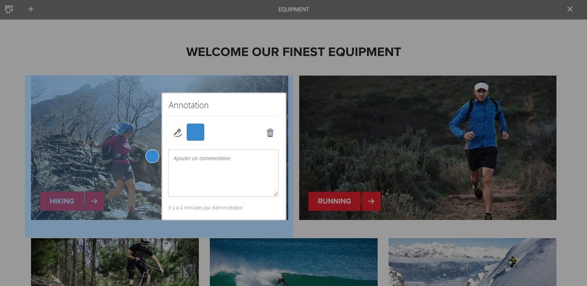
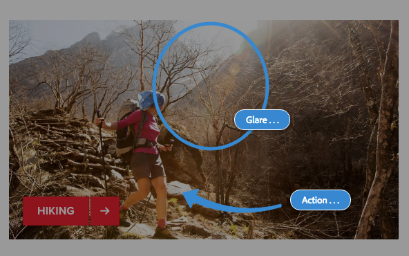
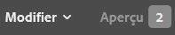

# Annotations lors de la modification d’une page{#annotations-when-editing-a-page}

L’ajout de contenu aux pages de votre site web est souvent l’objet de discussions avant la publication réelle. Pour vous aider dans cette tâche, de nombreux composants directement liés au contenu (par opposition à la disposition, par exemple) vous permettent d’ajouter une annotation.

Une annotation place une note autocollante colorée sur la page. L’annotation vous permet (ainsi qu’aux autres utilisateurs) de laisser des commentaires ou des questions à l’intention d’autres auteurs ou réviseurs.

>[!NOTE]
>
>La définition d’un type de composant individuel détermine s’il est possible d’ajouter une annotation sur des instances de ce composant.

>[!NOTE]
>
>Les annotations créées dans l’interface utilisateur classique s’affichent dans l’interface utilisateur tactile. Toutefois, les esquisses sont spécifiques à l’interface utilisateur et elles ne s’affichent que dans l’interface dans laquelle elles ont été créées.

>[!CAUTION]
>
>Si vous supprimez une ressource (un paragraphe, par exemple), toutes les annotations et tous les schémas associés sont également supprimés, quelle que soit leur position sur la page dans son ensemble.

>[!NOTE]
>
>Selon vos besoins, vous pouvez également développer un workflow pour envoyer des notifications lorsque celles-ci sont ajoutées, mises à jour ou supprimées.

## Annotations {#annotations}

Un [mode](/help/sites-authoring/author-environment-tools.md#page-modes) spécial est utilisé pour la création et l’affichage des annotations.

>[!NOTE]
>
>Pour rappel, des [commentaires](/help/sites-authoring/basic-handling.md#timeline) sont également disponibles pour fournir un retour d’informations sur une page.

>[!NOTE]
>
>Vous pouvez annoter un large éventail de ressources :
>
>* [Annotation de ressources](/help/assets/manage-assets.md#annotating)
>* [Annotation de ressources vidéo](/help/assets/managing-video-assets.md#annotate-video-assets)
>

### Annotation d’un composant {#annotating-a-component}

Le mode Annotation vous permet de créer, modifier, déplacer ou supprimer des annotations sur votre contenu :

1. Pour activer le mode Annotation, cliquez sur l’icône dans la barre d’outils (en haut à droite) lorsque vous modifiez une page :

   

   Vous pouvez maintenant afficher les annotations existantes.

   >[!NOTE]
   >
   >Pour quitter le mode Annotation, cliquez sur l’icône Annoter (symbole x) située à droite de la barre d’outils supérieure.

1. Cliquez sur l’icône Ajouter une annotation (symbole + à gauche de la barre d’outils) pour commencer à ajouter des annotations.

   >[!NOTE]
   >
   >Pour arrêter l’ajout d’annotations (et revenir à l’affichage), cliquez sur l’icône Annuler (symbole x dans un cercle blanc) à gauche de la barre d’outils supérieure.

1. Cliquez sur le composant requis (les composants qui peuvent être annotés sont encadrés en bleu) pour ajouter l’annotation et ouvrir la boîte de dialogue :

   

   Ici, vous pouvez utiliser le champ et/ou l’icône appropriés pour :

   * Saisir le texte de l’annotation.
   * Créez une esquisse (traits et formes) pour mettre en surbrillance une zone du composant.

     Le curseur prend la forme d’une croix lorsque vous créez une esquisse. Vous pouvez tracer plusieurs lignes distinctes. La ligne d’esquisse reflète la couleur de l’annotation et peut être une flèche, un cercle ou un ovale.

     

   * Choisissez/modifiez la couleur :

     

   * Supprimez l’annotation.

     

1. Pour fermer la boîte de dialogue de l’annotation, cliquez ou appuyez en dehors de la boîte de dialogue. Une vue tronquée (le premier mot) de l’annotation s’affiche avec les schémas :

   

1. Après avoir modifié une annotation, vous pouvez effectuer ce qui suit :

   * Cliquez sur la marque de texte pour ouvrir l’annotation. Une fois ouverte, vous pouvez afficher tout le texte, apporter des modifications ou supprimer l’annotation.

     * Les esquisses ne peuvent pas être supprimées indépendamment de l’annotation.

   * Repositionner la marque de texte.
   * Cliquez sur un trait de l’esquisse pour la sélectionner et la faire glisser dans la position de votre choix.
   * Déplacer ou copier un composant.

     * Toutes les annotations qui lui sont associées, ainsi que leurs esquisses, sont également déplacées ou copiées, mais leur position par rapport au paragraphe demeure inchangée.

1. Pour quitter le mode Annotation et revenir au mode précédent, cliquez sur l’icône Annoter (symbole x) à droite de la barre d’outils supérieure.

>[!NOTE]
>
>Les annotations ne peuvent pas être ajoutées à une page verrouillée par un autre utilisateur ou une autre utilisatrice.

### Indicateur d’annotations {#annotation-indicator}

Les annotations n’apparaissent pas en mode d’édition, mais le badge en haut à droite de la barre d’outils indique le nombre d’annotations qui existent pour la page active. Le badge remplace l’icône Annotations par défaut, mais fonctionne toujours comme un lien rapide qui bascule vers/depuis le mode Annotation :

