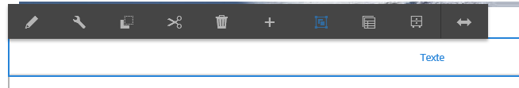
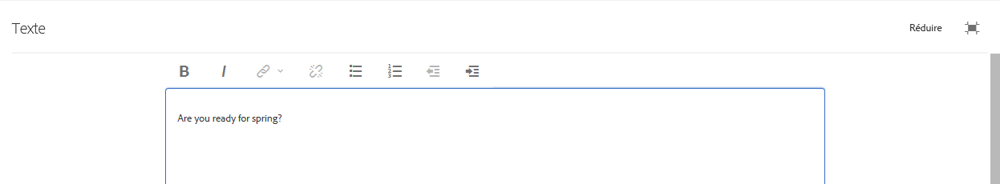

# Utilisation de l’éditeur de texte enrichi pour créer du contenu {#use-rich-text-editor-to-author-content}

L’éditeur de texte enrichi (RTE) est une composante essentielle à la saisie de contenu textuel dans AEM. Il constitue la base de divers composants, notamment :

* [Texte](https://experienceleague.adobe.com/fr/docs/experience-manager-core-components/using/wcm-components/text)
* [Tableau](https://experienceleague.adobe.com/fr/docs/experience-manager-core-components/using/wcm-components/text#table)

## Édition statique {#in-place-editing}

Si vous sélectionnez un composant texte en cliquant une seule fois dessus, il s’affiche dans la [barre d’outils de composant](/help/sites-authoring/editing-content.md#edit-configure-copy-cut-delete-paste), comme pour n’importe quel composant.

Appuyez/cliquez de nouveau ou sélectionnez initialement le composant avec un double clic lent pour ouvrir la modification sur place, qui possède sa propre barre d’outils. De là, vous pouvez modifier le contenu et apporter des modifications de base à la mise en forme.

Cette barre d’outils propose les options suivantes :

* **Format** : permet de définir les styles Gras, Italique et Souligné.
* **Listes** : permet de créer des listes à puces ou numérotées, ou de définir une mise en retrait.
* **Lien hypertexte**
* **Dissocier**
* **Plein écran**
* **Fermer**
* **Enregistrer**

## Modification en plein écran {#full-screen-editing}

Dans le cas des composants texte, si vous sélectionnez le mode Plein écran dans la barre d’outils, , l’éditeur de texte enrichi s’ouvre et le reste du contenu de la page est masqué.

Le mode Plein écran affiche toutes les options configurées que vous pouvez utiliser pour la création. La disponibilité des options [dépend de la configuration](/help/sites-administering/rich-text-editor.md).

Les options supplémentaires de l’éditeur de texte enrichi sont les suivantes :

* **Ancre** : crée une ancre dans le texte grâce à laquelle vous pourrez ensuite établir un lien ou créer une référence.
* **Aligner le texte à gauche**
* **Texte centré**
* **Aligner le texte à droite**

Pour fermer le mode Plein écran, cliquez sur l’icône Réduire.

>[!NOTE]
>
>La copie de listes imbriquées depuis Microsoft Word dans l’éditeur de texte enrichi peut donner des résultats incohérents et peut nécessiter un ajustement manuel après avoir collé le texte dans l’éditeur de texte enrichi.
