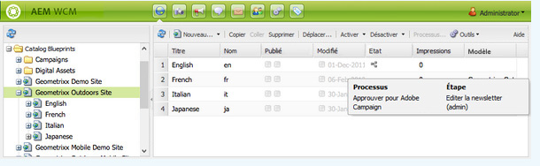

# Application de workflows aux pages{#applying-workflows-to-pages}

Lorsque vous appliquez le workflow, vous spécifiez les informations suivantes :

* Workflow à appliquer.

  Vous pouvez appliquer n’importe quel workflow (auquel vous avez accès, selon les affectations réalisées par votre administrateur AEM).
* Facultatif :

  * Un commentaire qui fournit des informations sur la raison pour laquelle vous avez démarré le workflow.
  * Un titre permettant d’identifier l’instance de workflow dans la boîte de réception d’un utilisateur ou d’une utilisatrice.

>[!NOTE]
>
>Les administrateurs et administratrices d’AEM peuvent démarrer des workflows en utilisant [plusieurs autres méthodes](/help/sites-administering/workflows-starting.md).

## Appliquer des workflows {#applying-workflows}

Les workflows peuvent être démarrés à partir de la console Sites web ou, lors de la modification d’une page, à partir du sidekick.

La colonne **Statut** de la console **Sites web** indique si un workflow a été appliqué à une page :

### Démarrage d’un workflow à partir de la console Sites web {#starting-a-workflow-from-the-websites-console}

1. Ouvrez la console Sites web. ([&#128279;](http://localhost:4502/siteadmin))
1. Dans l’arborescence Sites web, sélectionnez le parent de la page à laquelle vous souhaitez appliquer le workflow.
1. Dans la liste de pages, sélectionnez la page, puis cliquez sur Workflow.
1. Dans la boîte de dialogue Démarrer le workflow, sélectionnez le workflow à appliquer. Vous pouvez éventuellement saisir un commentaire et un titre. Cliquez ensuite sur Démarrer.

### Démarrer un workflow à l’aide du sidekick {#starting-a-workflow-using-sidekick}

1. Ouvrez la console Sites web.
1. Ouvrez la page requise.
1. Sélectionnez l’onglet Workflow dans le sidekick.
1. Développez la boîte de dialogue **Workflow** afin de sélectionner le **Workflow**. Si vous le souhaitez, entrez le **Titre du workflow** et un **Commentaire**.

   

1. Cliquez sur **Démarrer le workflow** pour démarrer une nouvelle instance de workflow avec les propriétés que vous avez configurées et la page active comme payload. Le workflow est maintenant en cours d’exécution.
