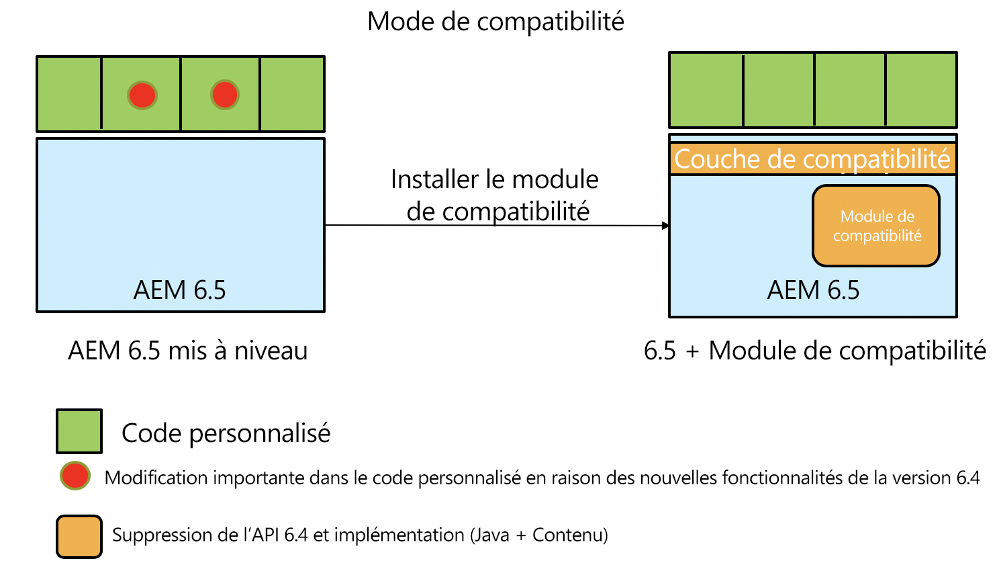
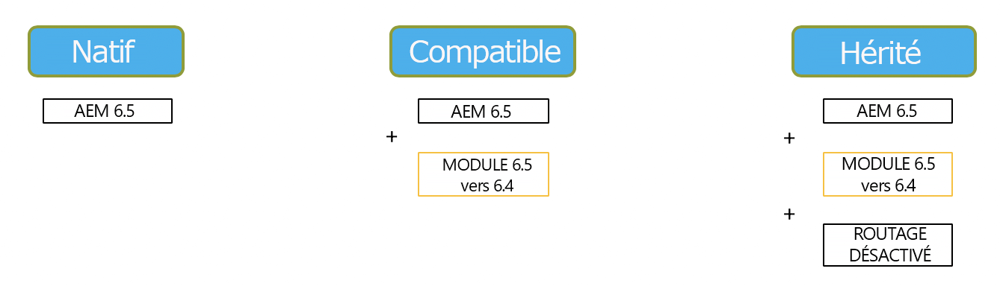

# Compatibilité ascendante dans AEM 6.5{#backward-compatibility-in-aem}

## du commerce électronique {#overview}

>[!NOTE]
>
>Pour obtenir la liste des modifications de contenu et de configuration qui ne font pas partie du package de compatibilité, consultez [Restructuration des référentiels dans AEM](/help/sites-deploying/repository-restructuring.md).

Dans Adobe Experience Manager (AEM) 6.5, toutes les fonctionnalités ont été développées dans une optique de rétrocompatibilité.

Dans la majorité des cas, les utilisateurs et utilisatrices qui utilisent AEM 6.3 ne doivent pas changer le code ni les personnalisations lorsqu’ils effectuent la mise à niveau. Pour les utilisateurs et utilisatrices d’AEM 6.1 et 6.2, aucun autre changement significatif n’est à signaler lors d’une mise à niveau vers la version 6.3.

Pour les cas exceptionnels où la rétrocompatibilité des fonctionnalités n’a pas pu être maintenue, les problèmes de rétrocompatibilité liés aux bundles et au contenu peuvent être atténués. Pour ce faire, installez un package de compatibilité pour la version 6.4 (voir la procédure de configuration ci-dessous pour plus d’informations sur les modalités de téléchargement). Ce package de compatibilité aide habituellement à restaurer la compatibilité pour les applications conformes à AEM 6.4.

Le package de compatibilité vous permet d’exécuter AEM en mode de compatibilité et de différer le développement personnalisé conformément aux nouvelles fonctionnalités d’AEM :

>[!NOTE]
>
>Le package de compatibilité ne constitue qu’une solution temporaire permettant de différer le développement requis pour devenir compatible avec AEM 6.5. Adobe recommande de ne l’utiliser qu’en derniers recours si vous ne pouvez pas résoudre les problèmes de compatibilité au cours du développement immédiatement après la mise à niveau. Il est vivement recommandé de passer en mode natif et de désinstaller le package de compatibilité une fois que vous avez décidé de procéder au développement personnalisé basé sur la version 6.5 et de bénéficier de toutes les fonctionnalités de cette version.

Le package de compatibilité possède deux modes : **Routage activé** et **Routage désactivé**.

AEM 6.5 peut ainsi être exécuté en trois modes :

**Mode natif :**

Le mode natif est destiné aux clientes et clients qui souhaitent utiliser toutes les nouvelles fonctionnalités d’AEM 6.5 et qui sont prêts à effectuer des développements pour que leurs personnalisations fonctionnent avec toutes les nouvelles fonctionnalités.

Cela signifie que vous devez ajuster votre application immédiatement après la mise à niveau.

**Mode de compatibilité : package de compatibilité installé avec le routage activé**

Le mode de compatibilité est destiné aux clientes et clients qui disposent de personnalisations d’interfaces non rétrocompatibles. Cela permet à AEM de s’exécuter en mode de compatibilité et de différer le développement personnalisé requis pour les nouvelles fonctionnalités AEM qui ne sont pas compatibles avec une partie de votre code personnalisé.

**Mode hérité : package de compatibilité installé avec le mode Routage désactivé**

Le mode hérité est destiné aux clientes et clients disposant d’interfaces personnalisées basées sur du code hérité ou obsolète d’AEM qui a été déplacé dans le package de compatibilité.

## Méthode de configuration {#how-to-set-up}

Le **package de compatibilité AEM 6.4 pour la version 6.5** peut être installé en tant que package à l’aide du gestionnaire de modules. Vous pouvez télécharger le [package de compatibilité AEM 6.4 pour la version 6.5](https://experience.adobe.com/#/downloads/content/software-distribution/en/aem.html?fulltext=compat*&orderby=%40jcr%3Acontent%2Fjcr%3AlastModified&orderby.sort=desc&layout=list&p.offset=0&p.limit=20&package=%2Fcontent%2Fsoftware-distribution%2Fen%2Fdetails.html%2Fcontent%2Fdam%2Faem%2Fpublic%2Fadobe%2Fpackages%2Fcq650%2Fcompatpack%2Faem-compat-cq65-to-cq64) sur le site de la distribution logicielle.

Une fois le package de compatibilité installé, le routage peut être activé ou désactivé à l’aide d’un commutateur dans la configuration OSGI, comme indiqué ci-dessous :

Une fois le package de compatibilité installé et configuré, les fonctionnalités sont utilisées sur la base du mode de compatibilité choisi.
