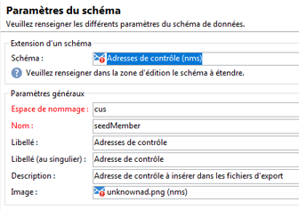
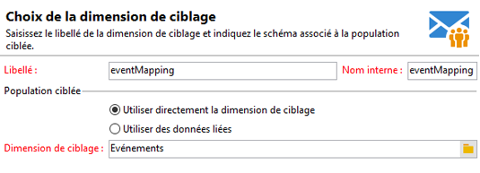
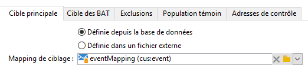
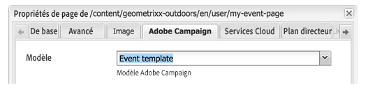
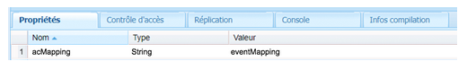
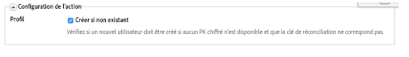
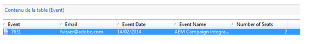

# Créer des mappages de formulaires personnalisés{#creating-custom-form-mappings}

Lorsque vous créez un tableau personnalisé dans Adobe Campaign, vous souhaiterez peut-être créer un formulaire dans AEM mappé à ce tableau personnalisé.

Ce document décrit comment créer des mappages de formulaire personnalisés. Lorsque vous aurez terminé les étapes de ce document, vous fournirez à vos utilisateurs et utilisatrices une page d’événement dans laquelle ils ou elles pourront s’inscrire à un événement à venir. Vous assurez ensuite le suivi de ces utilisateurs et utilisatrices via Adobe Campaign.

## Prérequis {#prerequisites}

Les éléments suivants doivent être installés :

* Adobe Experience Manager
* Adobe Campaign Classic

Pour plus d’informations, consultez [Intégration d’AEM à Adobe Campaign Classic](/help/sites-administering/campaignonpremise.md).

## Créer des mappages de formulaires personnalisés {#creating-custom-form-mappings-2}

Pour créer des mappages de formulaire personnalisés, vous devez suivre les étapes de haut niveau décrites en détail dans les sections suivantes :

1. Créez un tableau personnalisé.
1. Étendez le tableau **de contrôle**.
1. Créez un mappage personnalisé.
1. Créez une diffusion basée sur le mappage personnalisé.
1. Créez le formulaire dans AEM, qui utilisera la diffusion créée.
1. Envoyez le formulaire pour le tester.

### Créer un tableau personnalisé dans Adobe Campaign {#creating-the-custom-table-in-adobe-campaign}

Commencez par créer un tableau personnalisé dans Adobe Campaign. Dans cet exemple, nous allons utiliser la définition suivante pour créer un tableau d’événements :

```xml
<element autopk="true" label="Event" labelSingular="Event" name="event">
 <attribute label="Event Date" name="eventdate" type="date"/>
 <attribute label="Event Name" name="eventname" type="string"/>
 <attribute label="Email" name="email" type="string"/>
 <attribute label="Number of Seats" name="seats" type="long"/>
</element>
```

Après avoir créé le tableau d’événements, exécutez l’**assistant Mettre à jour la structure de la base de données** pour créer le tableau.

### Étendre le tableau de contrôle {#extending-the-seed-table}

Dans Adobe Campaign, sélectionnez **Ajouter** pour créer une extension du tableau **Adresses de contrôle (nms)**.



Utilisez à présent les champs du tableau d’**événement** pour étendre le tableau **source** :

```xml
<element label="Event" name="custom_cus_event">
 <attribute name="eventname" template="cus:event:event/@eventname"/>
 <attribute name="eventdate" template="cus:event:event/@eventdate"/>
 <attribute name="email" template="cus:event:event/@email"/>
 <attribute name="seats" template="cus:event:event/@seats"/>
 </element>
```

Ensuite, exécutez l’**assistant Mettre à jour la base de données** pour appliquer les modifications.

### Créer des mappings de ciblage personnalisés {#creating-custom-target-mapping}

Dans **Administration/Campaign Management**, accédez à **Mappings de ciblage** et ajoutez un nouveau **mapping de ciblage**.

>[!NOTE]
>
>Veillez à utiliser un nom significatif pour **Nom interne**.



### Créer un modèle de diffusion personnalisé {#creating-a-custom-delivery-template}

Dans cette étape, vous ajoutez un modèle de diffusion qui utilise le **mapping de ciblage** créé.

Dans **Ressources/Modèles**, accédez au modèle de diffusion et dupliquez la diffusion AEM existante. Lorsque vous cliquez sur **À**, sélectionnez l’événement de création **Mapping de ciblage**.



### Créer le formulaire dans AEM {#building-the-form-in-aem}

Dans AEM, assurez-vous d’avoir configuré un service cloud dans **Propriétés de la page**.

Ensuite, dans l’onglet **Adobe Campaign**, sélectionnez la diffusion qui a été créée dans [Créer un modèle de diffusion personnalisé](#creating-a-custom-delivery-template).



Lors de la configuration des champs, veillez à spécifier des noms d’élément uniques pour les champs de formulaire.

Une fois les champs configurés, vous devez modifier manuellement le mappage.

Dans CRXDE-lite, accédez au nœud **jcr:content** (de la page) et remplacez la valeur **acMapping** par le nom interne du **mapping de ciblage**.



Dans la configuration du formulaire, veillez à cocher la case « Créer s’il n’existe pas ».



### Envoyer le formulaire {#submitting-the-form}

Vous pouvez désormais envoyer le formulaire et valider, du côté Adobe Campaign, l’enregistrement des valeurs.



## Résolution des problèmes {#troubleshooting}

**« Type invalide sur la valeur &#39;02/02/2015&#39; à partir de l&#39;élément &#39;@eventdate&#39; (document de type &#39;Evénement ([adb:event])&#39;)«**

Lors de l’envoi du formulaire, cette erreur est consignée dans la variable **error.log** dans AEM.

Cela est dû à un format non valide pour le champ de date. La solution consiste à fournir la valeur **aaaa-mm-jj**.
