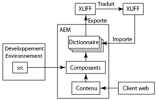
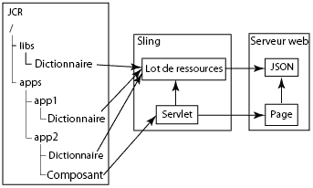

# Internationalisation de composants{#internationalizing-components}

Internationalisez vos composants et boîtes de dialogue afin que leurs chaînes d’interface utilisateur puissent être présentées dans différentes langues. Les composants conçus pour l’internationalisation permettent d’externaliser, de traduire et d’importer les chaînes de l’interface utilisateur dans le référentiel. Au moment de l’exécution, les préférences linguistiques de l’utilisateur ou de l’utilisatrice ou les paramètres régionaux de la page déterminent la langue affichée dans l’interface utilisateur.

Procédez comme suit pour internationaliser vos composants et proposer l’interface utilisateur dans différentes langues :

1. [Implémentez vos composants à l’aide d’un code qui internationalise les chaînes.](/help/sites-developing/i18n-dev.md) Votre code identifie les chaînes à traduire et sélectionne la langue à présenter au moment de l’exécution.
1. [Créez des dictionnaires](/help/sites-developing/i18n-translator.md#creating-a-dictionary) et [ajoutez](/help/sites-developing/i18n-translator.md#adding-changing-and-removing-strings) les chaînes anglaises à traduire.

1. [Exportez](/help/sites-developing/i18n-translator.md#exporting-a-dictionary) le dictionnaire au format XLIFF, traduisez les chaînes, puis [réimportez](/help/sites-developing/i18n-translator.md#importing-a-dictionary) les fichiers XLIFF dans AEM. Vous pouvez également [ajouter manuellement des traductions](/help/sites-developing/i18n-translator.md#editing-translated-strings) au dictionnaire.

1. [Intégrez le dictionnaire dans le processus de gestion des versions de votre application](/help/sites-developing/i18n-translator.md#publishing-dictionaries).

>[!NOTE]
>
>Les méthodes décrites ici pour internationaliser des composants sont destinées à traduire des chaînes statiques. Si les chaînes d’un composant sont susceptibles de changer, vous devriez utiliser les workflows de traduction traditionnels. Par exemple, lorsque les auteurs et autrices peuvent modifier une chaîne de l’interface utilisateur à l’aide de propriétés dans la boîte de dialogue Modifier d’un composant, vous ne devez pas utiliser de dictionnaire de langue pour internationaliser la chaîne.

## Dictionnaires de langues {#language-dictionaries}

Le framework d’internationalisation d’AEM utilise des dictionnaires dans le référentiel pour stocker les chaînes en anglais et leurs traductions dans d’autres langues. Le framework utilise l’anglais comme langue par défaut. Les chaînes sont identifiées à l’aide de leur version anglaise. En règle générale, les structures d’internationalisation utilisent des ID alphanumériques pour les chaînes de l’IU. L’utilisation de la version anglaise de la chaîne comme identifiant présente plusieurs avantages :

* Le code est facile à lire.
* La langue par défaut est toujours disponible.

Les chaînes localisées peuvent être stockées dans plusieurs dictionnaires du référentiel. Les dictionnaires système d’AEM se trouvent sous le nœud `/libs`. Vous pouvez créer des dictionnaires pour vos composants sous le nœud `/apps`. Le framework d’internationalisation d’AEM combine les dictionnaires et les rend disponibles dans Sling sous la forme d’un seul objet `ResourceBundle`. Lorsque les composants sont rendus, ils récupèrent les chaînes traduites à partir du bundle de ressources. Les dictionnaires combinés sont également déployés sur le serveur web au format JSON afin de fournir les chaînes traduites au code JavaScript dans les pages web.

De plus, l’[outil de traduction](/help/sites-developing/i18n-translator.md) vous permet de gérer tous les dictionnaires à partir d’un emplacement central.

>[!NOTE]
>
>Ne modifiez pas les dictionnaires système d’AEM qui se trouvent sous le nœud `/libs`.

### Remplacement de chaînes dans les dictionnaires système {#overlaying-strings-in-system-dictionaries}

Les chaînes figurant dans les dictionnaires sous le nœud `/apps` remplacent les chaînes en double dans les dictionnaires qui se trouvent sous le nœud `/libs`. Si vos composants utilisent des chaînes qui sont incluses dans les dictionnaires système AEM, dupliquez la chaîne dans votre propre dictionnaire. Tous les composants utiliseront les chaînes de votre dictionnaire.

Notez que vous ne pouvez pas prédire quelle traduction est utilisée lorsque des chaînes sont dupliquées dans les dictionnaires qui se trouvent tous sous le nœud `/apps`.
